# One Contract, One Windows Workspace, One Verifiable Record: the Vakilbench Architecture

*Canonical document C3: master research, architecture and engineering blueprint. C3 is the authority for decision IDs (D1–D35) and the MVP stage list (Stage 0–5, post-MVP P1–P4). Research current to 30 October 2026.*

*Companion canon:* `C1-literature-review.md` (papers behind every [A]), `C2-prior-art-repos-review.md` (repositories behind every [S]), `C4-master-product-plan.md` (modules and user journeys), `C5-master-standards-and-ontology-plan.md` (ILO schemas, ontology, NVS/CVS/RTS, INSC resolver specification, manifest and receipt, conformance suites CT-01–CT-15). This document decides *how it is built*.

---

## The answer in one paragraph

Build **one open TypeScript harness that obeys one published contract** (ILO v0.1, JSON Schema 2020-12; C5) and ship it as a **Windows desktop application**: an Electron workspace delivered as a signed `.exe` installer with auto-update, one workspace per matter, a **built-in Chromium browser** (where the lawyer, not the software, solves any CAPTCHA), a **built-in Docxodus DOCX editor** with tracked changes, an embedded SQLite matter store and step journal, a local hash-chained ledger, and **model access through an OpenRouter adapter (BYO key) or a local OpenAI-compatible endpoint**. Inside the MVP: matters, documents and evidence, the **W3 Notebook & case graph** (SUPACE-referenced document intelligence), **citation verification** (INSC: Supreme Court official sources → AWS Open Data → Indian Kanoon via webfetch), the defect checker, the ledger and verification-manifest export, the review UI, the **Research & Argument Studio** (LegRAA-referenced research layer, precedent graph with treatment, Case Conference) and, as a separate module, the **MOTO Argument Hypothesis Exploration Engine** that feeds candidate arguments back into the Studio for the lawyer to accept or reject. Agents never write the record: schemas compile into the only write tools, agents submit typed patches that a deterministic kernel validates and commits, retractions cascade through `dependsOn` edges, external actions wait in an outbox, and every reported state transition is gated on fresh evidence bound to the exact version it attests. Every check runs **deterministic gates first**; **Jev and Clef** (System One decision models) score what survives; a **separate Verifier/Eval agent** measures conformance against the three open standards (NVS, CVS, RTS). The gateway and website follow immediately after the MVP; macOS/Linux builds and commercial services come later.

---

## How to read this document

| Label | Meaning |
|---|---|
| **[F]** | Fact from a primary source (statute, draft regulation text, dataset documentation, official portal) |
| **[S]** | Source-inspected: repository code or data read (details in C2) |
| **[A]** | Academic finding (paper detail in C1) |
| **[V]** | Vendor documentation verified (model cards, API pages) |
| **[I]** | Inference from the facts |
| **[R]** | Recommendation. Unlabelled rows in decision tables are [R] |
| **[U]** | Unresolved, with the check that closes it |

Durations are omitted. Development is done with AI coding agents; the bottleneck is review, fixture authoring and expert labelling, so every stage closes on an evidence receipt, not a date (D34).

"Draft Regulations" means the Supreme Court of India's draft *Regulations for Use of Artificial Intelligence (AI) in Courts, 2026*, circulated with a notice dated **03.06.2026** inviting comments [F]. They are a draft, not notified.

---

## 0. The frame

| Part | What it is | Status |
|---|---|---|
| **1. Indian Legal AI Commons** | Open standards: ILO ontology, document/paragraph identity, NVS/CVS/RTS verification standards, AI-origin manifest and receipt, connector permission model, `@ilac/*` SDKs, conformance suites | The **contract layer** every component validates against (C5) |
| **2. Open Code of Litigation (Vakilbench workspace)** | Open-source local GUI workspace for litigation: per-matter workspace, all core modules, built-in browser and editor, BYO key, full audit trail | **The MVP**, shipped as a Windows installer |
| **3. Gateway, website, commercial** | Hosted gateway and website (P1), other desktop OSes (P2), connectors (P3), commercial services (P4) | **After MVP**; only the seams are designed now |

### 0.1 MVP and stages

**MVP = Stages 0–5, all on Windows.** Each stage is a vertical slice that extends the same golden matter (GM-01) and closes on a signed receipt bundle (§21).

| Stage | Name | Delivers |
|---|---|---|
| **Stage 0** | Windows shell, installer, journal | Hardened Electron shell; signed NSIS installer + auto-update (internal channel); typed IPC; BYO key in Windows Credential Manager; OpenRouter + local endpoint adapter; SQLite step journal; ILO core schemas + tool compiler; patch kernel; ledger chain + `ilac` CLI; Verifier/Eval agent skeleton |
| **Stage 1** | Matters, documents, ingest | Matter service, vault, document version DAG, ingest worker (OCR sidecar), line model, anchors, pdf.js anchor layer, evidence-package export/import, AWS SC mirror + profiling, ontology seed from SC/HC metadata, built-in browser with BrowserCapture |
| **Stage 2** | Notebook + NVS | W3 Notebook & case graph: logic-gate extraction, NVS gates G1–G7, Jev/Clef extraction scoring, Notebook editor, anchored chatbot, review UI, agent + runtime verifier, retrieval |
| **Stage 3** | Citation verifier CVS + editor + manifest | INSC parser and resolver chain (SC → AWS → Indian Kanoon webfetch), L1/L2 deterministic, L3 with Jev/Clef, Docxodus editor with agent proposals, defect checker, cascade engine, production, AI-origin manifest + receipt, outbox |
| **Stage 4** | Research & Argument Studio | LegRAA-referenced research layer, precedent graph with treatment + RTS gates, Jev/Clef treatment classification, temporal law, Case Conference |
| **Stage 5** | MOTO engine + Windows release | MOTO Argument Hypothesis Exploration Engine feeding the Studio; held-out GM-02; signed public Windows release with auto-update. **MVP complete** |

**Post-MVP:** **P1** gateway and website (server profile, accounts, shared matters) immediately after MVP; **P2** macOS and Linux builds; **P3** eCourts/sci.gov.in case-file connectors and High Courts; **P4** commercial services.

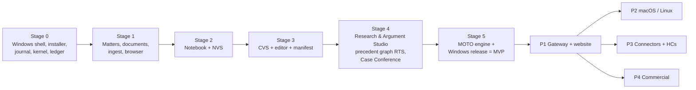

---

## 1. Decision register

C3 is the authority for these IDs. The alignment copy for other writers is `round3/R5_REGISTER.md`.

| ID | Decision | Chosen | Fallback | Evidence |
|---|---|---|---|---|
| D1 | Own harness? | **Yes, small**: custom loop + generic playbook interpreter + patch kernels + legal components | — | No inspected framework keeps the matter record outside itself while offering durable legal gates [S, C2]; clean loops are 360–960 lines [S] |
| D2 | Language | **TypeScript** (Node in Electron main/utility processes); Python only as OCR/layout and eval sidecars; no Rust services | — | One language for UI, harness, SDKs [I] |
| D3 | MVP shell and delivery | **Electron on Windows**; signed NSIS installer via electron-builder; electron-updater auto-update | — | Bundled Chromium makes court portals render and capture predictably; Windows is where Indian litigators work [I] |
| D4 | Workspace base | **Custom Electron + React app reusing OpenCode ideas** (agent-server split, permission rulesets, default-deny) | — | Closest open harness UX analogue; session store not adopted [S] |
| D5 | Durability | **Embedded SQLite step journal** behind `DurableRunner` | — | No cluster on a laptop [I] |
| D6 | Loop pattern | Pattern B (bounded turn as a step) default; Pattern C (loop node) for MOTO and Case Conference | — | Keeps any framework's call order out of replay [I] |
| D7 | Fallback loop | **OpenAI Agents JS core** behind `AgentRuntime` | — | Serialisable `RunState`; same language [S] |
| D8 | Model access | **OpenRouter adapter only** (chat completions + Decisions API) with BYO key, plus optional local OpenAI-compatible endpoint (Ollama, llama.cpp, vLLM; incl. `/v1/systemone`) | — | One choke point for keys, data labels and recording; OpenRouter gives multi-provider failover and serves Clef [V] |
| D9 | Contracts | **ILO JSON Schema 2020-12 is the source**; types, validators, write tools, MCP/OpenAPI ops generated | — | Ontology-to-tools compilation [A, arXiv 2602.03439] |
| D10 | Write path | **Patch kernel**: RFC 6902 proposals via compiled tools; schema + shapes + role + invariants; commit with ledger event in one transaction | — | PatchBoard: 84.6% vs 30.8% task success at ~45k vs ~368k tokens [A, abstract-level] |
| D11 | Retraction | `dependsOn` + **typed cascade invalidation**; export gated on zero open flags | — | MemTX [A] |
| D12 | External effects | **Outbox**, payload-bound approval, reconciliation on unknown outcome | — | Cordon [A] |
| D13 | Gating | **Proof-or-Stop**: fresh evidence with `attestsHash` of the exact version; newer version → `not_checked` | — | Proof-or-Stop: amplification 31/1,800 → 2/1,800 [A] |
| D14 | Runtime topology | **One generating agent + independent runtime verifier** (different model family) | — | Kim et al. 2025; MAST [A] |
| D15 | Conformance measurement | **Separate Verifier/Eval agent** measures outputs against NVS/CVS/RTS and CT suites on held-out sets; its reports close stages | — | Builders never grade themselves (§22) |
| D16 | Jev / Clef | **Deterministic gates veto first; Jev/Clef score survivors**; scores recorded; three-band thresholds calibrated on lawyer labels; never a sole gate; Jev public text only until terms are written; confidential text to local or self-hosted Clef | — | System One contract and pricing [V, R5_jev_clef]; no published legal calibration [V] |
| D17 | Storage | **SQLite + FTS5 + sqlite-vec**; typed edge tables; recursive CTEs; no graph DB | — | 10³ nodes/matter, 10⁵–10⁶ judgments [I] |
| D18 | Ledger | **RFC 8785 + SHA-256 hash chain**, Ed25519 signed checkpoints; witnessed log in P1 | Chain-only, labelled operator-verifiable | BSA s.63(4)-ready dossier [F, C5] |
| D19 | Editor | **Docxodus in-app** (WASM; .NET sidecar if needed) with tracked changes; agent edits only as proposals; "open in Word" handoff | LibreOffice compare (labelled degraded) | Native `w:ins/w:del/move` with reversibility proofs [S] |
| D20 | PDF | Typst (PDF/A) + qpdf + veraPDF; pdf.js viewer with our anchor layer | Gotenberg | [S] |
| D21 | Plugins | First-party in-process; third-party out of process (MCP/OpenAPI), **Read/Prepare only** | — | MCP Security Bench [A] |
| D22 | Court access | **No CAPTCHA bypass**; lawyer solves in built-in browser; capture hashed | — | Portal terms; C5 connector rules |
| D23 | Standards | **NVS, CVS, RTS**, normative in C5 with CT-14, CT-04, CT-15 | — | One evidence model for facts, citations, treatment |
| D24 | Citation resolver | **T1 SC official (human capture) → T2 AWS Open Data → T3 Indian Kanoon webfetch/API**; three levels × two axes; missing ≠ fabricated | — | §5 |
| D25 | Notebook | **W3 Notebook & case graph in MVP (Stage 2)**, SUPACE-referenced functions | — | Fact extraction is daily litigation work [I] |
| D26 | Studio | **W11 Research & Argument Studio in MVP (Stage 4)**: LegRAA-referenced research layer, precedent graph with treatment, Case Conference | — | LegRAA described as a judges' research aid [V, PIB] |
| D27 | MOTO | **Separate engine module** feeding candidate arguments into the Studio; human accepts; **Stage 5** | — | MOTO staged generate–validate loop [S] |
| D28 | SUPACE / LegRAA | **Functional references only**; our own code from available repos; conformance measured by the Eval agent | — | No public technical documentation [F] |
| D29 | Ontology | **Built from SC (AWS parquet) and HC dataset metadata**, or from scratch where missing; JSON Schema, JSON-LD, PROV-O, Web Annotation selectors as formats; Akoma Ntoso optional for statutes; Law and Justice Wiki as glossary | — | C5 |
| D30 | Repositories | All available repos usable as inputs; attribution completed before public release | — | — |
| D31 | Regulations | Manifest and receipt designed from draft Reg 3(1)(y), 3(1)(z), 8(3), 43(3)–(4) text | — | §16 |
| D32 | Security | Electron hardening, per-matter browser partitions, no-network ingest, data labels and egress rules, keys in Windows Credential Manager | — | §17 |
| D33 | Gateway / server | **Deferred to P1**, immediately after MVP; nothing in MVP depends on it | — | §20 |
| D34 | Build gating | Stage closes only on a signed receipt bundle (commit + CT + Eval-agent results) | — | Proof-or-Stop applied to the build |
| D35 | Language scope | **SC documents are English**; no Hindi/regional OCR thresholds or risks in MVP; regional-language records in P3 | — | Official SC translations exist separately (SUVAS) [F] |

---

## 2. Engineering assessment

### 2.1 Feasibility

**The MVP is viable and mostly integration.** Electron, SQLite, pdf.js, Docling-class parsing, PaddleOCR/Tesseract, Docxodus, Typst and the OpenRouter API are mature components [S]. The INSC resolver is bounded work: the AWS dataset's metadata already carries the SCR↔INSC equivalence (`path`, `citation`, `nc_display`) [S], so the hard part of L1 is coverage and provenance, not parsing. The real difficulty sits in seven places, none of which is the agent loop:

| # | Problem | Why it is hard | Where solved |
|---|---|---|---|
| H1 | Stable evidence anchors across re-OCR, re-parse and DOCX edits | Offsets move; paragraphs renumber; reporter headnotes look like judgment paragraphs | §12: line model, selector chain, `ReporterBlock` exclusion, normalisation profile |
| H2 | Pinpoint and proposition support, measured not asserted | Verifiers catch 93–100% of wrong-case but only 37–61% of wrong-pinpoint citations [A, Verma 2026]; no Indian labelled set | §5, §4 Jev/Clef, §9 Eval agent |
| H3 | Exactly-once effects over at-least-once execution | Steps retry; uploads may have unknown outcome | §14: outbox, `replay: never`, reconciliation |
| H4 | Non-destructive lawyer/agent co-editing | DOCX fidelity is a moving target | §12: version DAG with CAS heads; agent edits as proposals |
| H5 | Point-in-time law | IPC→BNS for offences before 1 July 2024; commencement by notification | §7: `ProvisionVersion` intervals; governing-date filter |
| H6 | Human-in-the-loop capture from court portals | Result tables are rendered by JS after a CAPTCHA | §5.4 BrowserCapture |
| H7 | Security of an agent-bearing desktop app with a browser | Untrusted web content, PDFs and an LLM in one process tree | §17 |

**Excluded:** outcome prediction, judge profiles, unattended portal automation, CAPTCHA solving. **Language scope:** Supreme Court records and judgments are in English (official translations exist separately, e.g. SUVAS); Hindi/regional-language OCR is not an MVP concern and moves to P3 with High Court and district records.

### 2.2 What a top professional adds

Write **failure semantics before features** (timeout, duplicate delivery, partial write, stale read, unknown outcome, for every boundary). Publish a **threat model per data path** (hostile PDFs, injection through pleadings, web content, model egress, third-party tools). Enforce an **ownership matrix in code** (dependency-cruiser rules). Insist on a **second implementation** of the contract from Stage 0 (the `ilac` CLI verifies an evidence package without the GUI). Treat **expert-labelling throughput** as the scarcest resource. Design the **review queue as a capacity problem**: items ranked by materiality, never bulk-approved. **Move rules from prompts into code**: prompt-only enforcement leaked prohibited content in 30 of 120 runs while contract-owned validators leaked none [A, arXiv 2607.08028].

### 2.3 Hidden requirements

| Requirement | Failure if missed | Mechanism |
|---|---|---|
| Derived paragraph numbers never pass as the court's | "para 18" the court never printed | `ilo:para-derived` scheme with extractor version |
| Reporter headnotes are not judgment text | Pinpoint lands in SCR headnote | `ReporterBlock` excluded from paragraph sequence |
| Missing from corpus ≠ non-existent | Real recent judgment reported as fabricated | `coverageWindow`; `unresolved/outside_corpus_coverage` |
| Two identifiers before L1 `verified` | Misread `nc_display` maps to wrong Work | INSC + SCR page, or CNR + date |
| Evidence must be fresh | Badge from version 3 shown on version 4 | `attestsHash` (D13) |
| Retractions propagate | Paragraph relies on an overruled case | `dependsOn` + cascade (D11) |
| Victim identity masking (POCSO/rape) | Statutory violation in a filed document [F, *Nipun Saxena*] | Deterministic defect rule; blocks export |
| Allegation vs fact | Averment stored as fact | Notebook `is_allegation` classification + G3 anchor (§6) |
| Counsel's submission vs holding | Submission cited as ratio | CVS L2 `voice` question (§4.3) |
| Model context provable | "What did it see" unanswerable | ContextManifest per call, hashed into ledger |
| Approvals unforgeable | Compromised renderer approves a filing | Signed in main process; payload-hash bound |
| Deletion vs append-only | Cannot erase client data | Per-matter key destroyed + tombstone |
| Offline court premises | Workspace unusable in court | Local profile; local models; AWS mirror offline |
| In-house audits (Reg 38(2)) | Court cannot audit internals on premises | Fully open, locally buildable |

### 2.4 Design principles

1. **The logic gate organises; it never evaluates merits.** SUPACE is publicly described as augmented intelligence: it automates the administrative and data-processing side of research (OCR, indexing, a logic gate that classifies material into synopsis, chronology, evidence and cited case law, a notebook) without intruding on legal reasoning or suggesting outcomes [V, secondary]. W3 Notebook and W11 Studio adopt this as a hard rule: extraction, classification, research organisation, MOTO candidates and Case Conference notes **organise and surface** material with anchors; none of them scores the merits of a case, predicts an outcome or ranks a party's chances. `OutputPolicy` (§10.3) enforces it in code, and typed rhetorical roles keep argument spans (submissions, allegations) from passing as findings (the OpenNyAI rhetorical-role idea, applied to Notebook `epistemic_type` and CVS `voice`).
2. **Deterministic gates decide; models score; lawyers accept.** (D13, D16.)
3. **Schema, not code.** The standard is a grammar of proof (schemas, vocabularies, receipt format, conformance vectors), not an engine; any implementation in any language conforms by producing valid, verifiable outputs (§5.5).
4. **Zero text upload.** Verification of a filing never requires sending its text anywhere (§5.5).
5. **Novelty is the assembly.** Each part has an analog (eyecite-style citation parsing, CiteSight/CaseCite checkers, the AWS SC dataset, Docxodus round-trip, OpenContracts/PAWLS token boxes, OpenNyAI NER and rhetorical roles, AILA tasks, C2SP/Tessera logs, in-toto/DSSE envelopes, SUPACE/LegRAA functions, commercial assistants); no single open system unifies them in a local-first workspace (C1, C2).

---

## 3. Architecture: one contract layer, ports everywhere, one Windows workspace

### 3.1 Layers

The **contract layer** (ILO schemas, JSON-LD contexts, shapes, normalisation profile, generated tools) is the only thing every layer agrees on. The **harness core** orchestrates. **Domain services** own state, one kind each, and each hosts the **patch kernel** for its own types. **Engines** (Notebook, CVS, Studio, MOTO) are domain modules built on the harness. **Adapters** bind ports. The **workspace UI** captures and displays; it owns nothing persistent. The **Verifier/Eval agent** sits outside the generating path entirely.

```mermaid
flowchart TB
  subgraph Contract["Contract layer (open): ILO v0.1 - C5"]
    SCH[JSON Schema 2020-12] --- CTX[JSON-LD contexts] --- SHP[Shapes / invariants] --- NORM[Quote normalisation profile]
    SCH --> GEN[Generators: TS types, Ajv validators,<br/>write tools, MCP/OpenAPI ops]
  end

  subgraph App["Vakilbench workspace - Electron on Windows (signed NSIS installer, auto-update)"]
    direction TB
    subgraph Renderer["Renderers (sandboxed, contextIsolation)"]
      UI[Matter workspace UI - React + TS]
      PDFV[pdf.js viewer + anchor layer]
      ED[Docxodus editor - tracked changes]
      REV[Review queue + gates]
      STU[Studio + Case Conference panels]
    end
    BR[Browser pane - WebContentsView,<br/>per-matter session, no preload]
    MAIN[Main process - windows, Credential Manager,<br/>signer, IPC broker, updater]
    subgraph Util["Utility processes"]
      HC[Harness core]
      SVC[Domain services + engines]
      ING[Ingest worker - no network]
    end
  end

  subgraph Harness["Harness core (TypeScript)"]
    PBI[Playbook interpreter] --- TE[Turn executor - AgentRuntime]
    CA[Context assembler - ContextManifest] --- TG[Tool gateway - Read/Prepare/Commit] --- GS[Gate service - Proof-or-Stop]
    OP[OutputPolicy + deterministic composer] --- BG[Budget governor] --- RM[RunManifest writer]
  end

  subgraph Domain["Domain services and engines (single owners, each with a patch kernel)"]
    MAT[Matter] --- DOC[Document - version DAG] --- VAULT[Source vault - CAS + line model]
    NB[Notebook & case graph - NVS] --- CVS[Citation verification - CVS]
    STUDIO[Research & Argument Studio - RTS] --- MOTO[MOTO hypothesis engine]
    LK[Legal knowledge - Works, coverage] --- RULES[Defect rules]
    LED[Ledger] --- OUT[Outbox] --- PROD[Production]
  end

  subgraph Adapters["Ports"]
    DUR[DurableRunner: SQLite journal]
    STORE[Store: SQLite + FTS5 + sqlite-vec]
    MP[ModelProvider: OpenRouter or local endpoint]
    S1[DecisionProvider: Clef / Clef-flash / Jev]
    OCR[OCR: Docling, PaddleOCR, Tesseract]
    SRC[Sources: SC capture, AWS mirror, Indian Kanoon webfetch]
  end

  EVAL[[Verifier/Eval agent<br/>separate process, held-out data]]

  UI <-->|typed IPC, schema-validated| MAIN
  BR -->|capture events only| MAIN
  MAIN <--> HC
  HC --> Domain
  Domain --> Adapters
  GEN -.compiles.-> TG
  Contract -.validates.-> Domain
  EVAL -.reads exports + ledger only.-> LED
  EVAL -.scores via.-> S1
```

### 3.2 The workspace, per matter

A matter is a directory under `%LOCALAPPDATA%\Vakilbench\matters\<id>\` (relocatable): `matter.db` (matter, documents, versions, passages, Notebook items, statements, edges, verification records, precedent edges, approvals, outbox, journal), `ledger.db` (append-only chain, separate file), `vault/` (content-addressed bytes), `responses/` (content-addressed model and read-tool responses for replay), `exports/` (evidence packages). Shared reference data (AWS SC mirror, ontology, precedent graph over public judgments) lives once under `corpus/`. A matter is portable by directory copy or evidence-package export.

| Module (IDs W0–W14, binding per R5_REGISTER) | Panel | Owner | Stage |
|---|---|---|---|
| W0 Shell, installer, model access (OpenRouter / local; no gateway) | Shell, OpenRouter key / local endpoint | Shell, `ModelProvider` | 0 |
| W1 Matters | Matter list, parties, forum | Matter | 1 |
| W2 Documents & evidence | PDF viewer with anchor layer; hashes, duplicates | Vault, Document | 1 |
| W7 Built-in browser | Court portals, research; *Capture* | BrowserCapture → Vault | 1 |
| W3 Notebook & case graph | Notebook items, chronology, parties, issues, chatbot | Notebook / case graph | 2 |
| W4 Research & drafting agents + runtime verifier | Task panel; typed outputs | Harness; Verification | 2 |
| W10 Review & verification UI | Review queue, audit mode | Gate service | 2 |
| W5 Citation checker (CVS) | Citation table: three levels, two axes, source tier | Verification, Legal knowledge | 3 |
| W6 Defect checker | SC filing defects, masking, format rules | Rules | 3 |
| W8 Built-in editor | Docxodus, tracked changes, agent proposals | Document | 3 |
| W9 Ledger & verification-manifest export | Ledger view, evidence package, manifest + receipt | Ledger, Production | 3 |
| W11 Research & Argument Studio | Research layer, precedent graph, argument board, Case Conference | Studio | 4 |
| W12 MOTO hypothesis engine | Candidate-argument inbox inside the Studio | MOTO engine | 5 |
| W13 Verifier/Eval agent | Conformance reports per stage and release | Eval agent (separate process) | 0 (skeleton) → 5 |
| W14 Jev/Clef decision scoring service | Scores, bands and calibration shown on items | `DecisionProvider`, `Calibrator` | 2 |

### 3.3 Data flow: upload to filed, attested document

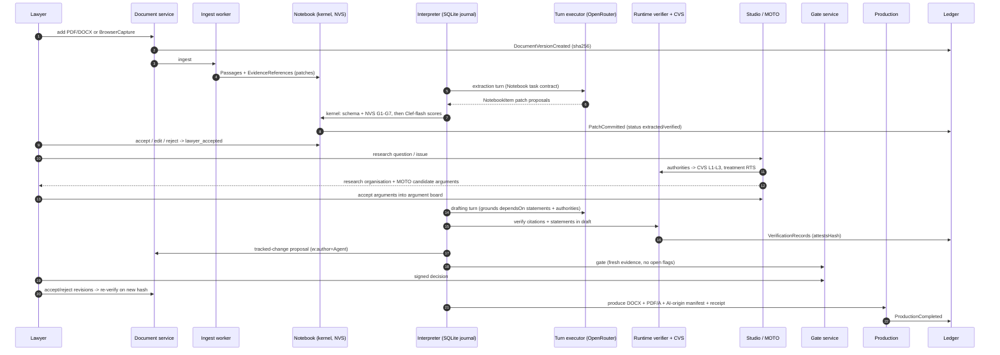

### 3.4 Write ownership: agents propose patches, kernels commit

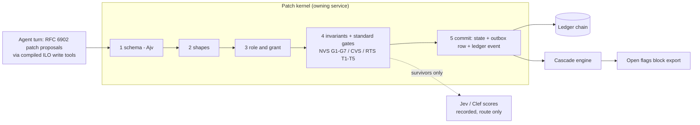

The harness never writes a domain table. Each service writes its own state, an outbox row if needed, and its ledger event in **one SQLite transaction**. Agents can only express writes through tools generated from ILO schemas (`ilo.proposeNotebookItem`, `ilo.proposeStatement`, `ilo.linkAuthority`, `ilo.proposePrecedentEdge`, `ilo.proposeArgument`, `ilo.proposeAmendment`, …). The graph has **two layers**: the **reference layer** (Works, INSC identities, statutes, court and bench registry, public precedent graph, concepts) is versioned and read-only to agents; the **matter layer** is agent-proposable and may only link into the reference layer.

### 3.5 Component specification

| Component | Responsibility | Interfaces | Technology | Failure modes | Replacement |
|---|---|---|---|---|---|
| Workspace shell | Windows, IPC broker, key custody, signing, updates | Typed IPC generated from ILO ops | Electron, electron-builder (NSIS), electron-updater | Renderer compromise → main holds keys | CEF |
| Workspace UI | Display and capture only | IPC client | React + TS; pdf.js with our anchor layer | Stale view → CAS at service | — |
| Browser pane | Court and research sites; lawyer-driven capture | `BrowserCapture` | `WebContentsView`, `persist:matter-<id>` session, downloads to vault | Portal change → capture still valid, fields `unparsed` | — |
| Editor | Client only; edits become versions | Document API | Docxodus WASM; .NET sidecar for compare if needed; Word handoff | Fidelity loss → three-oracle gate | LibreOffice compare |
| Matter service | Matters, parties, roles | `MatterService` | SQLite | — | — |
| Document service | Identity, version DAG, proposals | `DocumentService` | CAS heads; Docxodus compare | Stale save → branch | — |
| Source vault | Immutable bytes by sha256; line model | `put/get/lineModel` | CAS directory | Key loss = erasure by design | — |
| Ingest worker | Parse/OCR runs (recorded) | `ingest()` | Utility process, no network; pypdfium2, pdfplumber, Docling, PaddleOCR, Tesseract (Python sidecar, bundled) | Low confidence → second reader, review | — |
| Notebook & case graph | Notebook items, statements, edges, chronology; bitemporal | `NotebookService`, `CaseGraphService` | SQLite tables, CTEs | Contradictions kept + `contradicts` | — |
| Legal knowledge | Works/Expressions/Manifestations, equivalence, coverage, provenance; ontology instances | `LegalKnowledgeService` | SQLite + AWS mirror (DuckDB at ingest) | Upstream withdrawal → `withdrawn_upstream` | — |
| Verification (CVS) | VerificationRecords, receipts | `CitationResolver`, `VerificationService` | `@ilac/verification`; deterministic L1/L2; L3 Jev/Clef + generative assessor | Source down → `not_checked` | — |
| Studio | Research organisation, precedent graph, arguments, Case Conference | `StudioService`, `PrecedentGraphService` | SQLite; playbooks | Treatment unanchored → rejected by T3 | — |
| MOTO engine | Candidate argument generation and validation | `HypothesisEngine` | Separate package; Pattern C loop | Budget breach → gate | — |
| Defect rules | Rule packs, defect results | `RulesEngine` | GoRules Zen tables + statecharts | Weakening patch rejected | — |
| Harness | In-flight turn only | `AgentRuntime` | Custom TS loop | Loop creep → < 1,000-line guard | OpenAI Agents core |
| Model gateway | Routes, keys, usage | `ModelProvider`, `DecisionProvider` | OpenRouter adapter; local OpenAI-compatible endpoint | Provider outage → OpenRouter failover, recorded | Local endpoint |
| Durable runner | Workflow progression | `DurableRunner` | SQLite journal | Crash → resume | — |
| Ledger | Events, checkpoints | `LedgerService` | Hash chain + Ed25519 checkpoints | Append failure → write fails | — |
| Outbox | Pending external effects | `OutboxService` | Table + relay | Unknown → reconciliation | — |
| Production | DOCX, PDF/A, paper book, manifest, receipt | `ProductionService` | `docx` npm, Typst, qpdf, veraPDF, DSSE | Font drift → bundled fonts | Gotenberg |
| Verifier/Eval agent | Conformance measurement | `EvalAgent` | Separate Node process + Python eval workers; Inspect/promptfoo | Shares lineage with generator → blocked by config check | — |

### 3.6 Windows packaging and update

| Concern | Design |
|---|---|
| Installer | electron-builder NSIS target, per-user install by default (no admin), optional per-machine; Authenticode-signed (EV or OV certificate; Azure Trusted Signing acceptable); SmartScreen reputation built through signed releases |
| Update | electron-updater against a static release feed (GitHub Releases or object storage); signature verified before apply; staged rollout channels `internal → beta → stable`; delta updates |
| Bundled sidecars | Python OCR runtime (embedded distribution) and Docxodus .NET (self-contained) shipped as signed binaries with hashes pinned in the build manifest |
| Secrets | OpenRouter key and signing key via OS credential store (Windows Credential Manager through `keytar`-class binding or Electron `safeStorage`) |
| Data location | `%LOCALAPPDATA%\Vakilbench`; matters relocatable to any folder (e.g. a BitLocker volume) |
| Reproducibility | Lockfiles, SBOM, build provenance; `ilac` CLI shipped alongside for offline receipt verification |
| Platform | Windows 10 22H2+ and Windows 11, x64 (arm64 later); macOS/Linux in P2 with no code change behind the shell |

---

## 4. Model access: OpenRouter adapter, local endpoint, Jev and Clef

### 4.1 The adapter

One `ModelProvider` and one `DecisionProvider`, both behind the main process (the only holder of keys):

| Route | Backend | Use |
|---|---|---|
| `gen.*` | OpenRouter chat completions (`/api/v1/chat/completions`), structured outputs where the routed model supports them | Generating agent, runtime verifier's generative assessor, MOTO generator/validators, Case Conference roles |
| `gen.local.*` | Local OpenAI-compatible endpoint (Ollama, llama.cpp server, vLLM) | Confidential matters, offline use |
| `decide.*` | OpenRouter Decisions API (Clef, Clef-flash; Jev when available) | System One scoring on public or pseudonymised text |
| `decide.local.*` | Ollama `POST /v1/systemone` (`clef:27b`) or self-hosted SGLang `/v1/systemone` | System One scoring on confidential text |

Every request carries `dataLabel: public | pseudonymised | privileged`; `privileged` goes only to `*.local` routes unless the matter has a recorded written authorisation. OpenRouter provider preferences are pinned per route (allowed providers, `data_collection: deny`) and the provider actually used is recorded in the response store. Routing policy, model ids and provider pins are part of the run's `configHash`.

### 4.2 Jev and Clef: what they are

System One decision models take a `state` (string or JSON) and 1–64 typed `questions` and return per-question probabilities in one non-autoregressive pass [V]:

| Question type | Returns |
|---|---|
| `noul` | P(true) |
| `choice` (options described in `criteria`) | `choice`, per-option `probabilities`, `confidence` |
| `score` (ordered levels) | probability-weighted `score`, `probabilities`, `confidence` |

| Model | Context | Price (input; output free) | Notes |
|---|---|---|---|
| Clef (Cloudflare) | 65,536 tok on Workers AI | ~$0.19–0.24/M | Open weights; vision; self-host via vLLM/SGLang/Ollama (`clef:27b`, ~18–20 GB) [V] |
| Clef-flash | 24,576 tok | ~$0.02–0.04/M | Cheap triage [V] |
| Jev (TypeSafe) | ~32k, text only | $0.042/M | Hosted, early access; retention and region unstated [V] |

**Consequences.** They return **no rationale**: any explanation a lawyer reads comes from a deterministic check or a generative model told which flag fired. No public calibration (ECE) or legal benchmark exists [V], so our thresholds come from our own labelled sets. Clef and Clef-flash share Qwen lineage and count as one vote. Context limits on hosted routes are unresolved (an OpenRouter note says ~2K for Workers AI) [U], so `state` is kept short (cited paragraph ± 1) and a needle test runs before use.

### 4.3 Where they are used

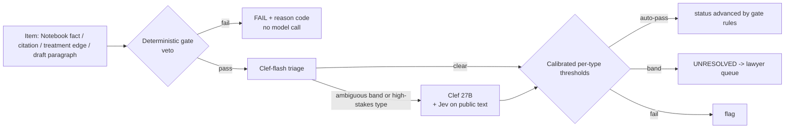

| Use | Engine | Question set (ids) | Rule |
|---|---|---|---|
| Notebook extraction checks | Notebook (Stage 2) | `support` (supported/partial/contradicted/absent), `date_ok`, `actor_ok`, `event_ok`, `place_ok`, `is_allegation` (fact_admitted/allegation/finding/unclear); per kind: party `name_match`, `role`; relation `relation_stated`, `direction_correct`, `time_bounded` | NVS G1–G7 first; ≤ ~6 items / ~40 questions per call; averment stored as fact is a defect |
| Citation identity (L1 disambiguation) | CVS (Stage 3) | `identity` over candidate cards + `none` | Auto-select only if top P ≥ τ_id and margin ≥ δ; `none` → NOT_FOUND via resolver, never model |
| Pinpoint support (L2 semantic) | CVS | `pin_support` (direct/adjacent/partial/no/contra), `voice` (court_holding/counsel_submission/lower_court/dissent/quoted_precedent), `quote_faithful` | Runs only after deterministic L2 (para exists, quote matches) |
| Proposition support (L3) | CVS | `holding_status` (ratio/obiter/assumed/rejected/not_addressed), `scope_match` (score), `still_good` | Clef 27B or retrieval-pruned excerpts; paired with treatment |
| Precedent treatment | Studio (Stage 4) | `treatment` (followed/approved/relied/distinguished/explained/doubted/referred_larger/overruled/impliedly_overruled/per_incuriam/sub_silentio/mentioned/not_about), `scope`, `who` | Overruled/per incuriam accepted only with bench-strength and date gates; negative treatments thresholded for recall (flag at P ≥ 0.15) and always to lawyer queue |
| Defect checking | Defect checker (Stage 3) | Substantive: `unsupported_fact`, `fact_vs_submission`, `date_inconsistent`, `relief_mismatch`, `severity`; registry fuzzy checks on page images (Clef vision) | Registry/format defects deterministic first |
| MOTO validation | MOTO (Stage 5) | Candidate argument vs Notebook and authorities: `grounded`, `authority_supports`, `contradicts_record` | Feeds acceptance gate of each MOTO iteration |
| Eval scoring | Verifier/Eval agent | Same question sets over (output, gold) pairs | Scores aggregate to metrics; LLM judge only on disagreement |

Four-state output across uses: **SUPPORTED / CONTRADICTED / NOT_FOUND / UNRESOLVED**; NOT_FOUND is emitted by retrieval or gates, never by a model. A score never sets `verified`.

### 4.4 Calibration and thresholds

1. **Label sets** per question type, 300–500 items to start (SC-heavy), two lawyers on a 20% overlap; inter-annotator agreement is the ceiling.
2. **Measure** reliability, ECE and Brier per (model, question id, wording hash).
3. **Recalibrate** per question type (temperature/Platt or isotonic) on a calibration split; refit whenever `instructions`/`criteria` wording changes (wording is part of the model; its hash is pinned).
4. **Thresholds by conformal risk control**: τ per type so P(error | auto-pass) ≤ α (α ≈ 2% for citations and negative treatments, 5% for Notebook facts); report coverage. Two thresholds → three bands.
5. **Calibrate the cascade** (Clef-flash → Clef → lawyer) on cascaded data, not stages in isolation.
6. **Paraphrase check**: 3 wordings; a swing > 0.15 on the same item → UNRESOLVED.
7. **Local quantised Clef is recalibrated separately** from hosted BF16.
8. **Pin model version** from each response's `model` field; drift is tracked across runs by the Eval agent.

### 4.5 Cost

Inference cost is negligible relative to labelling: a matter's Notebook (~2,000 items) costs ~$0.11 on Clef-flash; a brief's citations (150 × 3 calls) ~$0.43 on Clef; a one-off treatment backfill over the SC corpus ~$38–240 [I, from V prices].

---

## 5. Citation verification (CVS) and the INSC resolver

The normative specification (schemas, outcome vocabularies, receipt format, conformance vectors) is in C5. This section fixes how it is built.

### 5.1 Sources

| Tier | Source | Access | Gives | Constraint |
|---|---|---|---|---|
| T1 | `sci.gov.in/neutral-citation/`, `sci.gov.in/judgements-case-no/`, `scr.sci.gov.in/scrsearch/` (eSCR, Neutral Citation field) | Built-in browser; lawyer solves CAPTCHA; results rendered by JS | Neutral citation, title, case no., date, PDF | Human in the loop; one request at a time |
| T2 | AWS Open Data `s3://indian-supreme-court-judgments` (ap-south-1, no-sign-request), parquet per year | Offline mirror | `nc_display` (compact INSC, incl. back-assigned pre-2014), `citation` (eSCR), `path` (SCR `YYYY_vol_start_end`), `cnr`, `decision_date`, judges, `raw_html`, PDFs | eSCR-reported judgments only; thin for the last 12–18 months [S] |
| T3 | Indian Kanoon | **Webfetch** of a search/doc page on a lawyer's click, or API with the lawyer's token | Text and metadata | Discovery and confirmation only; never quote oracle when T1/T2 text exists |

### 5.2 Resolver chain

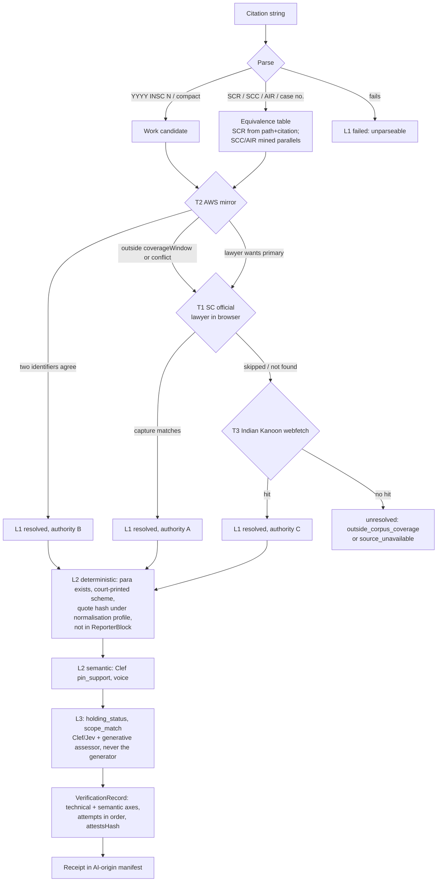

Order recorded per attempt is part of the record. The display order above tries T2 first for speed; the lawyer may require T1 for any citation, and the receipt states which tier each citation reached.

### 5.3 Outcome vocabulary (summary; normative in C5)

- **`ResolutionAttempt`** `{tier: T1|T2|T3, source, acquisitionMode, startedAt, outcome: resolved|not_found|skipped|error, reason?, manifestation?, coverageWindow?}`; closed reasons incl. `captcha_required_user_absent`, `user_declined`, `rate_limited`, `outside_corpus_coverage`, `source_unavailable`.
- **Technical axis** (L1, L2): `verified | failed | unresolved | not_checked | not_applicable` with reason (`unparseable`, `identifier_conflict`, `metadata_mismatch`, `wrong_pinpoint`, `misquotation`, `paragraph_scheme_absent`, …).
- **Semantic axis** (L2 semantic, L3): `supported | partially_supported | unsupported | contradicted | unresolved`, with assessor ids, `method: model | human | model_then_human`, and System One scores (`model`, question id, wording hash, probabilities).
- **`authorityLevel`**: A (T1), B (T2), C (T3). Display badges (`VERIFIED_PRIMARY / VERIFIED_SECONDARY / CONFLICT / FAILED / UNVERIFIED`) are derived by `ilo.summaryBadge`, never stored.
- **`hallucinationClass`** aligned to draft Reg 3(1)(z): `fabricated_authority`, `misattributed_authority`, `wrong_pinpoint`, `misquotation`, `misstated_holding`, `nonexistent_provision`, `superseded_provision`, `unsupported_proposition`.
- **`attestsHash`**: hash of the exact draft version and occurrence.

**Rules that are architecture:** (1) no CAPTCHA bypass; T1 is `skipped` unless the lawyer completes it. (2) One request at a time with back-off to SC portals; cached per citation. (3) Missing ≠ fabricated: absence from T2 beyond `coverageWindow` is `unresolved`, never `failed`. (4) Two identifiers before L1 `verified`. (5) Indian Kanoon raises L1 to authority C only and is never the L2 quote oracle when T1/T2 text exists. (6) L3 never upgrades a failed L2. (7) Jev/Clef never set `verified`; they set semantic status within calibrated bands or UNRESOLVED.

**Validation corpora:** AWS SC parquet for INSC↔SCR equivalence; Law and Justice Wiki case citations as a mixed-format parser corpus; ≥ 50 double-annotated golden judgments; planted-defect citation sets.

### 5.4 BrowserCapture

| Element | Design |
|---|---|
| Isolation | `persist:matter-<id>` session per matter; no Node, no preload, `sandbox: true` |
| Trigger | Lawyer clicks *Capture* or a download starts; main intercepts `will-download`, writes to vault, hashes |
| Recorded | URL, final URL, time, title, DOM snapshot (hash; bytes in vault), screenshot hash, PDF sha256, response headers, TLS certificate fingerprint, the citation/query it served |
| Typed result | `ilo:SourceCapture` linked to a `Manifestation`, with a T1 `ResolutionAttempt {acquisitionMode: in_session_human}` |
| Parsing | Versioned per-portal extractors; failed parse leaves capture valid, fields `unparsed` |
| Indian Kanoon webfetch | Same capture record when fetched through the pane; a direct fetch on click records URL, time, response hash |
| Never | CAPTCHA solving, background crawling, agent form submission |

### 5.5 Zero-text-upload verification: schema, hash-binding, signed receipts

A court, registry or opposing advocate must be able to check a filing's verification **without receiving the pleading text, the tool's source code or any confidential work product**.

| Mechanism | Design |
|---|---|
| Schema separate from code | `VerificationReceipt`, `AiOriginManifest`, `VerificationRecord` are JSON Schema 2020-12 + shapes (C5). Our engine is one implementation; a court-side or third-party verifier in any language validates the same structures |
| Hash-binding | The receipt carries the SHA-256 of the produced PDF and of each draft block, never the text. Each claim is an anchored tuple over **public** identifiers: `(2024 INSC 412, para 18, lines 4–7, quoteHash)` |
| Public canonical identifiers | INSC neutral citations, CNR numbers, provision version dates; the checker re-derives the quote hash from its own copy of the public judgment (eSCR, ICMIS, AWS mirror) |
| Signed receipts | RFC 8785 canonical JSON in a DSSE envelope, signed with the advocate-tool key (Ed25519); public keys published in a registry; any byte change to the PDF or receipt breaks verification |
| Offline verification | `ilac verify receipt.json filing.pdf` on an air-gapped registry machine: checks signature, PDF digest, schema validity, and re-runs L1/L2 against its own corpus copy |
| Conformance as certification | The CT suites are published; a tool passing them can be certified as a class |

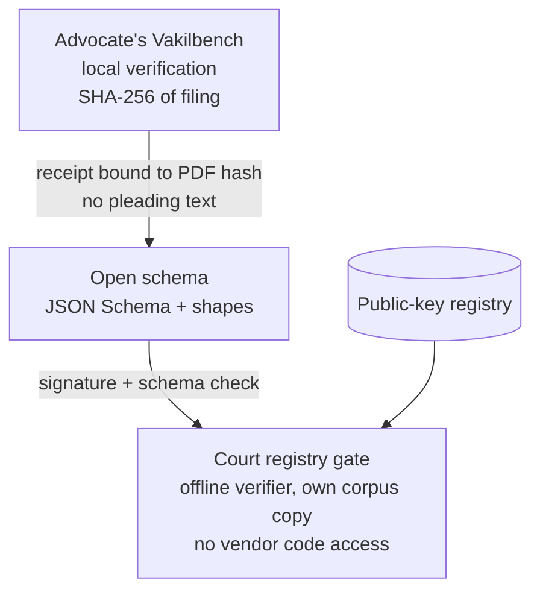

| Draft Regulation | Constraint | How schema-only verification complies |
|---|---|---|
| Reg 38(2) | No court code or architecture shared outside premises | Court releases no code; verifies receipts with its own implementation |
| Reg 3(1)(y) | Disclosure and verification through a designated centralised mechanism | The mechanism can be a published schema + public-key registry, not a server receiving filings |
| Reg 43(3)–(4) | Declaration; AI systems and verification steps disclosed | `AiOriginManifest` populates the declaration and Reg 43(4) fields mechanically |
| Reg 8(3) | Class-basis certification | Published conformance suite; passing tools certified as a class without source inspection |

---

## 6. W3 Notebook & case graph under NVS (SUPACE-referenced)

**Reference, functions only.** SUPACE's publicly described workflow has four parts: file preview (PDF→text, searchable), chatbot (matter overview), logic gate (fact extraction into synopsis, FAQs, evidence, case law) and Notebook (an integrated word processor) [V, non-official descriptions]. No technical documentation is public. Everything below is our design, measured against NVS by the Eval agent.

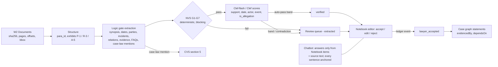

| Stage | Owner | Output |
|---|---|---|
| File preview / ingest | Document service, ingest worker | `SourceDoc{docId, sha256, pages[{n, text, charStart, bboxMap}]}`; text/scanned classification |
| Structure | Ingest worker | Stable `para_id` (doc, page, ordinal); annexure/exhibit detection |
| Logic gate (organises, never evaluates merits; §2.4) | Task contracts → kernel | Typed `NotebookItem`s: synopsis line, date, party (canonical id, aliases, role), incident, relation, evidence, FAQ answer, case-law mention; dates regex-first with relative-date resolution recording the anchor date |
| Chatbot | Assembler + runtime | Answers restricted to Notebook items and source text; unanchored sentences dropped |
| Notebook | Docxodus-backed editor | Lawyer accepts, edits, rejects; human edits become `source: user` with their own anchor |

**NVS gates (blocking, deterministic; normative in C5, CT-14):** **G1** anchor resolves (hash matches, offsets in range); **G2** exact quote match (normalised); **G3** every date, name and amount normalises from a string inside its anchor; **G4** no unanchored item; **G5** relation/incident endpoints exist; **G6** date validity and order; **G7** exhibit coverage report. Gates run on every commit and again on export. **System One scoring** (§4.3) runs only on items that pass, sets the routing band, and is stored on the item with model id and wording hash. Status is derived from the ledger: `extracted → verified → lawyer_accepted` (or `rejected`). `is_allegation` is recorded as the statement's epistemic type (allegation, admission, finding), because Indian pleadings routinely present averments ("it is submitted that…") that must not be stored as fact.

---

## 7. W11 Research & Argument Studio (LegRAA-referenced) under RTS

**Reference, functions only.** LegRAA is described publicly as a research aid for judges in pilot (document analysis, legal research) [V, PIB]. No technical documentation is public. We mirror its functions: a corpus of SC judgments plus uploaded matter documents; legal-reference extraction; research organisation; Q&A citing case id and paragraph; human in the loop throughout.

### 7.1 Studio components

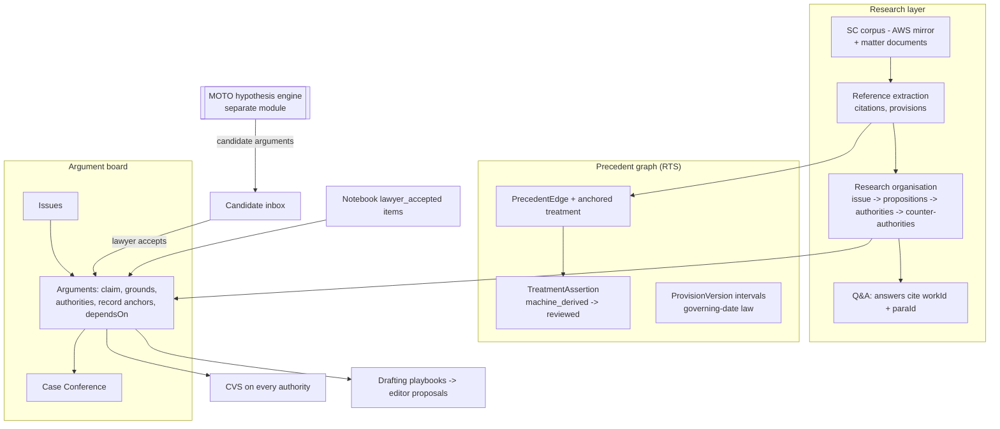

### 7.2 Precedent graph data model

| Object | Key fields | Rule |
|---|---|---|
| `judgment_ast` | `workId` (INSC canonical), `paraId`, text, bench strength (from metadata judges list), AKN crosswalk optional | Built from AWS mirror |
| `legal_reference` | source doc/para, raw string, normalised `workId` or provision id, anchor | Unresolved stays unresolved |
| `PrecedentEdge` | `citingWork`, `citedWork`, `citingParaId`, `treatment`, `scope`, `who`, `evidenceAnchor{doc, hash, page, charSpan, quote}`, `method`, `decisionScores[]` | No edge without an anchor |
| `TreatmentAssertion` | edge, treatment, status (`machine_derived`, `reviewed`, `pending_reference`), reviewer | Negative treatments always reviewed before entering the shared citator |
| `amendment_conflict_flag` | provision, versions cited, citing paras | Deterministic |
| `ProvisionVersion` | provision, `valid_from`, `valid_to`, commencement source | IPC/BNS, CrPC/BNSS, IEA/BSA intervals; governing-date filter |

**RTS gates (blocking; normative in C5, CT-15):** **T1** both cases resolve (CVS L1); **T2** citing paragraph exists and quote matches; **T3** no treatment without an anchor; **T4** "overruled" only with an anchored overruling passage, citing bench strength ≥ cited bench strength and citing date after cited date, otherwise downgraded to `doubted` + UNRESOLVED; per incuriam only from a competent court; **T5** amendment-version conflict flag. `referred_larger` creates a `pending_reference` status until a later judgment resolves it. Clef classifies treatment (§4.3); Jev is permitted here as a heterogeneous second scorer because the text is public. RTS gate names (T1–T5) are distinct from resolver tiers.

### 7.3 Case Conference

A structured, human-chaired review of a matter's issues and arguments, modelled on a chamber conference before a hearing. It is a Pattern C playbook over the argument board:

| Element | Design |
|---|---|
| Roles | Role profiles over one executor: *lead counsel* (synthesis), *opposing counsel* (walled: cannot see privileged notes), *bench* (questions only, no outcome prediction), *record checker* (Notebook anchors), *authority checker* (CVS/RTS status) |
| Inputs | Argument board snapshot `asOf`, Notebook items (`lawyer_accepted`), precedent graph, open flags |
| Output | Typed `ConferenceNote`s: objections, questions from the bench, weak links (arguments whose `dependsOn` include unresolved/failed items), counter-authorities, each anchored |
| Gate | Lawyer chairs: each note accepted, dismissed with reason, or converted to a task; nothing changes the argument board without a decision |
| Never | Outcome probabilities, judge profiles, merit scoring (§2.4) |

---

## 8. MOTO Argument Hypothesis Exploration Engine (separate module)

MOTO is a separate engine (`@vakil/moto`, its own playbooks and task contracts) that explores candidate arguments for an issue and **feeds them into the Studio's candidate inbox**. It adopts the MOTO repository's staged generate–validate loop [S] as Pattern C; it never writes the argument board directly.

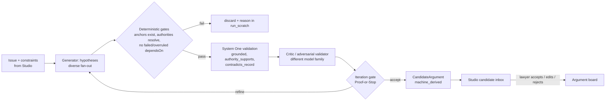

| Concern | Design |
|---|---|
| Input | Issue id, Notebook snapshot, precedent graph slice, budget, diversity policy |
| Loop | Interpreter `loop` node with `maxIter` and budget; each generator, gate and validator call is its own journaled step; notes in `run_scratch` |
| Output | `CandidateArgument {claim, grounds[], authorities[] (with CVS records), recordAnchors[], counterArguments[], dependsOn[], provenance: moto}` |
| Acceptance | Only a lawyer moves a candidate onto the argument board; rejection reasons are ledgered and feed the Eval agent's label pool |
| Isolation | Separate package and process boundary; MOTO cannot call Commit tools; it reads via the Studio's read API |
| Measurement | Eval agent reports grounding rate, authority validity, duplicate rate and lawyer acceptance rate |

---

## 9. The separate Verifier/Eval agent

Two different verifiers exist and must not be confused:

| | Runtime verifier (D14) | Verifier/Eval agent (D15) |
|---|---|---|
| Purpose | Checks each output in the live workflow before it reaches the lawyer | Measures whether the system conforms to NVS/CVS/RTS and CT suites |
| When | Every run | Every stage receipt, every release, on demand |
| Data | The matter | Held-out golden matters (GM-02…), golden judgments, planted-defect sets, lawyer-labelled calibration sets |
| Output | VerificationRecords on items | Conformance reports: precision/recall per gate and mutation type, calibration (ECE, Brier) per question type, κ between verifiers, drift |
| Independence | Different model family from generator | Separate process and package; cannot read generator `run_scratch`, builder fixtures or prompts; different model family from both generator and runtime verifier where possible |

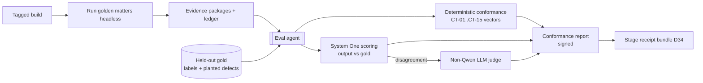

**Planted-defect suite** per standard: swap date, swap parties or relation direction, store an allegation as fact (NVS); wrong pinpoint ±1/±5, misquote, cite counsel's submission as holding, drop a condition from a ratio, too-recent citation (CVS); "overruled" without anchor, overruling by smaller bench, flip followed→overruled, amendment-version conflict (RTS). Detection recall is reported per mutation type. Clef + Clef-flash count as one vote; pair with an encoder NLI model and/or a non-Qwen judge; report Cohen's κ.

---

## 10. The harness: our loop, one owner of progression

### 10.1 Candidates

| Candidate | Who owns state | Verdict | Reason |
|---|---|---|---|
| **Custom loop** | Caller (us) | **Primary** (D1) | Only option where the matter record is structurally outside the harness |
| OpenCode | Own session server | **Reuse ideas**: agent-server split, permission rulesets, default-deny | Closest open harness UX; session store not adopted |
| Pi (pi-agent-core), Pi Durable | Caller | Reference: hook vocabulary, intent-before-execute, `replay: never | safe` | Cleanest ~960-line I/O-free loop [S] |
| OpenAI Agents JS core | Caller without `Session` | **Fallback** behind `AgentRuntime` (D7) | Serialisable `RunState` |
| Vercel AI SDK | Caller | Reference (`ToolLoopAgent`, HMAC approvals) | Model I/O goes through the OpenRouter adapter |
| Closed agent binaries | Binary | Not on any data path | Unauditable loop and compaction |
| Google ADK, LangGraph, Mastra, CrewAI, Agno | Own stores | Not used as runtime; reference only (interrupt APIs) | Duplicate interpreter and engine state |
| DeepSeek Harness / Cordis | own | Reference; composition model reimplemented | Best composition model |
| Pydantic AI | Caller | Inside Python eval workers only | — |
| Semantica, ActiveGraph | own | Reference: injective hashing, PROV-O export, truth-maintenance filter; response keying, strict replay, fork/diff | — |
| MOTO | own | Pattern adopted in §8 | — |
| Self-evolving harnesses | — | Skip | Conflict with a fixed, approved system (Reg 19(1), 33(3)(a)) [I] |

### 10.2 Where each concern lives

| Concern | Owner | Implementation | Explicitly not |
|---|---|---|---|
| Agent execution | Turn executor (`AgentRuntime`) | Custom TS loop; Pattern B; Pattern C for loops | Framework sessions |
| Orchestration | Playbook interpreter | One generic workflow over a compiled, content-hashed playbook | Framework graphs |
| Durability | `DurableRunner` | SQLite journal | Framework durability |
| Writes | Patch kernel of the owning service | Compiled tools → JSON Patch → validate → commit | Raw SQL by agents |
| External effects | Outbox | Approval-released relay | Tool calls inside a turn |
| Model access | `ModelProvider` / `DecisionProvider` | OpenRouter adapter; local endpoint | Provider SDKs in harness code |
| Context | Context assembler | Pure function → ContextManifest | Framework memory |
| Permissions | Tool gateway | `PermissionGrant` ∩ step allowlist; default deny | Prompt instructions |
| Output policy | `OutputPolicy` | Leakage / links / language validators | Post-hoc filters |
| Approval | Gate service | Durable wait + signed `ApprovalRecord` + freshness | Framework interrupts |
| Observability | Local OTel file exporter (ops); ledger (evidence) | Hashes only in traces | Framework exporters |

### 10.3 The harness contract

```
AgentTurn(input: { taskContract, contextManifestHash, toolAllowlist(read-only), budget })
  -> { typedOutput, patchProposals[], toolIntents[], usage, modelTraceRef }
```

**Pattern B** (default): resolve the manifest, call `ModelProvider`, run the tool loop only for read-class tools, validate typed output against the task-contract schema, then run `OutputPolicy`:

| Validator | Checks | On failure |
|---|---|---|
| Leakage | No text from walled partitions or other matters | Reject; retry ≤ N |
| Links | Every citation, anchor and id exists in the ContextManifest | Reject; retry ≤ N |
| Language | Forbidden phrasing: outcome probabilities, "verified" without a passing record, victim identity in POCSO matters | Reject; retry ≤ N |

After N failures, tasks declared `fallback: deterministic` (chronologies, citation tables, verification summaries, defect reports) emit a deterministic template rendering, flagged in the RunManifest; tasks declared `fallback: gate` (drafting, arguments) open a gate. Patch proposals and intents return to the interpreter, which executes them as explicit steps with idempotency keys. A crash replays at most one turn.

**Pattern C** (MOTO, Case Conference): the loop is an interpreter `loop` node with a budget; each generator and validator call is its own step; the validator's verdict gates each iteration's acceptance; notes go to `run_scratch`.

**Ontology-to-tools compilation.** `@ilac/ontology` emits, per ILO type with a write operation: a tool definition (name@version, input schema, `actionClass`, side-effect class, replay policy, description hash), the kernel validator chain and the MCP/OpenAPI operation. The model-visible tool set is compiled tools ∩ step allowlist ∩ grant; the registry rejects allowlists with overlapping declared capabilities.

### 10.4 Migration paths

| Trigger | Move | Unchanged |
|---|---|---|
| Custom loop falls behind | `AgentRuntime` → OpenAI Agents core | Playbooks, manifests, ledger, ILO objects |
| Server profile (P1) | `DurableRunner` → server runner | Interpreter logic, kernels, ledger |
| Docxodus editing insufficient | `DocumentEngine` → LibreOffice compare (labelled degraded) + Word handoff | Version DAG, proposals |
| Electron untenable | Shell → CEF | Everything behind IPC |

The swap test (V-14) proves this on every release.

---

## 11. Memory and retrieval: five owners, one read path, never a transcript

**Governing rule.** An agent's conversation dies with the turn. Nothing becomes part of the matter until an owning kernel accepts it as an ILO object with an evidence anchor or a counsel decision, a verification record where it is displayed as reliable, and a ledger event.

| Memory | Holds | Owner | Write rule | Read path |
|---|---|---|---|---|
| Episodic | Events, RunManifests, ContextManifest hashes, approvals, committed patches | Ledger | Append-only, RFC 8785 + `hashProfile` | Audit, evidence package |
| Semantic | Notebook items, `LegalStatement` subtypes (allegation, admission, denial, submission, evidence, finding, proposition, direction), issues, arguments, `EvidenceReference`, edges incl. `dependsOn`; Works, ProvisionVersions, PrecedentEdges | Notebook/case graph (matter layer); Legal knowledge and Studio (reference layer) | Agent patches enter `machine_derived`; promotion only by `ApprovalRecord`; reference layer read-only to agents | Assembler via `snapshot(asOf)` |
| Procedural | Rule packs, defect packs, playbooks, question-set wordings for System One | Rules engine; registry | Signed, content-addressed | Pinned hash |
| Working | Per-turn context; `run_scratch`; compaction summaries | Context assembler | Ephemeral; manifest-hashed; never promoted | Replay only |
| Institutional | Chamber playbooks, clause bank, prior work product | Matter service (user library) | Counsel decision | Assembler, filtered in query |

**Response store.** Every model and decision response is stored keyed by `sha256(JCS(request))` (request includes ContextManifest hash, route, OpenRouter provider used, model id, parameters); every read-tool response by `(tool id, args, source snapshot)`. Replay uses the store as provider and reports the **first diverging event and field**. A fork is a new run naming `{parentRun, cutoffSeq}`; the prefix replays at zero cost and a structural diff of typed outputs is the review artefact.

**Retraction and truth maintenance.** `dependsOn` on every statement, draft block, argument and candidate argument. When a VerificationRecord turns `failed`/`contradicted`, a treatment becomes `overruled`, a statement is withdrawn or a manifestation is superseded, the cascade engine walks `dependsOn` (recursive CTE) and raises `dependency_failed | dependency_overruled | dependency_superseded | dependency_withdrawn` flags. Export and outbox release refuse while flags are open unless overridden with written reasons (mirrors Reg 8(3) first proviso). Before the assembler uses a retrieved item, superseded or contradicted items as of `asOf` are dropped with a manifest entry.

**Core tables:**

| Table | Key columns |
|---|---|
| `ilo_object` | `id (urn:ilo:…)`, `type`, `schema_version`, `content_hash`, `hash_profile`, `body json`, `matter_id`, `valid_from`, `valid_to`, `recorded_at`, `superseded_at` |
| `notebook_item` | `id`, `kind`, `status`, `anchors json`, `gate_results json`, `decision_scores json`, `epistemic_type` |
| `statement` | `id`, `subtype`, `asserted_by`, `epistemic_status`, `classification_method`, `human_review_id` |
| `evidence_ref` | `id`, `work`, `expression`, `manifestation`, `selector json`, `quote_hash` |
| `edge` | `src`, `rel`, `dst`, `verification_id`, `valid_*`, `recorded_at` |
| `flag` | `id`, `target`, `kind`, `cause_event`, `opened_at`, `resolved_by` |
| `passage` | `id`, `manifestation`, `page`, `line_start`, `line_end`, `para_label`, `para_scheme`, `block_kind (judgment|reporter)`, `text`, FTS, `embedding` |
| `work` / `expression` / `manifestation` | INSC, SCR, CNR, case numbers, bench, judges, `source_provenance` |
| `coverage_window` | `source`, `snapshot_id`, `from_date`, `to_date`, `insc_max_by_year json` |
| `verification_record` | `id`, `target`, `level`, `technical`, `semantic`, `reason`, `resolution json`, `attests_hash`, `assessors`, `decision_scores json` |
| `precedent_edge` / `treatment_assertion` | as §7.2 |
| `argument` / `candidate_argument` / `conference_note` | claim, grounds, authorities, anchors, `dependsOn`, provenance, status |
| `patch` | `id`, `proposer`, `target_type`, `ops json`, `base_hash`, `status`, `kernel_errors` |
| `outbox` | `id`, `effect_kind`, `payload_hash`, `state`, `approval_id` |
| `context_manifest` / `response_store` | hash keys; blob keys |
| `decision_call` | `id`, `route`, `model`, `wording_hash`, `state_hash`, `answers json`, `calibration_version` |

**Retrieval.** (1) Plan `{text, matter, principal, asOf, governingDate + rule, partitions}`. (2) Filter inside the query (matter, partition, law time, record time). (3) Hybrid recall: FTS5 with a legal tokenizer keeping citation tokens and section numbers intact, plus sqlite-vec dense vectors, top-k 100 each. (4) Reciprocal rank fusion (k = 60). (5) Graph expansion 1–3 hops (cited Works, treatment as of governing date, contradicting statements). (6) Cross-encoder rerank to top 20. (7) Matter header block (parties, forum, stage, governing dates, open gates and flags) pre-loaded; for statutory tasks, `ProvisionVersion` text valid on the governing date first. (8) Truth-maintenance filter; record evidence ids and quote hashes in the ContextManifest.

---

## 12. Documents: the document service owns identity, editors are clients

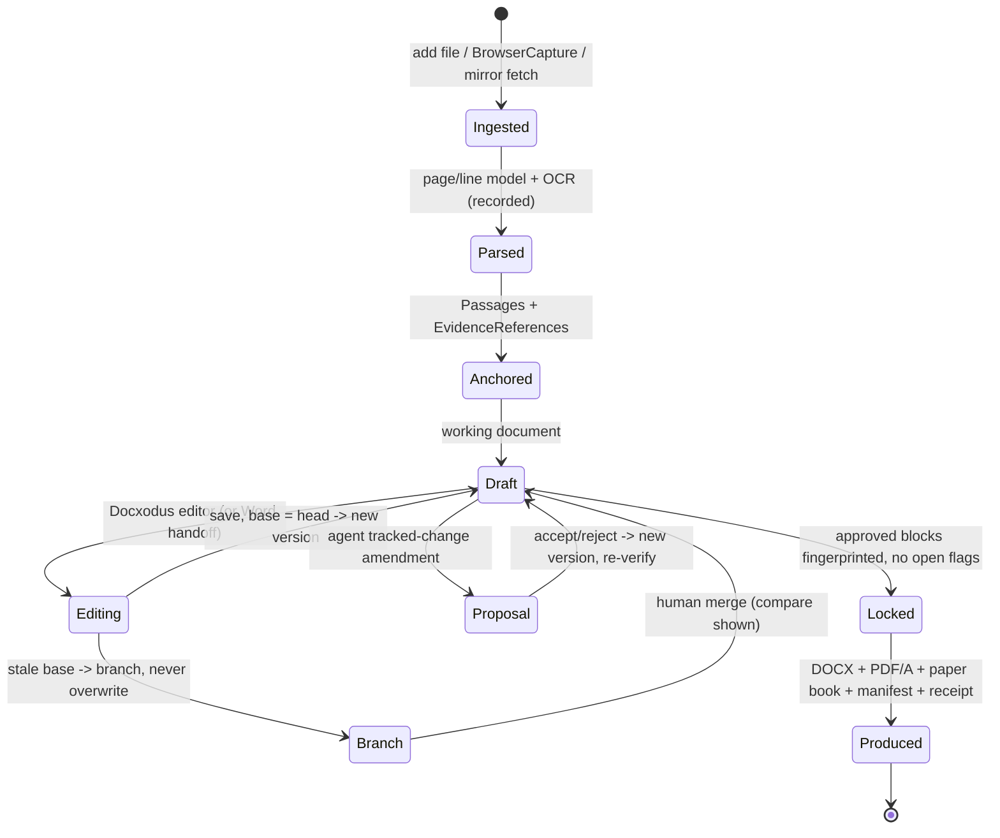

| Concern | Decision |
|---|---|
| Storage | Bytes in vault (sha256 = Manifestation id); metadata, versions, heads in document service |
| Parsing | Born-digital: pypdfium2 + pdfplumber geometry. Layout: Docling. OCR for scanned English pages: PaddleOCR + Tesseract second reader; VLM text only aligned onto geometry anchors |
| Corpus-first step | Corpus-profiling job over the AWS SC objects (null rates, headnote presence, printed paragraph numbers by decade, text layer) sets OCR/CER targets for scanned English judgments by decade |
| Paragraphs | `court-printed` vs `ilo:para-derived` with extractor version; SCR headnote and "Case Law Referred" are `ReporterBlock`s outside the sequence; paragraph count stored so an overflow pinpoint fails L2 |
| Hashes per Work | PDF sha256; JCS sha256 of raw source JSON; per-passage `quoteHash` under normalisation profile |
| References | Selector chain `ParagraphSelector → FragmentSelector(page) → TextQuoteSelector / TextPositionSelector / PdfBoxSelector` (W3C Web Annotation), coarse-to-fine fallback |
| Versions | Version DAG with exact-head CAS; stale saves become branches |
| Editor | Docxodus in-app: view, edit, tracked-change display, accept/reject; compare and reversibility proofs in the same engine |
| Word handoff | "Open in Word" with re-ingest and CAS check; a Word add-in (navigation, verification, comments) is post-MVP |
| Agent amendments | `w:author="Agent: drafting@<contract>"`; each revision linked to its VerificationRecord and `dependsOn`; reversibility proof |
| Generation | `docx` npm with block ids in content controls |
| PDF | Typst PDF/A-2b (or the variant SC e-filing accepts [U]); qpdf; veraPDF |
| Filing package | Index, pagination, annexure markers, bookmarks, defect check, AI-origin manifest + receipt, attribution annex for reproduced corpus text, BSA s.63(4) Part A draft |

**Lawyer and agent never overwrite each other.** Every write names its base; only `base == head` is accepted, else a branch and a merge item. Approved blocks are fingerprinted; at production, PDF text of each locked block is compared to approved text. Every accept/reject produces a new hash, which demotes bound verification and approvals to `not_checked` until re-run (automatic for deterministic L1/L2).

**DOCX testing.** LibreOffice OOXML tests, OpenXmlPowerTools tests, Docxodus fixtures and ≥ 200 de-identified SC filings (SLPs, counters, written submissions, paper books; tables, footnotes, numbered paragraphs). Three oracles: Word render on Windows CI, LibreOffice headless, Open XML SDK validator. Gate: zero invalid packages; 100% revision/comment preservation; block-id survival ≥ 99.5%; page drift 0 with bundled fonts.

---

## 13. Composition: services, plugins, profiles, an unpatchable legal layer

A Cordis-inspired registry reimplemented in ~1–2k lines of TS. Rule packs and workflows are versioned data, not plugins; chamber/user layers cannot patch legal rule rows.

| Kind | Format | Who changes it |
|---|---|---|
| Executable capability (tool) | Generated from ILO | Release |
| Service | TS module | Developers |
| Plugin | Signed npm package; `iloRange`, `harnessRange` | First-party in-process; third-party out of process, Read/Prepare only |
| Profile | `base → forum (signed rule pack) → matter type → chamber → user`, YAML + JSON Schema | Forum/matter by us; chamber by its admin |
| Playbook | `task`, `fanout`, `validate`, `gate`, `branch`, `loop`, `subplaybook`, `wait`, `outbox` nodes | Knowledge engineers; chambers may add |
| Legal rule pack | Zen tables + statecharts with provision refs; effective dates | Signed release only; non-patchable |
| System One question sets | Versioned wording + calibration map | Release; wording change forces recalibration |
| Agent manifest (TCR profile) | Tasks, competences, responsibilities | Release; maps to Reg 8(2) accountability and Reg 37 register |

The composer rejects any chamber/user patch targeting a rule-pack path; `strengthen` may only add checks. Fixtures disabling limitation or POCSO masking must fail composition.

| Profile | Rule pack | Playbooks | Notable rules |
|---|---|---|---|
| **Supreme Court (MVP)** | SC Rules 2013, A4 circular, SC defect categories | SLP (C/Crl), counter, rejoinder, IA, written submissions, paper book, citation audit, research memo, Case Conference | Limitation (90 days, delay condonation IA), certified copy, synopsis and list of dates, CVS on every citation |
| Criminal bail | BNSS with CrPC transitional mapping | Regular, anticipatory, SLP against refusal | Masking hard gate; governing date = offence date for IPC/BNS |
| Chamber playbook | none | Styles, clause bank | `strengthen` only |

---

## 14. Workflow and durable execution

The SQLite step journal owns progression; **the ledger, not the journal, is the record.**

| Object | States |
|---|---|
| Run | `created → running → waiting(gate | timer | event | outbox) → running → completed | failed | cancelled` |
| Step | `scheduled → started → succeeded | failed(retryable) | failed(terminal) | unknown(effect)` |
| Patch | `proposed → validated → committed | rejected` |
| Gate | `open → decided(approve | edit_approve | reject | escalate | defer) | stale | timed_out` |
| Outbox item | `pending → approved → sent → returned | unknown → reconciled`; `cancelled` |
| Flag | `open → resolved(fixed | overridden_with_reasons)` |
| Notebook item | `extracted → verified → lawyer_accepted | rejected` |
| Candidate argument | `proposed → accepted | edited_accepted | rejected` |

| Concern | Design |
|---|---|
| Checkpointing | Every step result journaled; every domain effect writes a ledger event keyed `(run_id, step_id)` with `INSERT … ON CONFLICT DO NOTHING` |
| Resumption | Deterministic interpreter over the pinned playbook; recorded steps not re-run |
| Proof-or-Stop gates | Open only on fresh evidence (`attestsHash` = current version), no open flags, no `not_checked` on required levels; decision signed in main process (payload hash) and ledgered before return |
| Retries | Only `replay: safe` steps retry; `replay: never` goes through the outbox |
| Outbox | Rows written with the justifying state; whole-task validation before release; fresh approval bound to payload; crash → `unknown` → reconciliation gate. In MVP the outbox carries no automated court effects (no e-filing); it guards exports and any agent-initiated external send |
| Parallelism | `fanout` with N and diversity policy; typed capped returns (≤ 2,000 tokens + evidence ids) |
| Versioning | Run pins `{playbookHash, profileHash, routingVersion, rulePackHash, questionSetHash, iloVersion, harnessVersion, configHash}` |
| Replay | Recorded journals replayed in CI on every PR; first-divergence report |

| Failure | Behaviour |
|---|---|
| Ledger unavailable | No domain write commits; UI: "record unavailable, nothing saved" |
| Runtime verifier or decision route unavailable | `not_checked`; nothing displayed as verified; gates stay closed |
| SC portal unreachable / CAPTCHA not completed | Attempt `error` / `skipped`; chain continues |
| AWS mirror stale | `coverageWindow` decides `outside_corpus_coverage`; banner shows snapshot date |
| Indian Kanoon unreachable | Attempt recorded; `unresolved` if nothing else resolved |
| OCR low confidence | Page flagged; second reader; below threshold → review; derived items cannot be promoted |
| OpenRouter provider down | OpenRouter failover within pinned providers; else local route or gate; deterministic composer for presentation tasks |

---

## 15. Integrated data model and ontology source

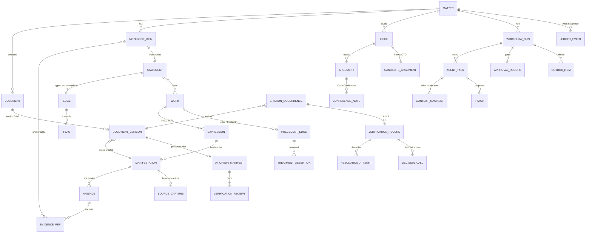

| Entity | Single owner | Others may | Others may not |
|---|---|---|---|
| Matters | Matter service | Reference | Mutate |
| Documents, versions | Document service | Propose versions | Write heads |
| Manifestations, passages | Vault; ingest writes passages | Cite via EvidenceReference | Edit text |
| Notebook items, statements, edges, flags | Notebook / case graph kernel | Propose | Promote without decision |
| Works, equivalence, coverage, provenance | Legal knowledge (reference layer) | Read, link | Create (agents) |
| Precedent edges, treatment | Studio kernel | Propose | Display "overruled" without RTS T4 |
| Issues, arguments, conference notes | Studio kernel | Propose | Accept without lawyer |
| Candidate arguments | MOTO engine (writes only to inbox) | Read | Write argument board |
| Verification records, attempts, decision calls | Verification service | Read | Be written by the generating agent |
| Lawyer decisions | Gate service | Read | Be inferred |
| Ledger events | Ledger | Append | Update, delete |
| Eval reports | Eval agent | Read | Be produced by the builder or generator |
| Provider keys | Main process (Credential Manager) | Request a call by route | Read the key |

**Ontology source (D29).** Reference-layer classes and properties are derived from the data we hold, not from external Indian ontologies:

| Source | Fields used | Becomes |
|---|---|---|
| AWS SC parquet | `title`, `petitioner`, `respondent`, `judge`, `author_judge`, `citation`, `case_id`, `cnr`, `decision_date`, `disposal_nature`, `nc_display`, `path`, `raw_html` | `Work`, `Expression` (INSC, SCR), `Party`, `Judge`, `Bench` (strength derived), `Disposal`, `Court`; INSC↔SCR equivalence |
| HC dataset metadata | `cnr`, `decision_date`, court, bench, order number | HC `Work` identity (P3 resolver; reference data loaded in MVP where useful) |
| Judgment text | paragraph structure, citations, provisions cited | `Passage`, `legal_reference`, `PrecedentEdge` |
| From scratch (no metadata) | Notebook kinds, statement subtypes, treatment vocabulary, argument structure | ILO classes defined in C5 |
| Format standards | JSON Schema, JSON-LD, PROV-O, W3C Web Annotation selectors; Akoma Ntoso optional for statutes | Serialisation and interop |
| Law and Justice Wiki | concept pages | Non-normative glossary (`ilo-concepts`) |

**Portability.** Outbound calls in MVP: the OpenRouter routes the user configured, Indian Kanoon on click, the AWS bucket for mirror sync, the update feed, and sites the user browses. The evidence package (ILO objects, manifests, response-store subset, ledger proof, manifestations, captures) is the vendor-neutral export.

---

## 16. The draft Regulations, mapped to mechanisms

Status: draft circulated 03.06.2026, not notified [F]. The AI-origin manifest is designed directly from Reg 43(3)–(4) text.

| Provision (draft) | What it says [F] | Mechanism |
|---|---|---|
| **Reg 3(1)(y)** | GenAI content not to be filed "without mandatory disclosure of its origin and verification through a designated centralised mechanism" | AI-origin manifest + receipt hash-bound to the produced PDF; receipt carries citation identities, hashes and attempts (not matter text) so a court mechanism can re-run checks |
| **Reg 3(1)(z)** | "Hallucination": fabricated, misleading or unsupported outputs incl. misstatement of precedents and provisions | `hallucinationClass`; planted-defect suite covers each class |
| Reg 3(1)(q), (w) | Court process incl. research and drafting; explainability on request | ContextManifest + RunManifest; verification records state method and source |
| **Reg 8(2)** | Documented lines of accountability | TCR agent manifests; gate roles; ledgered approvals |
| **Reg 8(3)** | AI output advisory; verify before use; dispensation "for reasons to be recorded in writing"; class certification of administrative tools | Gates closed until verification passes; override = `ApprovalRecord{decision: override, reasons}` printed in the receipt; conformance suites designed so a verifier can be certified as a class |
| Reg 19(1)(a), (d), (h) | Permissible uses incl. defect identification, research, citation verification, authenticity verification | Defect checker; CVS; manifestation hashing and capture provenance |
| Reg 20(h) | No AI output as independent evidence without disclosure | `machine_derived` origin until confirmed; production refuses machine-derived text as evidence without manifest |
| **Reg 33(3)** | Committees approve AI systems after impact assessment; common standards and shared platforms | Fixed, reproducible builds; no self-modifying harness; NVS/CVS/RTS offered as common standard |
| Reg 37 | AI Register per court | Agent manifests and run pins give register-ready descriptions |
| **Reg 38(2)** | Audits in-house; code never sent outside court premises | Fully open, locally buildable, offline-capable |
| **Reg 43(3)** | Disclose AI-assisted character at submission by declaration/certificate | Production emits the declaration from the manifest: tool name and version, nature of assistance, verification performed, advocate's signature block |
| **Reg 43(4)** | Court may require "the AI System used, the nature and extent of AI assistance provided, and the steps taken to verify the accuracy" | `aiSystems` (OpenRouter route, provider, model id/version, harness version, config hash), `natureAndExtent` (per block: generated, edited, suggested-accepted), `verificationSteps[]` (per citation and Notebook fact: levels, attempts in order, outcomes, System One scores, hashes, overrides) |
| Reg 43(5) | Synthetic data disclosure | Golden matters labelled `synthetic: true` |
| **Reg 43(6)** | Submitter bears full responsibility | No auto-filing; every export needs the advocate's signed approval on fresh evidence |
| **Reg 44** | AI Content Verification Authority maintains verification standards and tools | Spec and conformance versioned (C5); receipts name the spec version |
| Reg 10 / external transfer | Restrictions on transferring sensitive judicial data | Data labels; `privileged` only to local routes (§4.1, §17) |

---

## 17. Security

| Area | Design |
|---|---|
| Electron hardening | `contextIsolation`, `sandbox`, `nodeIntegration: false` in every renderer; strict CSP; typed IPC with Ajv validation; navigation and `window.open` denied in app renderers; Electron fuses (no `RunAsNode`, no `NODE_OPTIONS`, ASAR integrity); Authenticode-signed builds; updater verifies signatures |
| Browser pane | Separate `WebContentsView` and session per matter; no preload; permissions denied by default; downloads intercepted to vault; agents cannot type into or submit the pane |
| Untrusted files | Parsing in a no-network utility process; macro, external-relationship and zip-bomb stripping; PDF parsing never in a privileged renderer |
| Prompt injection | Reader/actor split: turns reading untrusted documents hold only read tools; writes via kernels; effects via outbox; links validator rejects unknown ids; AgentDojo-style and MSB suites with action-level attack-success gate 0 |
| Keys | OpenRouter key and signing key in Windows Credential Manager, read only by main process; never in renderer, journal, manifests or traces |
| Data labels and egress | `public | pseudonymised | privileged` on every request; `privileged` only to local routes unless written authorisation is recorded; OpenRouter `data_collection: deny` and provider allowlist; Jev only on public text; CT-09 egress test |
| Integrity | RFC 8785 + `hashProfile`; chain verifier on open; DSSE-signed manifests and receipts |
| Third-party tools | Out of process; Read/Prepare only; description-hash pinning; MSB before enablement |
| Encryption at rest | Per-matter data key wrapped by an OS-protected key (DPAPI via `safeStorage`); SQLite page encryption (SQLCipher-class) [U: packaging] |
| Erasure | Destroy per-matter key + tombstone |
| Masking | POCSO/rape-victim identity detector at ingest; hard defect rule on export |
| Supply chain | Lockfiles, SBOM, pinned sidecar binaries with hashes, reproducible build notes |

---

## 18. Repository and component adoption map

All available repositories are usable inputs (D30). Integration: **D** depend, **W** wrap behind a port, **V** vendor/pin binary, **R** reimplement pattern, **Ref** reference, **Data** data source. Attribution: to be completed before public release.

| Component | Source | Part used | Integration |
|---|---|---|---|
| Electron, electron-builder, electron-updater | electron/electron; electron-userland | Shell, `WebContentsView`, sessions, utility processes, NSIS installer, auto-update | D |
| React, pdf.js | — | UI, viewer | D |
| OpenCode | anomalyco/opencode | Agent-server split, permission rulesets, default-deny | R |
| Docxodus | JSv4/Docxodus | Editor (WASM), compare, accept/reject, reversibility | D/V |
| Open XML SDK, LibreOffice | — | Validation; second oracle; degraded compare | D |
| `docx` npm | dolanmiu/docx | DOCX generation | D |
| Typst, qpdf, veraPDF | — | PDF/A, assembly, validation | D (CLI) |
| SQLite + FTS5 + sqlite-vec; DuckDB | — | Store; ingest-time parquet queries | D |
| Ajv, json-schema-to-typescript | — | Validation, codegen, tool compiler | D |
| OpenRouter API | openrouter.ai | Chat completions + Decisions API (Clef, Clef-flash, Jev) | W (`ModelProvider`, `DecisionProvider`) |
| Ollama / llama.cpp / vLLM / SGLang | — | Local generation and `/v1/systemone` | D (user-installed) |
| Clef, Clef-flash weights | Cloudflare (HF) | Local/self-hosted System One | D (optional) |
| OpenAI Agents JS core | openai/openai-agents-js | Fallback loop | W |
| Docling, PaddleOCR, Tesseract, pypdfium2, pdfplumber | — | Parsing/OCR sidecar | D |
| GoRules Zen | gorules/zen | Rule tables | D |
| Inspect, promptfoo | — | Eval agent harness | D |
| MiniCheck-class NLI | — | Eval agent second verifier | D |
| MCP TS SDK | modelcontextprotocol | Generated adapters | D |
| Presidio | microsoft/presidio | Pseudonymisation | D |
| MOTO | Intrafere/MOTO | Staged generate–validate loop | R (§8) |
| mootloop | — | Fabrication-gate pattern (NVS G3); bench personas (Case Conference) | R |
| ChronosAI | — | Date/actor reconciliation ideas | R |
| `@stll/legal-ast` | — | Starting point for `judgment_ast` | D/R |
| Harness-Multi-Agent-Legal | — | Amendment-version conflict idea | Ref |
| Pi, Pi Durable, Cordis/dsh, Pydantic AI, OpenHands | — | Hooks, replay policy, dispatch modes, tool-effect ledger | R |
| Semantica, ActiveGraph | — | Hashing, PROV-O export, truth maintenance; response keying, replay, fork/diff | Ref |
| A2AJ | — | Open public-corpus service design | Ref |
| **SC judgments (AWS Open Data)** | vanga/indian-supreme-court-judgments | T2 corpus, equivalence, ontology source, fixtures | Data |
| HC judgments | vanga/indian-high-court-judgments | Ontology metadata; P3 resolver | Data |
| Law and Justice Wiki | lawandjusticewiki.org | Glossary; parser citation corpus | Data |
| Indian Kanoon | indiankanoon.org | T3 via webfetch / API | Data (user-triggered) |

**Not used:** closed agent binaries on any data path; graph databases; separate search engines in MVP; automated CAPTCHA solvers; self-modifying harnesses.

---

## 19. TypeScript contracts

ILO types (`EvidenceReference`, `NotebookItem`, `LegalStatement`, `VerificationRecord`, `PrecedentEdge`, `RunManifest`, `ContextManifest`, `PermissionGrant`, `ApprovalRecord`, `AiOriginManifest`, `VerificationReceipt`, `SourceCapture`, …) are generated from C5's schemas into `@ilac/ontology`. The ports below are hand-written and illustrative.

```ts
// ---- shared primitives ----
import type {
  EvidenceReference, NotebookItem, LegalStatement, VerificationRecord, PrecedentEdge,
  RunManifest, ContextManifest, PermissionGrant, ApprovalRecord, ActionClass,
  AiOriginManifest, VerificationReceipt, SourceCapture,
} from "@ilac/ontology";

type Urn = `urn:ilo:${string}`;
type Sha256 = `sha256:${string}`;
type IsoDate = string;      // law time
type IsoInstant = string;   // record time
type DataLabel = "public" | "pseudonymised" | "privileged";
interface Budget { tokens: number; toolCalls: number; wallMs: number; costMicroUsd: number }
interface Principal { userId: string; roles: string[] }
interface RunPin {
  playbookHash: Sha256; profileHash: Sha256; rulePackHash: Sha256; questionSetHash: Sha256;
  routingVersion: string; iloVersion: "0.1"; harnessVersion: string; configHash: Sha256;
}
interface RunCtx { runId: string; stepId: string; matterId: string; principal: Principal; pins: RunPin }
interface Disposable { dispose(): void | Promise<void> }
```

```ts
// ---- ModelProvider: OpenRouter adapter + local OpenAI-compatible endpoint ----
interface ModelRequest {
  route: `gen.${string}`;                       // e.g. gen.draft, gen.verify, gen.local.draft
  messages: Array<{ role: "system" | "user" | "assistant" | "tool"; content: unknown }>;
  outputSchema?: object; allowedIds?: string[];
  params: { temperature?: number; seed?: number; maxTokens: number };
  dataLabel: DataLabel;
}
interface ModelResult {
  output: unknown; raw: Sha256;
  model: { backend: "openrouter" | "local"; provider: string; id: string; version?: string };
  usage: { inputTokens: number; outputTokens: number; costMicroUsd: number };
}
interface ModelProvider { generate(r: ModelRequest, s: AbortSignal): Promise<ModelResult> }

interface OpenRouterRouteConfig {
  route: string; model: string;                 // e.g. "anthropic/...", "cloudflare/clef-flash"
  providerOrder?: string[]; allowFallbacks: boolean; dataCollection: "deny";
  maxDataLabel: Exclude<DataLabel, "privileged">;   // privileged never leaves the machine by default
}
```

```ts
// ---- DecisionProvider: System One (Clef, Clef-flash, Jev) ----
type Question =
  | { type: "noul"; instructions: string; criteria?: string }
  | { type: "choice"; instructions: string; criteria: Record<string, string> }
  | { type: "score"; instructions: string; criteria: string[] };       // ordered, lowest first
type Answer =
  | { noul: number }
  | { choice: string; probabilities: Record<string, number>; confidence: number }
  | { score: number; legend: string[]; probabilities: number[]; confidence: number };
interface DecisionRequest {
  route: `decide.${string}`;                    // decide.flash, decide.clef, decide.jev, decide.local.clef
  state: string | object;                       // keep short: cited para ± 1
  questions: Record<string, Question>;          // 1..64; ids [A-Za-z0-9_.-]{1,100}
  questionSetId: string; wordingHash: Sha256; dataLabel: DataLabel;
}
interface DecisionResult { model: string; answers: Record<string, Answer>; raw: Sha256 }
interface DecisionProvider { decide(r: DecisionRequest, s: AbortSignal): Promise<DecisionResult> }

type Band = "auto_pass" | "unresolved" | "auto_fail";
interface Calibrator {                          // per (model, questionSetId, question id, wordingHash)
  calibrate(r: DecisionResult, q: string): number;               // recalibrated probability
  band(questionType: string, p: number): Band;                   // conformal thresholds
}
interface DecisionCascade {                     // gates first, then flash -> clef (+jev on public) -> lawyer
  run(item: Urn, gatePassed: boolean, req: Omit<DecisionRequest, "route">):
    Promise<{ band: Band; calls: DecisionResult[]; paraphraseSwing?: number }>;
}
```

```ts
// ---- AgentRuntime + OutputPolicy ----
interface ToolIntent { tool: `${string}@${string}`; args: unknown; actionClass: ActionClass; idempotencyKey: string; replay: "safe" | "never" }
interface JsonPatchOp { op: "add" | "remove" | "replace" | "move" | "copy" | "test"; path: string; value?: unknown; from?: string }
interface PatchProposal { targetType: string; targetId?: Urn; baseHash?: Sha256; ops: JsonPatchOp[]; dependsOn: Urn[] }
interface AgentTurnInput { taskContract: `${string}@${string}`; contextManifestHash: Sha256; toolAllowlist: string[]; budget: Budget }
interface AgentTurnOutput { typedOutput: unknown; patchProposals: PatchProposal[]; toolIntents: ToolIntent[]; usage: ModelResult["usage"]; modelTraceRef: Sha256 }
interface AgentRuntime { run(i: AgentTurnInput, ctx: RunCtx, signal: AbortSignal): Promise<AgentTurnOutput> }

type PolicyFamily = "leakage" | "links" | "language";
interface OutputPolicy { check(out: unknown, m: ContextManifest, contract: string): Array<{ family: PolicyFamily; ok: boolean; violations: { path: string; rule: string }[] }> }
interface DeterministicComposer { render(contract: string, inputs: unknown): { output: unknown; composition: "deterministic_fallback" } }
```

```ts
// ---- PatchKernel, ToolCompiler, Cascade, Outbox ----
interface KernelResult {
  status: "committed" | "rejected"; objectIds: Urn[]; ledgerSeq?: number;
  errors?: Array<{ stage: "schema" | "shapes" | "role" | "invariant" | "standard_gate"; code: string; message: string }>;
}
interface PatchKernel {
  validate(p: PatchProposal, ctx: RunCtx, g: PermissionGrant): Promise<KernelResult>;
  commit(p: PatchProposal, ctx: RunCtx, g: PermissionGrant, a?: ApprovalRecord): Promise<KernelResult>; // idempotent on (runId, stepId, hash(p))
}
interface ToolEntry { name: string; operationSchema: object; actionClass: ActionClass; sideEffect: string; replay: "safe" | "never"; descriptionHash: Sha256; maxReturnBytes: number }
interface ToolCompiler { compile(schemaId: string): { tools: ToolEntry[]; kernelChain: string[]; mcp: object; openapi: object } }

type FlagKind = "dependency_failed" | "dependency_overruled" | "dependency_superseded" | "dependency_withdrawn";
interface CascadeEngine {
  onRetraction(cause: { object: Urn; kind: FlagKind; event: number }): Promise<{ flagged: Urn[] }>;
  openFlags(scope: { matterId: string; documentVersion?: Urn }): Promise<Array<{ target: Urn; kind: FlagKind }>>;
}
type OutboxState = "pending" | "approved" | "sent" | "returned" | "unknown" | "reconciled" | "cancelled";
interface OutboxItem { id: Urn; effect: "export_share" | "email" | "browser_submit" | "efiling"; payloadHash: Sha256; state: OutboxState; approval?: Urn }
interface OutboxService {
  enqueue(effect: OutboxItem["effect"], payload: unknown, ctx: RunCtx): Promise<OutboxItem>;
  release(id: Urn, a: ApprovalRecord): Promise<OutboxItem>;
  reconcile(id: Urn, outcome: "returned" | "not_sent", evidence: Urn[]): Promise<OutboxItem>;
}
```

```ts
// ---- Notebook (NVS) ----
type NvsGate = "G1" | "G2" | "G3" | "G4" | "G5" | "G6" | "G7";
type NotebookKind = "synopsis" | "date" | "party" | "incident" | "relation" | "evidence" | "faq" | "case_law_mention";
interface NotebookService {
  extract(documentIds: Urn[], ctx: RunCtx): Promise<{ proposed: Urn[] }>;             // logic gate playbook
  gateResults(item: Urn): Promise<Array<{ gate: NvsGate; ok: boolean; reason?: string }>>;
  decide(item: Urn, d: "accept" | "edit" | "reject", a: ApprovalRecord, edit?: Partial<NotebookItem>): Promise<NotebookItem>;
  ask(matterId: string, question: string, ctx: RunCtx): Promise<{ sentences: Array<{ text: string; anchors: EvidenceReference[] }> }>; // unanchored dropped
}
```

```ts
// ---- CVS: CitationResolver + VerificationService ----
type Tier = "T1" | "T2" | "T3";
type AttemptOutcome = "resolved" | "not_found" | "skipped" | "error";
interface ResolutionAttempt { tier: Tier; source: string; acquisitionMode: "in_session_human" | "offline_mirror" | "user_webfetch" | "api"; startedAt: IsoInstant; outcome: AttemptOutcome; reason?: string; manifestation?: Sha256; coverageWindow?: { from: IsoDate; to: IsoDate; snapshot: string }; captureId?: Urn }
interface ParsedCitation { raw: string; kind: "insc" | "scr" | "scc" | "air" | "case_number" | "other"; year?: number; n?: number; normalized?: string }
interface CitationResolver {
  parse(raw: string): ParsedCitation | { error: "unparseable" };
  resolve(c: ParsedCitation, opts: { requirePrimary: boolean; allowWebfetch: boolean }, ctx: RunCtx):
    Promise<{ work?: Urn; attempts: ResolutionAttempt[]; authorityLevel?: "A" | "B" | "C"; conflict?: boolean }>;
}
interface VerificationService {
  verify(targets: Array<{ citationOccurrence?: Urn; statement?: Urn; notebookItem?: Urn }>, ctx: RunCtx): Promise<VerificationRecord[]>;
  // invariants: assessor != generator; L3 'supported' impossible if L2 failed; scores never set 'verified';
  // record.attestsHash = hash(draft version + occurrence)
  summaryBadge(r: VerificationRecord): "VERIFIED_PRIMARY" | "VERIFIED_SECONDARY" | "CONFLICT" | "FAILED" | "UNVERIFIED";
  receipt(documentVersion: Urn): Promise<VerificationReceipt>;
}
interface BrowserCapture {
  open(matterId: string, url: string, purpose: { citation?: string; query?: string }): Promise<{ paneId: string }>;
  capture(paneId: string, gesture: string): Promise<SourceCapture>;   // requires lawyer gesture token
  onDownload(paneId: string, cb: (c: SourceCapture) => void): Disposable;
}
```

```ts
// ---- Studio (RTS), Case Conference, MOTO ----
type Treatment = "followed" | "approved" | "relied" | "distinguished" | "explained" | "doubted" | "referred_larger"
  | "overruled" | "impliedly_overruled" | "per_incuriam" | "sub_silentio" | "mentioned" | "not_about";
type RtsGate = "T1" | "T2" | "T3" | "T4" | "T5";
interface PrecedentGraphService {
  proposeEdge(e: Omit<PrecedentEdge, "id">, ctx: RunCtx): Promise<KernelResult>;     // RTS gates in kernel
  treatmentOf(work: Urn, asOf: IsoDate): Promise<Array<{ edge: Urn; treatment: Treatment; status: "machine_derived" | "reviewed" | "pending_reference" }>>;
  benchCheck(citing: Urn, cited: Urn): Promise<{ ok: boolean; citingStrength: number; citedStrength: number; dateOrderOk: boolean }>;
}
interface Argument { id: Urn; issue: Urn; claim: string; grounds: string[]; authorities: Urn[]; recordAnchors: EvidenceReference[]; dependsOn: Urn[]; status: "draft" | "accepted" }
interface StudioService {
  research(matterId: string, question: string, ctx: RunCtx): Promise<{ propositions: Array<{ text: string; authorities: Array<{ work: Urn; paraId: string; record: Urn }> }>; counterAuthorities: Urn[] }>;
  acceptCandidate(candidate: Urn, a: ApprovalRecord, edit?: Partial<Argument>): Promise<Argument>;
  conference(issueIds: Urn[], roles: Array<"lead" | "opposing" | "bench" | "record_checker" | "authority_checker">, ctx: RunCtx):
    Promise<{ notes: Array<{ id: Urn; role: string; kind: "objection" | "question" | "weak_link" | "counter_authority"; anchors: EvidenceReference[] }> }>;
}
interface CandidateArgument extends Omit<Argument, "status"> { provenance: "moto"; counterArguments: string[]; validation: Record<string, number>; status: "proposed" | "accepted" | "rejected" }
interface HypothesisEngine {                    // @vakil/moto: separate module, no Commit tools
  explore(issue: Urn, opts: { maxIter: number; budget: Budget; diversity: string }, ctx: RunCtx): Promise<{ runId: string }>;
  candidates(issue: Urn): Promise<CandidateArgument[]>;   // delivered to Studio inbox only
}
```

```ts
// ---- DurableRunner, Retrieval, Documents, Production ----
type PlaybookNode =
  | { kind: "task"; id: string; contract: string; next: string }
  | { kind: "fanout"; id: string; contract: string; n: number; diversity: string; next: string }
  | { kind: "validate"; id: string; validators: string[]; next: string }
  | { kind: "gate"; id: string; role: string; requires: Array<"fresh_verification" | "no_open_flags" | string>; decisions: string[]; next: Record<string, string> }
  | { kind: "branch"; id: string; expr: string; cases: Record<string, string> }
  | { kind: "loop"; id: string; body: string; maxIter: number; budget: Budget; next: string }
  | { kind: "subplaybook"; id: string; playbook: Sha256; next: string }
  | { kind: "outbox"; id: string; effect: OutboxItem["effect"]; next: string }
  | { kind: "wait"; id: string; timerMs?: number; event?: string; next: string };
interface DurableRunner {                       // SQLite journal in MVP
  start(playbook: Sha256, input: unknown, ctx: Omit<RunCtx, "stepId">): Promise<{ runId: string }>;
  signalGate(runId: string, gateId: string, d: ApprovalRecord): Promise<"accepted" | "rejected" | "stale">;
  cancel(runId: string, reason: string): Promise<void>;
  fork(parentRun: string, cutoffSeq: number): Promise<{ runId: string }>;
}
interface MatterContext { matterId: string; forum: string; caseType: string; asOf: IsoInstant; governingDate: { date: IsoDate; rule: string }; grant: PermissionGrant; pins: RunPin }
interface RetrievalService {
  search(q: { text: string; mc: MatterContext; partitions: Array<"matter" | "reference" | "institutional">; k: number }):
    Promise<{ hits: Array<{ evidence: EvidenceReference; score: number; via: string[] }>; coverage: Array<{ source: string; snapshot: string; window: [IsoDate, IsoDate] }> }>;
}
interface DocumentService {
  ingest(bytes: Uint8Array, meta: { matterId: string; filename: string; capture?: Urn }, ctx: RunCtx): Promise<{ version: Urn; manifestation: Sha256 }>;
  save(doc: Urn, base: Urn, bytes: Uint8Array, author: string): Promise<{ version: Urn; branched: boolean }>;
  propose(doc: Urn, base: Urn, amendment: { revisions: unknown[]; verification: Urn[]; dependsOn: Urn[] }, ctx: RunCtx): Promise<{ proposalId: Urn; docx: Sha256 }>;
  decide(proposalId: Urn, perRevision: Record<string, "accept" | "reject">, a: ApprovalRecord): Promise<{ version: Urn }>;
  resolve(ref: EvidenceReference): Promise<{ text: string; page: number; lines: [number, number]; exact: boolean; blockKind: "judgment" | "reporter" }>;
}
interface ProductionService {
  produce(version: Urn, opts: { pdfa: "2b" | string; paperBook: boolean }, a: ApprovalRecord):
    Promise<{ docx: Sha256; pdf: Sha256; manifest: AiOriginManifest; receipt: VerificationReceipt }>; // refuses on open flags or stale evidence
}
```

```ts
// ---- Verifier/Eval agent (separate package @vakil/eval) ----
type Standard = "NVS" | "CVS" | "RTS";
interface EvalSuite { id: string; standard: Standard | "CT"; goldRef: Sha256; mutations: string[] }   // gold stored outside builders' reach
interface EvalReport {
  build: { commit: string; harnessVersion: string; configHash: Sha256 };
  suite: string; perGate: Record<string, { precision: number; recall: number; n: number }>;
  perMutation: Record<string, { recall: number; n: number }>;
  calibration: Record<string, { ece: number; brier: number; model: string; wordingHash: Sha256 }>;
  verifierAgreement: { kappa: number; pairs: [string, string] };
  signature: string;
}
interface EvalAgent {
  run(suite: EvalSuite, evidencePackages: Sha256[]): Promise<EvalReport>;   // reads exports + ledger only
  assertIndependence(cfg: { generatorModels: string[]; verifierModels: string[] }): { ok: boolean; reason?: string }; // lineage check
}
```

| Port | Decouples us from |
|---|---|
| `ModelProvider` / `DecisionProvider` | Specific models and providers behind OpenRouter; local endpoints |
| `Calibrator` / `DecisionCascade` | Raw vendor probabilities |
| `AgentRuntime` | Custom loop vs OpenAI Agents core |
| `PatchKernel` / `ToolCompiler` | Ad hoc tool definitions, raw writes |
| `CascadeEngine`, `OutboxService` | Stale dependents; framework tool execution |
| `CitationResolver` / `VerificationService` / `BrowserCapture` | Any single source or assessor; scrapers |
| `NotebookService`, `PrecedentGraphService`, `StudioService`, `HypothesisEngine` | Engine internals; MOTO as a replaceable module |
| `DurableRunner` | Journal vs P1 server runner |
| `DocumentService`, `ProductionService` | Editors; export path |
| `EvalAgent` | Builders grading themselves |

---

## 20. After MVP

**P1 Gateway and website (immediately after MVP).** Same contract and services on a server profile for shared matters and the hosted gateway: Postgres + pgvector, a durable server runner behind `DurableRunner`, witnessed ledger checkpoints and RFC 3161 timestamps, OIDC accounts, relationship-based access control with ethical walls, single-tenant deployment in AWS ap-south-1, and a public website (downloads, documentation, conformance results). Profile-parity test: identical ILO outputs on both profiles modulo ids and timestamps.

**P2 macOS and Linux builds.** Same Electron code; platform signing/notarisation; capture parity test across OSes.

**P3 Connectors and High Courts.** eCourts and `sci.gov.in` case files via BrowserCapture (human CAPTCHA only); HC resolver over the HC dataset with identity `(cnr, decision_date, order_number)`; per-court neutral-citation registry; regional-language OCR for HC/district records.

**P4 Commercial.** Managed hosting, chamber collaboration, hearing rehearsal and simulation, custom models and knowledge bases; each consumes ILO objects and adds no core state; none is a dependency of the open workspace or the Commons.

---

## 21. Roadmap: MVP stages in detail

Every stage ships running code in the Windows workspace, the ILO artefacts it needs (C5) and passing conformance suites, and closes only on a **signed receipt bundle** naming the commit and the CT and Eval-agent results produced from it (D34). From Stage 1 every stage extends GM-01 end to end.

### Stage 0 — Windows shell, installer, journal

| Item | Content |
|---|---|
| Goal | A signed installer puts the app on a clean Windows machine; a trivial playbook runs on the SQLite journal, proposes patches through a generated tool, the kernel commits objects and ledger events idempotently, a gate refuses stale evidence, a signed RunManifest is emitted |
| Components | Electron shell (hardened), electron-builder NSIS, electron-updater (internal channel), typed IPC, Credential Manager key storage, OpenRouter + local `ModelProvider`/`DecisionProvider` with recorded-fixture backend, ILO 0.1 core schemas, codegen, tool compiler, kernel chain, RFC 8785 + `hashProfile`, normalisation profile, interpreter (`task`, `gate`, `outbox`), custom loop, response store, ledger + chain verifier, DSSE, `ilac` CLI, Eval agent skeleton |
| Tests | Install/upgrade/uninstall on Windows 10/11; property tests (JCS, normalisation); replay with first-divergence; kill-at-gate chaos ≥ 1,000 faults; forged and edit-after-approval tests; ownership rules |
| Acceptance | CT-01; zero duplicate/missing ledger events; zero stale approvals accepted; loop < 1,000 lines; invalid object cannot be expressed; update applied only with valid signature |

### Stage 1 — Matters, documents, ingest

| Item | Content |
|---|---|
| Goal | A lawyer creates a matter, adds PDFs/DOCX or captures from the browser, and every passage has a resolvable `EvidenceReference`; the CLI round-trips the evidence package |
| Components | Matter/document/vault services; ingest utility process + bundled Python OCR sidecar; line model; paragraph schemes incl. `ReporterBlock`; selector resolver; pdf.js anchor layer; Docxodus viewer; browser pane + BrowserCapture; evidence-package export/import; AWS SC mirror sync + corpus-profiling job; ontology seed from SC/HC metadata |
| Tests | CT-03 round-trip on SC judgments incl. headnotes; OCR gold set for scanned English judgments by decade; hostile-file fuzz; re-OCR anchor stability; Electron security audit |
| Acceptance | CT-03 100%; anchor survival after re-OCR ≥ 99%; CER targets from profile met; zero sandbox escapes |

### Stage 2 — Notebook + NVS

| Item | Content |
|---|---|
| Goal | The Notebook extracts typed items from GM-01's record; NVS gates block fabrication; Clef-flash/Clef route items; the lawyer accepts in the Notebook editor; the chatbot answers only from anchored items |
| Components | Logic-gate task contracts; NVS G1–G7 in kernel; `DecisionCascade` + `Calibrator` (initial calibration set); Notebook editor; chatbot; review UI; one agent + runtime verifier; retrieval (FTS5 + sqlite-vec, RRF, graph expansion); case graph promotion |
| Tests | CT-14 vectors; planted fabricated dates/names/amounts, unanchored items, swapped relation direction, allegation-as-fact; Clef scores forced high on a failing item |
| Acceptance | 100% planted gate failures caught; zero items reach `verified` on gate failure regardless of score; Eval agent NVS report signed |

### Stage 3 — Citation verifier CVS + editor + manifest

| Item | Content |
|---|---|
| Goal | Every citation in a GM-01 draft has a two-axis record with tier order; agent edits arrive as tracked changes; export is gated by freshness and cascade; produced documents carry a hash-bound AI-origin manifest and receipt |
| Components | INSC/SCR parser, equivalence table, `coverage_window`, T2 resolver, T1 capture extractors for the three SC portals, T3 Indian Kanoon webfetch/API; L1/L2 deterministic; L2-semantic and L3 via `DecisionCascade` + generative assessor; Docxodus editor with proposals and reversibility proofs; defect checker (SC subset + masking); cascade engine; production (DOCX, PDF/A, paper book); manifest + receipt (Reg 43(3)–(4)); outbox |
| Tests | CT-02 on ≥ 500 mined strings; CT-04 planted defects incl. too-recent citation, counsel-submission-as-holding; CT-08 altered PDF byte; CT-09 egress; cascade test; capture replay; three-oracle DOCX corpus |
| Acceptance | CT-02 ≥ 99% INSC, ≥ 97% report citations; L1 recall ≥ 99% within coverage; L2 pinpoint recall ≥ 90%; zero false `verified` on misquotes; zero `failed` on out-of-coverage plants; receipt re-verifiable offline by CLI; Eval agent CVS report signed |

### Stage 4 — Research & Argument Studio

| Item | Content |
|---|---|
| Goal | The lawyer researches an issue over the SC corpus and the matter record, sees authorities with anchored treatment, builds an argument board and runs a Case Conference |
| Components | `judgment_ast`; reference extraction; research organisation and Q&A; precedent graph with RTS T1–T5; Clef/Jev treatment classification and negative-treatment queue; treatment backfill over the SC corpus; `ProvisionVersion` intervals for IPC/BNS, CrPC/BNSS, IEA/BSA; argument board; Case Conference playbook |
| Tests | CT-06 (IPC 302 vs BNS 103 on 30 Jun vs 1 Jul 2024); CT-12 treatment warnings; CT-15; planted "overruled" without anchor, overruling by smaller bench, amendment conflict |
| Acceptance | Zero "overruled" shown without anchor + bench check; 100% amendment conflicts flagged; negative-treatment recall ≥ target at α; Eval agent RTS report signed |

### Stage 5 — MOTO engine + Windows release (MVP complete)

| Item | Content |
|---|---|
| Goal | MOTO explores candidate arguments that land in the Studio inbox; the golden matter runs end to end; a signed public Windows release ships with auto-update |
| Components | `@vakil/moto` package, playbooks, validators; Studio inbox; full GM-01 script; held-out GM-02; release pipeline (stable channel), SBOM, attribution annex |
| Tests | GM script below; kill-and-resume mid-loop; swap test; three-arm enforcement ablation; AgentDojo/MSB suites; MOTO grounding and acceptance metrics |
| Acceptance | All steps pass on GM-02; all CT suites green; action-level injection success 0; external reviewer verifies receipts offline on a clean Windows machine; blind AOR review of the produced filing |

**Golden matter GM-01.** *State v. R. Kumar* (synthetic, `synthetic: true`): SLP (Crl) against a High Court order refusing regular bail; offence 28 June 2024 (IPC governs; BNSS for later steps); 4 years 3 months in custody; record: FIR and charge-sheet extracts (English), born-digital HC order, bail application DOCX, two medical reports, custody certificate; six SC authorities from the AWS mirror including one planted mis-pinpoint, one authority later distinguished on the relevant proposition, and one 2026 judgment outside mirror coverage that must resolve via T1 capture or remain `unresolved`. GM-02 (a constitutional writ) is authored by a different person and held out by the Eval agent.

| # | Step | Pass condition |
|---|---|---|
| 1 | Install and create matter | Signed installer; SC + bail profile hash logged; chamber patch disabling masking rejected |
| 2 | Ingestion | Each file → Manifestation sha256; duplicates by hash |
| 3 | Structure | Line model per page; `court-printed` vs `derived` labelled |
| 4 | Notebook | Items with anchors; NVS gates pass; allegations typed as allegations; lawyer accepts |
| 5 | Chronology | Events with `evidencedBy`; governing date 28 Jun 2024, rule "offence date" |
| 6 | Research | Propositions with authorities and treatment; distinguished authority flagged |
| 7 | MOTO + Case Conference | Candidate arguments grounded; lawyer accepts two; conference notes anchored; opposing role sees no privileged notes |
| 8 | Drafting | Grounds linked to statements, arguments and authorities; `dependsOn` recorded |
| 9 | Verification | Mis-pinpoint → L2 `failed`, `wrong_pinpoint`; out-of-coverage → `unresolved`; scores recorded |
| 10 | Cascade | Paragraphs depending on the failed citation flagged; export refused |
| 11 | Approval | No bulk approval of unresolved; stale evidence refused |
| 12 | Amendment | Tracked changes by "Agent: drafting@…"; reversibility proof; acceptance re-triggers L1/L2 |
| 13 | Production | PDF/A passes veraPDF; manifest + receipt bind to PDF digest; Reg 43(3) declaration draft |
| 14 | Recovery | App killed at step-11 gate and mid-step 12; resume; zero duplicate or missing events |

---

## 22. Validation: the builders never grade themselves

Three rules: **(1) generator ≠ judge** (different families; Clef + Clef-flash one vote; κ reported); **(2) held-out data** stored where builders' coding agents cannot read it, owned by the Eval agent; **(3) external re-execution** at each receipt. Results report model × harness version × config hash.

| ID | Dimension | Criterion |
|---|---|---|
| V-01 | Expert labels | 500 claims and 300–500 items per System One question type; κ reported |
| V-02 | Held-out matters | All GM steps pass on GM-02…n |
| V-03 | Retrieval | Recall@20 ≥ 0.90; zero superseded-provision hits on CT-06 |
| V-04 | Traceability | 100% of displayed statements resolve to Manifestation + exact quote or a counsel decision |
| V-05 | Citation verification | L1 recall ≥ 99% within coverage; L2 pinpoint recall ≥ 90%; zero L2 false `verified`; zero `failed` on out-of-coverage; L3 ≥ 90% precision on `supported`, ≥ 95% recall on unsupported/contradicted/unresolved |
| V-06 | Kill rule | L3 agreement < 70% on 100 claims → UI says "citation resolved", not "supported" |
| V-07 | Contradictions | Recall ≥ 85%; both anchors shown |
| V-08 | Transcript isolation | Seeded fabricated fact never reaches the case graph; compaction keeps open gates and anchors |
| V-09 | Adverse authority | Recall ≥ 80%; coverage statement names snapshot |
| V-10 | Recovery | Zero duplicate/missing events over ≥ 1,000 faults |
| V-11 | Approvals | Tampering, replay, payload swap, edit-after-approval: zero accepted |
| V-12 | DOCX fidelity | Zero invalid packages; 100% revision/comment counts; block-id ≥ 99.5% |
| V-13 | Rendering | Page drift 0; locked-block fingerprint matches PDF |
| V-14 | Replaceability | Swap loop, editor engine, model route: identical ILO outputs |
| V-15 | Permissions | Zero cross-matter reads; zero Commit without approval; third-party tools cannot Commit; MOTO cannot write the argument board |
| V-16 | Fault injection | Corrupt OCR, poisoned PDFs, malformed portal HTML fail closed |
| V-17 | Security | Action-level attack success 0; three-arm ablation reported; Electron audit |
| V-18 | Latency | L1/L2 p95 ≤ 2 s per citation offline; retrieval p95 ≤ 1.5 s |
| V-19 | Cost | Cost and tokens per verified citation and per Notebook item, per route |
| V-20 | Reproducibility | Outside party replays from response store; first divergence reported |
| V-21 | Code review | External review of kernel, gateway, ledger, verifier, IPC, updater before each receipt |
| V-22 | Egress | Only configured endpoints contacted; `privileged` never to hosted routes |
| V-23 | Cascade | 100% of dependents flagged; export refused until resolved or overridden with reasons |
| V-24 | Capture provenance | One-byte tamper detected; stored DOM re-parse reproduces fields |
| V-25 | NVS | 100% planted failures caught by G1–G7; zero `verified` on gate failure regardless of score |
| V-26 | RTS | Zero "overruled" without anchor + bench check; 100% amendment conflicts flagged; treatment P/R vs expert labels |
| V-27 | System One calibration | ECE and Brier per question type within target after recalibration; conformal α met on held-out split; paraphrase swing tracked |
| V-28 | MOTO | Grounding rate, authority validity and lawyer acceptance rate reported; zero candidates with failed/overruled `dependsOn` reach the inbox |
| V-29 | Installer and update | Clean install/upgrade/rollback on Windows 10/11; unsigned update refused |

---

## 23. Experiments, first tasks, open items

### 23.1 Experiments

| # | Experiment | Decides | Pass condition |
|---|---|---|---|
| E1 | Loop, kernel and journal gate test (custom loop vs OpenAI Agents core on the SQLite journal; kill mid-gate/mid-commit; edit after approval) | D1, D5, D7, D10, D13 | Zero duplicate ledger writes; identical ILO outputs; stale approval refused |
| E2 | Docxodus in Electron (WASM editor + .NET sidecar over the three-oracle corpus incl. ≥ 50 SC filings; installer size, cold start) | D19 | V-12 met and editing usable; else Docxodus as engine and Word handoff as editing surface |
| E3 | Patch kernel vs direct structured output on GM-01 and 20 golden judgments | D9, D10 | Zero schema-invalid commits at ≤ tokens and ≥ extraction F1 |
| E4 | BrowserCapture on the three SC portals and Indian Kanoon webfetch on Windows | D22, D24 | Captures re-verify; no CAPTCHA automation reachable from agent code |
| E5 | System One needle and calibration test (answer planted at 3k/20k/50k tokens on OpenRouter vs local Ollama; ECE on 300 labelled items per question type; batched vs single-item calls) | D16 | Honoured context known per route; recalibrated ECE within target; batching cap set |
| E6 | OpenRouter route pinning (provider allowlist, `data_collection: deny`, failover, structured outputs per routed model) | D8 | Recorded provider matches policy on 100% of calls; failover stays inside allowlist |

### 23.2 First engineering tasks

1. Stand up the hardened Electron shell with signed NSIS build, electron-updater internal channel, typed IPC and Credential Manager key storage.
2. Write ILO 0.1 core schemas, codegen and the tool compiler; implement RFC 8785 hashing, the normalisation profile and the INSC/SCR parser with published vectors.
3. Build the ledger, chain verifier and `ilac` CLI; the SQLite journal interpreter with `task`, `gate`, `outbox`; run E1.
4. Implement the OpenRouter `ModelProvider` and `DecisionProvider` with the local endpoint backend and response store; run E5 and E6.
5. Mirror the AWS SC metadata, run the corpus-profiling job, seed the ontology from its fields, and publish the profile as the Stage 1–3 baseline.
6. Scaffold `@vakil/eval` with the first held-out set and planted-defect generators, owned outside the builders' repository.

### 23.3 Open items

| # | Question | Closed by |
|---|---|---|
| U-01 | Final notified text of the Regulations vs the 03.06.2026 draft | Notification |
| U-02 | Are pre-2014 INSC numbers on eSCR official and stable? | Compare ≥ 100 `nc_display` values with SC listings and printed copies |
| U-03 | Size of the SC recent-judgment gap in the mirror; upstream cadence | Profiling job |
| U-04 | SC portal result columns and terms of use | E4 sessions |
| U-05 | Indian Kanoon API pricing and limits for user-triggered fetches | API documentation |
| U-06 | Docxodus WASM editing fidelity | E2 |
| U-07 | SQLite page-encryption packaging on Windows | Build spike |
| U-08 | SC e-filing PDF technical limits | Registry documentation |
| U-09 | Honoured `state` length for Clef on OpenRouter/Workers AI (2K vs 24k/64k) | E5 |
| U-10 | Calibration of Clef/Clef-flash/Jev on Indian legal entailment and treatment | E5, V-27 |
| U-11 | Jev API details, retention, region, GA | Vendor terms |
| U-12 | OpenRouter Decisions API exact path and per-provider retention | E6 |
| U-13 | Local quantised Clef calibration drift vs BF16 | E5 |
| U-14 | Who beyond s.79A examiners may sign BSA s.63(4) Part B | Case law or notification |

**Attribution: to be completed before public release.**

---

## Conclusion

The bet is that a small, published contract can carry legal meaning, provenance and permission across every boundary, so that the loop, the model, the editor and the vendor are replaceable details. The MVP proves it on one Windows machine: a lawyer installs the workspace, opens a matter, has the Notebook extract the record under gates that refuse fabrication, researches authorities whose treatment is anchored, weighs candidate arguments from the MOTO engine in a Case Conference, drafts with an agent, and files a document in which every fact and every Supreme Court citation carries a record of where it was checked, in what order, against which bytes, what the deterministic gates found and what the decision models scored, bound to the exact version filed, with a separate Eval agent measuring the whole against open standards. That is what draft Regulation 43(4) asks a lawyer to be able to show.
