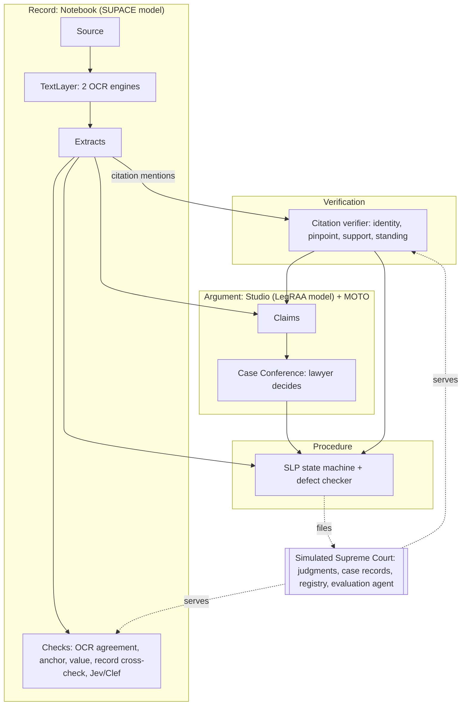

# Architecture

## Four layers of data, four owners

The standard (`standard/schemas/ilo.schema.json`) defines every record. TypeScript types are generated from it (`pnpm codegen`). Every event is validated against it when it is written.

| Layer | Records | Written by | Generative AI? |
|---|---|---|---|
| **Record** (store of truth) | Source, TextLayer, Extract, ExtractCheck | Notebook (lawyer adds sources and reviews) | Never |
| **Verification** | CitationVerification | Citation verifier | Never. Jev/Clef only as a recorded second opinion |
| **Argument** | Claim, ConferenceDecision | Studio and MOTO propose. Lawyer decides in Case Conference | Yes, and only here |
| **Procedure** | Pleading transitions | Pleading state machine | Never |

The ledger enforces the owners (`OWNERS` in `packages/core/src/ledger.ts`). MOTO writing an extract is a thrown error, not a convention.



## Packages

```
standard/            Product 2. JSON Schema, ontology, codegen
packages/core        Generated types, validation, hashing, ledger with ownership, receipts,
                     citation grammar, Jev/Clef port
packages/notebook    Record layer. Text layers, deterministic extractors, checks, review
packages/citations   Verification layer. Four-level citation verification over source tiers
packages/studio      Argument layer. Research, claims, Case Conference, MOTO
packages/pleading    Procedure layer. SLP state machine, Supreme Court defect rules
sim/supreme-court    Product 2 demo. Judgments, case records, source tiers, registry,
                     evaluation agent, golden matter GM-01
apps/workspace       Product 1. React GUI, Playwright tests
apps/cli             ilac: receipt verification backend
```

Packages depend downward only: `core` ← `notebook`, `citations`, `studio`, `pleading` ← `sim`, `workspace`. The Notebook imports nothing from the others.

## Status is derived, never stored

Each layer derives status from the ledger. Checks and decisions bind to the hash of the exact record they judged, so a changed record loses its old checks automatically.

| Layer | Status values |
|---|---|
| Extract | `rejected` (the advocate discarded it, which always wins), `failed` (any check failed), `unresolved` (a check could not decide), `checked` (all pass), `confirmed` (advocate accepted the current version; never possible past a failed check) |
| Citation | Each of identity, pinpoint, support, standing is `verified`, `failed`, `unresolved` or `not_checked` |
| Claim | `proposed`, `accepted`, `rejected`, `deferred`, or `blocked` when anything in `groundedIn` is not verified, confirmed or accepted |
| Pleading | The current state of the SLP machine (see [slp.md](slp.md)) |

## Notebook (record layer, SUPACE model)

Organises the record. Never evaluates the merits.

- **Text layer.** Every page is read by two engines (for example, the PDF text layer and OCR). A line's text is the agreed text. Lines where the engines disagree have empty text and are sent to review.
- **Extractors.** Deterministic rules, each with an ID and version: dates and their role, parties from the cause title, statutes and sections, case numbers, amounts, citation mentions with pinpoint and quote.
- **Checks on every extract:**

| Check | Passes when |
|---|---|
| `ocr-agreement` | Both engines agree on the anchored line |
| `anchor` | The quote is in the agreed line text |
| `value-in-quote` | Re-reading the quote yields the same value |
| `record-crosscheck` | The court's case record agrees (parties, order dates, case number). `unresolved` if the record has no such field |
| `second-opinion` | A Jev/Clef score agrees. `unresolved` if it is unsure, `fail` if it disagrees |

## Citation verifier (verification layer)

Verifies citation mentions the Notebook found. Source tiers in fixed order: Supreme Court official, open corpus, Indian Kanoon. Every verdict records the tier and snapshot that decided it.

| Level | `verified` when | `failed` when | `unresolved` when |
|---|---|---|---|
| Identity | Exactly one judgment matches, and party names in the mention match its title | Party names contradict the title | No tier has it, or more than one judgment matches |
| Pinpoint | The paragraph exists and contains the quote | The paragraph is missing or lacks the quote | `not_checked` with no pinpoint |
| Support | The paragraph's voice is holding, analysis or order, and Jev/Clef agrees with the proposition | The paragraph is counsel's submission, or Jev/Clef says no | Jev/Clef is unsure |
| Standing | No later judgment by an equal or larger bench overrules it | Overruled by a later, equal or larger bench | — |

A citation missing from every source is `unresolved`, never `failed`. Verification reruns on every request and records a new verdict only when it changed, so a newly captured source settles an unresolved citation. The advocate can fetch it from the Supreme Court site in the built-in browser and capture it as a source.

## Studio and MOTO (argument layer, LegRAA model)

- **Research.** Questions over verified extracts and the judgment corpus. Answers cite only anchored paragraphs.
- **Studio** proposes questions of law and grounds from the verified record.
- **MOTO** expands the argument space: counter-arguments, alternative grounds, novel propositions. Each is generated, then validated: every `groundedIn` reference must be verified before it reaches the inbox.
- **Case Conference.** The advocate opens a conference on an agenda of claims and records accept, reject or defer with a written rationale. Only accepted claims can fill the SLP's grounds.

## Pleading (procedure layer)

The SLP is a state machine. See [slp.md](slp.md).

## Simulated Supreme Court

| Part | Role |
|---|---|
| Judgment corpus | Synthetic judgments with numbered paragraphs, voice, bench strength, INSC and SCC citations, treatment between them |
| Source tiers | `sc-official` (complete), `corpus` (a snapshot missing recent judgments), `indian-kanoon` (partial). Same `JudgmentSource` interface the real adapters will use |
| Case-record repository | Case status for the High Court case: parties, order dates, case number |
| Registry | Accepts a filing, runs the same defect rules, verifies the receipt, returns a diary number or defects |
| Second reader | A simulated, calibrated Jev/Clef: agrees with extracts true to the record, disagrees with the rest |
| Evaluation agent | Holds the answer key for each test matter. Grades Notebook extracts, citation verdicts and defects as precision and recall |

The verification code is real. Only the data is simulated. Swapping in the real AWS Open Data corpus changes the source, not the verifier.

## GUI

A React app (`apps/workspace`). One window per matter with panels: Documents, Notebook, Citations, Studio, Case Conference, SLP, Ledger. It runs the packages in-process and subscribes to the ledger. Playwright tests drive it through the golden matter from the first commit. The Electron shell wraps the same app for the Windows installer.

## Storage

One folder per matter: `ledger.db` (SQLite, append-only events, the only truth) and `sources/` (bytes by SHA-256). Everything else is rebuilt from the ledger. The current scaffold keeps the ledger in memory.
