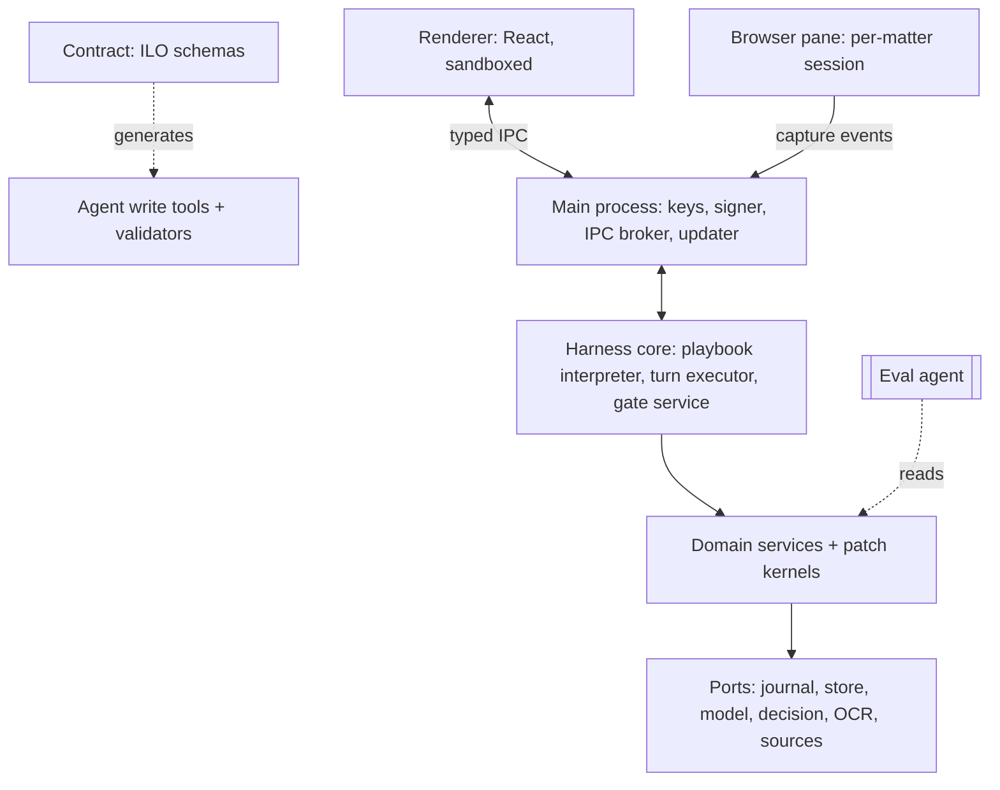
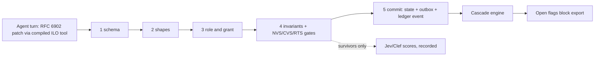

# Architecture

How Vakilbench is built. Condensed from [C3](C3-master-research-and-architecture.md), which holds the full decision register (D1 to D35), component specification and TypeScript contracts. Normative schemas live in [C5](C5-master-standards-and-ontology-plan.md).

## The core idea

One small published contract carries legal meaning, provenance and permission across every boundary. The agent loop, the model, the editor and the vendor are replaceable details behind ports. Agents propose. Deterministic kernels decide and commit. Every commit is a ledger event.

## Layers

| Layer | Owns | Rule |
|---|---|---|
| Contract (ILO v0.1) | JSON Schema 2020-12, JSON-LD contexts, shapes, quote normalisation profile | The only thing every layer agrees on. Types, validators and agent write tools are generated from it (D9) |
| Harness core | In-flight turns and workflow progression | Never writes a domain table |
| Domain services | One kind of state each, with its own patch kernel | State, outbox row and ledger event commit in one SQLite transaction |
| Engines | Notebook, CVS, Studio, MOTO | Domain modules built on the harness |
| Adapters | Bindings for ports | Swappable without changing ILO outputs |
| Workspace UI | Display and capture | Owns nothing persistent |
| Verifier/Eval agent | Conformance measurement | Separate process, held-out data, reads exports and ledger only |

## Process model (Electron on Windows)

| Process | Runs | Security posture |
|---|---|---|
| Main | Windows, IPC broker, key custody (Windows Credential Manager), signer, updater | Holds secrets. Renderer compromise cannot reach keys |
| Renderers | Matter UI, pdf.js viewer with anchor layer, Docxodus editor, review queue, Studio | `sandbox`, `contextIsolation`, no Node |
| Browser pane | Court portals and research sites as `WebContentsView` | `persist:matter-<id>` partition, no preload, emits capture events only |
| Utility processes | Harness core, domain services, engines | Typed IPC only |
| Ingest worker | Parse and OCR (Python sidecar: Docling, PaddleOCR, Tesseract) | No network |
| Eval agent | Conformance measurement | Separate process, different model lineage from the generator |

## Write path

Agents only write through generated tools such as `ilo.proposeNotebookItem`, `ilo.linkAuthority`, `ilo.proposePrecedentEdge` and `ilo.proposeAmendment`. The graph has two layers. The reference layer (judgments, INSC identities, statutes, bench registry, public precedent graph) is read-only to agents. The matter layer accepts agent proposals through the kernel.

## Verification path

Every check that can mark an item `verified` takes the same route (D13, D14, D16):

1. **Deterministic gate.** Vetoes with a reason code. Examples: citation resolves to exactly one judgment, quote found under the normalisation profile, pinpoint paragraph exists, overruling bench strength ≥ cited bench.
2. **Clef-flash triage** on all survivors.
3. **Clef, plus Jev on public text only,** for the ambiguous band or high-stakes types. Scores are recorded, never the sole gate.
4. **Calibrated per-type thresholds** route to auto-pass, unresolved (advocate decides) or fail.
5. **Runtime verifier** from a different model family checks generative claims.
6. **Advocate decision** in W10, then kernel commit and ledger event.

Support checks have four outcomes: SUPPORTED, CONTRADICTED, NOT_FOUND, UNRESOLVED. NOT_FOUND comes only from retrieval and gates, never from a model.

### The three standards

| Standard | Verifies | Gates | Suite |
|---|---|---|---|
| NVS | Notebook facts extracted from the record | G1 to G7 | CT-14 |
| CVS | Citations: existence (L1), pinpoint (L2), support (L3), on two axes | L1, L2 deterministic. L3 scored | CT-04 |
| RTS | Precedent treatment and research traceability | T1 to T5 | CT-15 |

### Citation resolver

Fixed tier order (D24). Every attempt is recorded, including failures.

| Tier | Source | Mechanism |
|---|---|---|
| T1 | Supreme Court official portals | Advocate-driven capture in the built-in browser. Advocate solves any CAPTCHA (D22) |
| T2 | AWS Open Data SC judgments mirror | Local parquet mirror, queried with DuckDB at ingest |
| T3 | Indian Kanoon | Webfetch or API |

A citation outside mirror coverage resolves via T1 or stays `unresolved`. It is never reported `failed`.

## Storage

Per matter, under `%LOCALAPPDATA%\Vakilbench\matters\<id>\` (relocatable):

| Path | Contents |
|---|---|
| `matter.db` | Matters, documents, versions, passages, Notebook items, statements, edges, verification records, precedent edges, approvals, outbox, journal |
| `ledger.db` | Append-only hash chain, separate file |
| `vault/` | Content-addressed source bytes by SHA-256 |
| `responses/` | Content-addressed model and tool responses, for replay |
| `exports/` | Evidence packages |

Shared reference data (AWS SC mirror, ontology, public precedent graph) lives once under `corpus/`.

Engine choices: SQLite with FTS5 and sqlite-vec, typed edge tables and recursive CTEs (D17). No graph database. The ledger is RFC 8785 canonical JSON hashed with SHA-256, with Ed25519-signed checkpoints (D18).

## Data flow, upload to filed document

1. Advocate adds a PDF or DOCX, or captures a page. Document service writes a version and a `DocumentVersionCreated` ledger event.
2. Ingest worker produces passages and evidence references as patches.
3. An extraction turn proposes Notebook items. The kernel runs NVS gates, then Clef-flash scores.
4. Advocate accepts, edits or rejects each item.
5. Advocate researches in the Studio. Authorities pass CVS, treatment passes RTS. MOTO proposes candidate arguments.
6. A drafting turn writes grounds that `dependsOn` statements and authorities, as tracked-change proposals.
7. Citations and statements in the draft are verified. Records carry `attestsHash` of the exact version.
8. The gate requires fresh evidence and zero open flags. Advocate signs the decision.
9. Production emits DOCX, PDF/A, AI-origin manifest and receipt. `ProductionCompleted` lands in the ledger.

## Model access

All model calls pass one choke point (D8).

| Port | Backends |
|---|---|
| `ModelProvider` | OpenRouter (BYO key, provider allowlist, `data_collection: deny`) or a local OpenAI-compatible endpoint (Ollama, llama.cpp, vLLM) |
| `DecisionProvider` | Clef and Clef-flash via OpenRouter Decisions API or local `/v1/systemone`. Jev via its API, public text only until its terms are written |

Confidential matter text goes only to local or self-hosted models unless the matter policy allows otherwise. Clef and Clef-flash share lineage and count as one vote.

## Harness

A custom TypeScript loop under 1,000 lines (D1), behind the `AgentRuntime` port, with OpenAI Agents JS core as the fallback (D7). Workflow progression runs on an embedded SQLite step journal behind `DurableRunner` (D5). Default loop pattern is one bounded turn per step. MOTO and Case Conference use a loop node (D6). External effects wait in an outbox with payload-bound approval (D12).

## Technology choices

| Concern | Choice | Decision |
|---|---|---|
| Language | TypeScript. Python only for OCR and eval sidecars | D2 |
| Shell | Electron, electron-builder NSIS installer, electron-updater | D3 |
| UI | React + TypeScript, pdf.js with our anchor layer | D4 |
| DOCX editor | Docxodus (WASM, .NET sidecar if needed). Word handoff as fallback | D19 |
| PDF | Typst (PDF/A), qpdf, veraPDF | D20 |
| Rules | GoRules Zen decision tables | C3 §3.5 |
| Plugins | First-party in process. Third-party out of process via MCP/OpenAPI, Read/Prepare only | D21 |
| Receipts | DSSE envelopes, Ed25519 | D18, D31 |

## Packaging

Per-user NSIS installer, Authenticode-signed. Auto-update against a static feed with signature checked before apply, on `internal → beta → stable` channels. Python OCR runtime and Docxodus .NET ship as signed bundled sidecars with pinned hashes. Lockfiles, SBOM and build provenance for every release.

## Security

Hardened Electron (sandbox, context isolation, typed and validated IPC), per-matter browser partitions, a network-free ingest worker, data labels with egress rules (`privileged` text never reaches hosted routes), and keys in the OS credential store (D32). CT-09 tests egress. CT-13 tests tool security.

## Open questions that can change this design

Tracked in [README.md](README.md#open-items) and C3 §23.3. The ones with architectural impact:

| Item | Affects | Closed by |
|---|---|---|
| U-06 Docxodus WASM editing fidelity | Editor choice (D19) | Experiment E2 |
| U-07 SQLite page encryption on Windows | At-rest encryption of `matter.db` | Build spike |
| U-09, U-10, U-13 Clef context length and calibration | Scoring thresholds (D16) | Experiment E5 |
| U-11 Jev retention terms | Whether Jev may see matter text | Vendor terms |
| U-12 OpenRouter Decisions API path and retention | `DecisionProvider` adapter | Experiment E6 |
