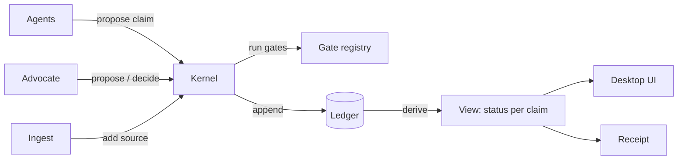

# Architecture

## The foundation: six data shapes

Every feature in the product is built from these. They live in `packages/core/src/types.ts`.

| Shape | What it is |
|---|---|
| **Source** | Immutable bytes, identified by SHA-256. A PDF, a scan, a captured web page, a judgment. |
| **Anchor** | A pointer into a source: page, optional line or paragraph, and the exact quoted text. |
| **Claim** | A typed statement that cites anchors and may depend on other claims. Kinds: `fact`, `citation`, `treatment`, `argument`. |
| **Check** | The result of one gate on one exact version of a claim: `pass`, `fail` or `unresolved`, with a reason. |
| **Decision** | The advocate accepts or rejects one exact version of a claim. |
| **Event** | One entry in the matter's append-only ledger. Each event holds the hash of the previous one. |

Every module is one of these shapes plus a different producer:

| Module | Is really |
|---|---|
| Notebook | Agents propose `fact` claims from the record |
| Citation verifier | `citation` claims plus resolver gates |
| Research Studio | `treatment` claims between citations |
| MOTO argument engine | An agent that proposes `argument` claims |
| Review queue | A list of claims whose status is `pending` or `unresolved` |
| Editor | Each saved document version becomes a new source |
| Receipt export | A signed list of verified claim hashes plus the document hash |

The research docs describe three verification standards (NVS, CVS, RTS). They are the same shape: a claim, its anchors and its checks. Only the gates differ by kind.

## Status is computed, never stored

`view(events).status(id)` derives each claim's status from the ledger:

| Status | When |
|---|---|
| `failed` | A gate failed on the current version |
| `unresolved` | A gate could not decide (for example, the source is missing) |
| `rejected` | The advocate rejected the current version |
| `pending` | Gates pass, waiting on the advocate |
| `blocked` | Accepted, but something it depends on is not verified |
| `verified` | Gates pass, advocate accepted, and every dependency is verified |

Checks and decisions bind to the claim's hash. Edit the claim and its hash changes, so old checks and acceptances no longer count. Staleness and cascade fall out of the data. There is no invalidation code.

## One writer



- The **kernel** (`packages/core/src/kernel.ts`) is the only code that appends to a ledger.
- Agents can propose claims. Only an actor of kind `lawyer` can decide. The kernel enforces this.
- Gates run inside the kernel on every proposal. Their results are events too.
- Concurrency rule: one kernel per matter, in one process. Agents, the UI and ingest send requests to it. Nothing else writes the matter.

## Gates

A gate is a pure function from a claim and its sources to an outcome. The registry maps each claim kind to its gates.

| Kind | Gates today | Gates to add |
|---|---|---|
| `fact` | `anchored` (every quote is found in its source) | dates and parties match the quoted text |
| `citation` | `citation-parses`, `anchored` | resolves to one judgment, pinpoint paragraph exists |
| `treatment` | `anchored` | "overruled" needs a larger or equal bench and a later date |
| `argument` | `anchored` | every dependency is a verified citation or fact |

AI scoring models may rank or route claims. They never replace a gate.

## Processes

| Process | Does |
|---|---|
| Desktop app (Electron, Windows) | Shows matters, documents, claims and drafts. Holds keys. Talks to the kernel. |
| Kernel | Owns the ledger and runs gates. One per open matter. |
| Agents | Call a model (OpenRouter or a local endpoint) and propose claims. |
| Ingest worker | Turns files into page text. No network. |
| Built-in browser | Opens court sites. The advocate solves CAPTCHAs. Captures become sources. |
| `ilac` CLI | Verifies a receipt offline. Depends only on `core`. |

## Storage

One folder per matter:

```
matter/
  ledger.db    SQLite, append-only events (the only truth)
  sources/     bytes stored by SHA-256
```

Everything else (status, search indexes, the case graph) is rebuilt from these two.

## Receipt

A receipt is the hash of the filed document, the ledger head, and each verified claim's ID, hash and status, signed with Ed25519. `ilac verify` checks the signature and, given the document, that its bytes match. Nothing from the draft is uploaded to verify it.
