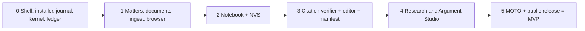

# Implementation Plan

What gets built, in what order, and how each step is proved. Condensed from [C3 §21 to §23](C3-master-research-and-architecture.md) and [C4 §2](C4-master-product-plan.md).

## Rules for every stage

1. **Vertical slices.** Each stage ships running code in the Windows app and extends the same golden matter, GM-01 (a synthetic SLP (Crl) bail matter).
2. **Proof, not dates.** A stage closes only on a signed receipt bundle naming the commit, the conformance suite results and the Eval agent's report (D34).
3. **Builders never grade themselves.** Held-out data (GM-02 onward, gold sets, planted defects) lives outside the build repository and belongs to the Eval agent.
4. **Contract first.** Schemas change before code. Types, validators and agent tools regenerate from them.

## Stage map



## Stage 0. Shell, installer, journal

**Goal.** A signed installer puts the app on a clean Windows machine. A trivial playbook runs on the journal, proposes patches through a generated tool, the kernel commits them with ledger events, a gate refuses stale evidence, and a signed run manifest is emitted.

**Build.**
- Hardened Electron shell, NSIS installer, internal update channel, typed IPC.
- OpenRouter key in Windows Credential Manager. `ModelProvider` and `DecisionProvider` with a recorded-fixture backend.
- ILO 0.1 core schemas, codegen, tool compiler.
- RFC 8785 hashing and the quote normalisation profile.
- Patch kernel. Playbook interpreter with `task`, `gate`, `outbox`. Custom loop. Response store.
- Ledger, chain verifier, DSSE, `ilac` CLI. Eval agent skeleton.

**Prove.** CT-01. Install, upgrade and uninstall on Windows 10 and 11. Kill-at-gate chaos over ≥ 1,000 faults with zero duplicate or missing ledger events. Zero stale approvals accepted. Loop under 1,000 lines. Unsigned update refused.

## Stage 1. Matters, documents, ingest

**Goal.** An advocate creates a matter, adds files or browser captures, and every passage has a resolvable evidence reference. The CLI round-trips the evidence package.

**Build.** Matter, document and vault services. Ingest utility process with the bundled Python OCR sidecar. Line model and paragraph schemes. pdf.js anchor layer. Browser pane with BrowserCapture. Evidence package export and import. AWS SC mirror sync, corpus profiling job, ontology seed from SC and HC metadata.

**Prove.** CT-03 at 100%. Anchors survive re-OCR at ≥ 99%. OCR error targets from the corpus profile met. Hostile-file fuzzing. Zero sandbox escapes in the Electron audit.

## Stage 2. Notebook and NVS

**Goal.** The Notebook extracts typed items from GM-01's record. NVS gates block fabrication. Clef routes items. The advocate accepts them in the Notebook editor. The chatbot answers only from anchored items.

**Build.** Extraction task contracts. NVS gates G1 to G7 in the kernel. Decision cascade and calibrator with an initial labelled set. Notebook editor, chatbot, review UI. One agent plus runtime verifier. Retrieval (FTS5, sqlite-vec, reciprocal rank fusion, graph expansion).

**Prove.** CT-14. 100% of planted failures caught (fabricated dates, names and amounts, unanchored items, swapped relation direction, allegation typed as fact). Zero items reach `verified` on gate failure even with scores forced high. Signed Eval agent NVS report.

## Stage 3. Citation verifier, editor, manifest

**Goal.** Every citation in a GM-01 draft has a two-axis verification record. Agent edits arrive as tracked changes. Export is gated by freshness and cascade. Produced documents carry a hash-bound AI-origin manifest and receipt.

**Build.** INSC and SCR parser, equivalence table, coverage window. Resolver T1 (SC portal capture extractors), T2 (AWS mirror), T3 (Indian Kanoon). L1 and L2 deterministic, L3 scored. Docxodus editor with proposals and reversibility proofs. Defect checker (SC subset and masking). Cascade engine. Production (DOCX, PDF/A, paper book). Manifest and receipt per Reg 43(3) and (4). Outbox.

**Prove.** CT-02 at ≥ 99% for INSC and ≥ 97% for report citations. CT-04, CT-08, CT-09. Existence recall ≥ 99% within coverage, pinpoint recall ≥ 90%. Zero false `verified` on misquotes. Zero `failed` on out-of-coverage plants. Receipt re-verifies offline with the CLI. Signed Eval agent CVS report.

## Stage 4. Research and Argument Studio

**Goal.** The advocate researches an issue over the SC corpus and the matter record, sees authorities with anchored treatment, builds an argument board and runs a Case Conference.

**Build.** Judgment AST and reference extraction. Research organisation and Q&A. Precedent graph with RTS gates T1 to T5. Treatment classification and negative-treatment queue, backfilled over the SC corpus. Provision version intervals for IPC/BNS, CrPC/BNSS, IEA/BSA. Argument board. Case Conference playbook.

**Prove.** CT-06 (IPC 302 vs BNS 103 across 30 June and 1 July 2024), CT-12, CT-15. Zero "overruled" shown without an anchor and bench check. 100% of amendment conflicts flagged. Signed Eval agent RTS report.

## Stage 5. MOTO and public release

**Goal.** MOTO explores candidate arguments that land in the Studio inbox. The golden matter runs end to end. A signed public Windows release ships with auto-update. **MVP complete.**

**Build.** `@vakil/moto` package, playbooks, validators. Studio inbox. Full GM-01 script. Held-out GM-02. Stable release channel, SBOM, attribution annex.

**Prove.** The 15-step acceptance script in [C4 §2.3](C4-master-product-plan.md) passes on GM-02. All CT suites green. Zero action-level prompt-injection success. An external reviewer verifies receipts offline on a clean machine. Blind review of the produced filing by an Advocate on Record.

## First engineering tasks

In order, from C3 §23.2:

1. Hardened Electron shell with signed NSIS build, internal update channel, typed IPC and Credential Manager key storage.
2. ILO 0.1 core schemas, codegen and tool compiler. RFC 8785 hashing, normalisation profile and INSC/SCR parser with published test vectors.
3. Ledger, chain verifier and `ilac` CLI. SQLite journal interpreter with `task`, `gate`, `outbox`. Run experiment E1.
4. OpenRouter `ModelProvider` and `DecisionProvider` with the local backend and response store. Run E5 and E6.
5. Mirror the AWS SC metadata, run the profiling job, seed the ontology from its fields, publish the profile as the Stage 1 to 3 baseline.
6. Scaffold `@vakil/eval` with the first held-out set and planted-defect generators, in a repository the builders' agents cannot read.

## Experiments that gate decisions

| # | Experiment | Decides | Pass condition |
|---|---|---|---|
| E1 | Custom loop vs OpenAI Agents core on the SQLite journal, with kills mid-gate and mid-commit | D1, D5, D7, D10, D13 | Zero duplicate ledger writes, identical ILO outputs, stale approval refused |
| E2 | Docxodus in Electron over ≥ 50 SC filings | D19 | DOCX fidelity targets met and editing usable. Else Word handoff becomes the editing surface |
| E3 | Patch kernel vs direct structured output | D9, D10 | Zero schema-invalid commits at no more tokens and no lower F1 |
| E4 | BrowserCapture on the three SC portals and Indian Kanoon | D22, D24 | Captures re-verify. No CAPTCHA automation reachable from agent code |
| E5 | Clef context length and calibration, hosted vs local | D16 | Honoured context known per route. Calibration error within target |
| E6 | OpenRouter route pinning and failover | D8 | Recorded provider matches policy on 100% of calls |

## Proposed repository layout

Not yet decided in the canon. A starting point that follows the package names C3 and C5 already use:

```
apps/desktop/          Electron main, renderer, preload, installer config
packages/ilo/          ILO schemas and codegen (source of @ilac/ontology)
packages/ilac-*/       Commons SDKs: evidence, notebook, verification, precedent, conformance
packages/harness/      Loop, playbook interpreter, gate service, kernels
packages/services/     Matter, document, vault, ledger, outbox, production
packages/moto/         @vakil/moto
cli/ilac/              Offline verifier, built against the spec only
sidecars/ocr/          Python OCR and layout worker
docs/                  Canon (C1 to C5) and these summaries
```

`@vakil/eval` and held-out data live in a separate repository by design.

