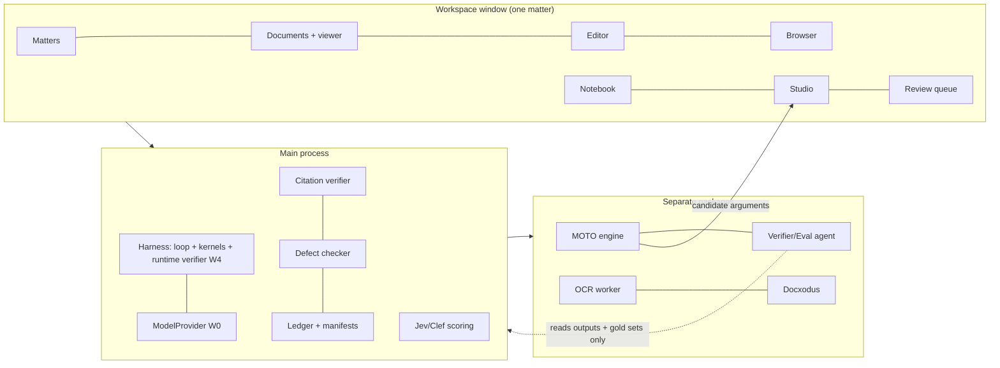

# Master Product Plan: Vakilbench (Open Code of Litigation)

*Canonical document C4 of 5. Companion canon: `C1-literature-review.md` (papers and policy), `C2-prior-art-repos-review.md` (repositories used as inputs), `C3-master-research-and-architecture.md` (architecture, contracts, data model, decision register, roadmap), `C5-master-standards-and-ontology-plan.md` (ULOS schemas, ontology, NVS/CVS/RTS, INSC resolver, manifest and receipt, conformance suites CT-01 to CT-16). Decision IDs (D1 to D35) and stages (Stage 0 to 5, P1 to P4) are those of the C3 register. Current to 30 October 2026.*

## 0. How to read this plan

This plan decides what the product is, which modules it has, what each must do, how each is accepted, and in which stage each is built. Architecture is in C3; normative schemas and conformance suites are in C5 and are referred to here by ID.

**Labels.** [F] fact from a primary source; [S] finding from inspected source code or a fetched page; [A] academic finding (C1); [I] inference; [R] recommendation. Unlabelled statements inside module specifications are [R]. Numeric targets are proposed and recalibrated once a baseline exists; "baseline first" marks targets with no baseline yet.

**Conformance suites** (C5): CT-01 schema and shape; CT-02 identifiers; CT-03 evidence-package round trip; CT-04 citation verification reporting; CT-05 resolver order; CT-06 temporal law; CT-07 permissions; CT-08 manifest and receipt integrity; CT-09 egress; CT-10 cascade invalidation; CT-11 competency questions; CT-12 treatment; CT-13 tool security; CT-14 Notebook Verification Standard (NVS); CT-15 research and precedent traceability (RTS); CT-16 Jev/Clef advisory scoring (scores recorded, never move an item past a failed gate). All sixteen are MVP suites.

**Golden matters.** GM-01 is the build golden matter extended stage by stage. GM-02 is held out, authored outside the build, and used only for the Stage 5 acceptance run.

**Regulatory anchor.** The Supreme Court's draft Regulations for Use of AI in Courts were circulated for comment on 3 June 2026 and are not notified [F]. Reg 3(1)(y) requires verification of AI output (through a centralised mechanism to be designated); Reg 43(3) requires disclosure of AI-assisted character at submission; Reg 43(4) lets the Court require disclosure of the system used, the nature and extent of assistance, and the steps taken to verify accuracy; Reg 43(6) places full responsibility on the filer [F]. The AI-origin manifest and verification receipt are designed directly from the text of Reg 43(3) and 43(4) (D31).

## 1. The product in one page

**Vakilbench** is an open-source, local-first litigation workspace for an Indian advocate: "Open Code of Litigation", OpenCode for law. It ships as a **Windows desktop application**: an Electron app delivered as a signed `.exe` installer with auto-update, with the complete harness source open (D3). One workspace per matter holds the matter's documents and evidence, its Notebook and case graph, citation and defect checkers, a Research & Argument Studio with a precedent graph and Case Conference, a separate argument-hypothesis engine, a built-in Chromium browser, a built-in DOCX editor, and a hash-chained ledger that exports a verification manifest with each filing. The lawyer brings an OpenRouter key or a local model (D8). There is no server, account or gateway in the MVP (D33).

Vakilbench is also the first conforming implementation of an **open verification standard**: three Commons standards, NVS (Notebook facts), CVS (citations) and RTS (research and precedent traceability) (D23), against which facts, citations and treatment can be checked as Supreme Court practice requires. The standards, SDK, `ulos` CLI and conformance suites ship with the MVP.

**Guarantees enforced in code, not by model judgement:**
- Agents never write the record. They submit typed patch proposals through schema-compiled tools; a deterministic kernel validates and commits each with a ledger event (D9, D10).
- Every fact, quote and citation is anchored to a hashed source at page, paragraph and line, and compared deterministically.
- Deterministic gates decide; Jev and Clef score only what passes the gates and never act as the sole gate (D16).
- No agent verifies its own output: one generating agent plus an independent runtime verifier from a different model family (D14), and a separate Verifier/Eval agent that measures conformance and closes stages (D15).
- Every AI edit to a document is a tracked-change proposal the lawyer accepts or rejects (D19).
- Every citation is resolved in a fixed order (SC official → AWS Open Data → Indian Kanoon) and every attempt, including failures, is recorded (D24). The software never bypasses a CAPTCHA (D22).
- Every "verified" or "ready" state needs fresh evidence bound by hash to the exact version (D13); retractions cascade (D11).
- Every filing can export an AI-origin manifest and receipt bound to the exact PDF bytes (D31).

**Out of scope:** model training; win-probability, outcome or judge prediction.

## 2. The MVP

### 2.1 Definition

The MVP is the Windows application with all modules in §4 at MVP scope, built across **Stage 0 to Stage 5**, and released as a signed public Windows installer. Stage 5 closing is MVP complete.

| Module | Name | Stage |
|---|---|---|
| W0 | Workspace shell, model access, settings, Windows installer | 0 |
| W1 | Matters | 1 |
| W2 | Documents and evidence | 1 |
| W7 | Built-in browser | 1 (capture), 3 (SC portal path) |
| W3 | Notebook & case graph (SUPACE-referenced) | 2 |
| W4 | Agent runtime: research and drafting agents, runtime verifier | 2 (runtime), 3 (drafting) |
| W10 | Review and verification UI | 2 |
| W5 | Citation verifier (CVS) | 3 |
| W6 | Defect checker | 3 |
| W8 | Editor (Docxodus) | 3 |
| W9 | Ledger and verification-manifest export | 0 (chain), 3 (manifest, receipt) |
| W11 | Research & Argument Studio (LegRAA-referenced research layer, precedent graph, Case Conference) | 4 |
| W12 | MOTO Argument Hypothesis Exploration Engine (separate module) | 5 |
| W13 | Verifier/Eval agent (separate) | 0 (skeleton), each stage (reports) |
| W14 | Decision scoring service (Jev/Clef) | 2 |

### 2.2 Stages

| Stage | Name | Delivers | Closes on |
|---|---|---|---|
| Stage 0 | Windows shell, installer, journal | Hardened Electron shell; signed NSIS installer and internal auto-update channel; typed IPC; BYO key in Windows Credential Manager; OpenRouter and local endpoint adapter; SQLite step journal; ULOS core schemas and tool compiler; patch kernel; ledger chain and `ulos` CLI; Verifier/Eval agent skeleton | CT-01; installer installs, updates and uninstalls cleanly on Windows 10/11; kill-and-resume with zero duplicate ledger events |
| Stage 1 | Matters, documents, ingest | Matter service; vault (CAS); document version DAG; ingest worker (Python OCR sidecar); line model; paragraph schemes incl. `ReporterBlock`; anchors and selectors; pdf.js anchor layer; evidence-package export/import; AWS SC corpus mirror and profiling; ontology seed from SC/HC metadata; built-in browser with BrowserCapture | CT-03; anchors survive re-OCR ≥ 99% |
| Stage 2 | Notebook + NVS | Logic-gate extraction; NVS gates G1 to G7; Jev/Clef extraction scoring; Notebook editor; anchored chatbot; review UI; one agent plus runtime verifier; retrieval | CT-14; Eval agent NVS report |
| Stage 3 | Citation verifier CVS + editor + manifest | INSC parser; resolver T1 → T2 → T3; L1/L2 deterministic; L3 with Jev/Clef and generative assessor; Docxodus editor with tracked-change proposals; defect checker; cascade engine; DOCX and PDF/A production; AI-origin manifest and receipt; outbox | CT-02, CT-04, CT-08, CT-09; GM-01 end to end; Eval agent CVS report |
| Stage 4 | Research & Argument Studio | LegRAA-referenced research layer; precedent graph with treatment and RTS gates T1 to T5; Jev/Clef treatment classification; temporal law (IPC/BNS, CrPC/BNSS, IEA/BSA); Case Conference | CT-06, CT-12, CT-15; Eval agent RTS report |
| Stage 5 | MOTO engine + Windows release | MOTO engine feeding candidate arguments into the Studio; full GM-01/GM-02 run; signed public Windows installer with auto-update | All CT suites green; held-out GM-02; external reviewer verifies receipts offline; signed release published = **MVP complete** |

A stage closes only on a signed receipt bundle: commit hash, CT results and the Eval agent's report (D34).

### 2.3 Acceptance script (Stage 5, on GM-02)

Run on a clean Windows 10 or 11 machine by an advocate outside the build team.

| # | Step | Modules | Pass condition |
|---|---|---|---|
| 1 | Install from the signed `.exe`; enter an OpenRouter key or a local endpoint | W0 | Installer signature valid; key stored in Windows Credential Manager; no outbound call before a model is configured (CT-09) |
| 2 | Create a matter (SC, SLP(Crl)) | W1 | Matter, profile and governing-date rule recorded as ledger events |
| 3 | Drop in PDFs, scans and DOCX | W2 | Each file hashed into the vault; every page has a line model; low-confidence pages flagged |
| 4 | Run the Notebook logic gate; accept or edit items | W3, W14, W10 | Every item shown `verified` passes NVS G1 to G7; planted fabricated date and unanchored synopsis line blocked; Jev/Clef scores recorded and shown separately from status |
| 5 | Ask "what does the impugned order say about custody?" | W3, W4 | Every answer sentence anchored to an exact line |
| 6 | Draft a synopsis with six SC citations | W8, W5 | Each citation has an audit card with L1, L2 and L3 outcomes and the resolving source |
| 7 | One citation is newer than the AWS snapshot | W5, W7 | SC page opens in the built-in browser; the lawyer solves the CAPTCHA; PDF captured and hashed; L1 verified at authority level A |
| 8 | One citation has a wrong pinpoint; one cites counsel's submission as a holding (planted) | W5, W14 | L2 `failed: wrong_pinpoint`; voice check flags the submission; neither shown verified |
| 9 | Research the bail question in the Studio | W11 | Research memo with authorities, treatment edges anchored to citing paragraphs, a "not searched" list; one planted overruled authority flagged |
| 10 | Run the MOTO engine on ground C; take candidates to Case Conference | W12, W11 | Candidates arrive as proposals with verified citations; the lawyer accepts one and rejects one; decisions logged with snapshot hash |
| 11 | Ask the drafting agent to strengthen ground C from the accepted argument | W4, W8 | Tracked-change proposal with provenance comment; nothing applied until accepted |
| 12 | Run the defect check | W6 | Defect memo by SC Registry category, each with a rule citation |
| 13 | Review queue | W10 | Unresolved items cannot be bulk-approved; overrides need a rationale |
| 14 | Export the filing package | W9 | DOCX/PDF + AI-origin manifest + receipt + declaration draft; `ulos verify` passes on a second machine; one changed PDF byte fails it (CT-08) |
| 15 | Kill the app mid-proposal; reopen | W0, W9 | Run resumes; zero duplicate or missing ledger events |

### 2.4 MVP exit gates

1. Acceptance script §2.3 passes on GM-02.
2. CT-01 to CT-16 green in CI on Windows 10 and 11.
3. Eval agent (W13) reports for NVS, CVS and RTS on held-out sets meet each module's acceptance targets.
4. INSC resolver: L1 existence recall ≥ 99%, L2 pinpoint recall ≥ 90%, zero false `verified` on planted misquotes.
5. The `ulos` CLI, written against the spec rather than app internals, verifies every package the app emits.
6. Signed public installer published; auto-update from the previous build succeeds; uninstall leaves matter folders intact.

## 3. Product shape

One Electron application (D3, D4):

- **Main process (Node, TypeScript):** harness (custom agent loop, playbook interpreter, patch kernels; D1, D6), SQLite matter store with FTS5 and sqlite-vec (D17), step journal behind `DurableRunner` (D5), hash-chained ledger (D18), `ModelProvider` choke point to OpenRouter or a local OpenAI-compatible endpoint (D8), egress guard, outbox (D12).
- **Utility processes and sidecars:** Python OCR/layout worker with no network (D2, D32); Docxodus engine (WASM, .NET sidecar if needed; D19); MOTO engine and Verifier/Eval agent as separate packages.
- **Renderer (React, sandboxed, no Node):** matter workspace, pdf.js viewer with anchor layer, editor, Notebook, Studio, review queues; built-in browser as `WebContentsView` in a per-matter session partition (D32).



**SUPACE and LegRAA** are the Supreme Court's own AI tools; their internals are not public. Vakilbench uses only their publicly described functions as references: SUPACE for Notebook document intelligence (W3), LegRAA for the research layer and human-in-the-loop argument work (W11) (D28). The code is our own, built from available repositories (C2). Because there is no reference implementation, conformance is measured against the published NVS/CVS/RTS standards by the separate Eval agent (W13).

**Ontology.** ULOS is built from the Supreme Court judgments dataset metadata (AWS Open Data parquet fields: title, petitioner, respondent, judge, author_judge, citation, case_id, cnr, decision_date, disposal_nature, nc_display, path and others) plus the High Court dataset, and from scratch where metadata is missing. JSON Schema 2020-12, JSON-LD, PROV-O and W3C Web Annotation selectors are the format standards; Akoma Ntoso is optional for statutes; the Law and Justice Wiki is a non-normative glossary (D29; C5).

**Language.** Supreme Court records are in English (official translations exist separately, for example through SUVAS). The MVP targets English documents; Hindi and regional-language OCR and records are post-MVP (P3, with High Courts and district courts).

### 3.1 Verification architecture common to all modules

Every check that can mark an item `verified` follows the same path (D13, D14, D16):

```
proposal ─► deterministic gate (veto, reason code) ─fail─► FAILED / NOT_FOUND
                │ pass
                ▼
        Clef-flash triage (all items)
                │ ambiguous band or high-stakes type
                ▼
        Clef 27B (+ Jev on public text only) ─► recorded scores
                │
                ▼
   calibrated per-type thresholds ─► AUTO-PASS / UNRESOLVED (lawyer) / FAIL
                │
                ▼
   runtime verifier (different model family) for generative claims
                │
                ▼
   lawyer decision in W10 ─► kernel commit + ledger event
```

- **Deterministic gates** are never overridden by a model: citation parses and resolves to one judgment; quoted string found under the quote-normalisation profile; pinpoint paragraph exists; date parses and appears in the passage; party matches the matter party registry (alias table); for overruling, citing bench strength ≥ cited and citing date later; statutory section exists in the version in force on the governing date.
- **Jev/Clef** (System One decision models: `state` plus 1 to 64 typed questions of kinds `noul`, `choice` and `score`, returning probabilities and no rationale) score what survives. Scores are stored on the item with model ID and version as returned. Thresholds are set per question type on lawyer-labelled sets with conformal risk control (target error among auto-passed items ≤ 2% for citations and negative treatment, ≤ 5% for Notebook facts); three paraphrases per question, and a swing above 0.15 routes the item to UNRESOLVED.
- **Explanations** a lawyer reads come from deterministic reason codes or a generative reviewer told which flag fired, never from Jev/Clef.
- **Confidentiality routing:** Jev only on public text (judgments, statutes) until TypeSafe publishes written retention terms; confidential matter text goes to local Ollama (`/v1/systemone`) or a self-hosted Clef; hosted Clef through OpenRouter's Decisions API only for public text or when the lawyer's matter policy allows.
- **Independence:** Clef and Clef-flash share Qwen lineage and count as one vote; a Qwen-family generator is never judged by Clef alone.
- **Four-state output** for support checks: SUPPORTED / CONTRADICTED / NOT_FOUND / UNRESOLVED. NOT_FOUND comes only from retrieval and gates.
- **Separate Eval agent (W13)** measures each module against its standard on held-out gold and planted-defect sets, with Clef/Jev as its cheap scoring layer paired with a non-Qwen judge and encoder NLI; its reports close stages.

## 4. MVP modules

Each module is specified under the same headings: purpose; capabilities; components; data; agents; verification (deterministic gates, Jev/Clef use, Eval-agent measurement); acceptance criteria; failure modes; stage. Contracts and schemas named here are defined in C3 and C5.

### W0. Workspace shell, model access, settings, Windows installer

**Purpose.** One local window per matter that installs like any Windows program, works offline, uses the lawyer's own model, and sends nothing the lawyer did not authorise.

**Capabilities.**
- Signed Windows `.exe` installer (NSIS via electron-builder) for Windows 10 and 11; per-user install without admin rights; auto-update via electron-updater with signed releases (can be disabled); clean uninstall that leaves matter folders.
- Matter picker; per-matter window; command palette; keyboard-first navigation.
- Model settings: OpenRouter key (chat and Decisions API) or local OpenAI-compatible endpoint (Ollama, llama.cpp, vLLM, including `/v1/systemone`); per-role model choice (generator, runtime verifier, Jev/Clef scorer); warning when generator and verifier share a model family; monthly spend cap.
- Status bar: active models, network state, and "nothing leaves this machine except calls to: [list]"; activity panel listing every outbound request.
- Matter confidentiality flag that controls routing (hosted vs local) for every model call on that matter.

**Components.** Hardened Electron main/renderer split (context isolation, sandboxed renderer, no Node in renderer, strict CSP, typed IPC); `ModelProvider` with OpenRouter and local adapters as the single choke point; egress guard enforcing an allowlist on all main-process traffic; Windows Credential Manager key store via `safeStorage`; SQLite step journal behind `DurableRunner`; update service; crash recovery.

**Data.** `ProviderConfig {id, kind: openrouter|local, endpoint, model, roles[], family, budget}`; `ModelCall {call_id, manifest_hash, provider, model@version, tokens, cost, started_at, ended_at}`; `EgressEvent {dest_host, purpose, matter_id?, bytes, initiated_by: user|agent}`; `JournalStep {run_id, step_no, input_hash, output_hash, status}`.

**Agents.** None; W0 hosts agents and owns no legal state.

**Verification.** CT-09 egress audit under deny-all firewall; CT-01 schema; kill-at-random chaos on the journal; Eval agent checks that every model call in a run has a manifest hash and model version.

**Acceptance.**
- Installer signature valid; install, update (N-1 → N) and uninstall succeed on clean Windows 10 and 11 images on 100% of CI runs.
- Zero outbound connections not listed in the activity panel during the CT-09 run.
- Cold start to usable matter window ≤ 5 s on the reference laptop (8 GB RAM, Windows 11); installer size budget set after the Stage 0 baseline.
- 100% of model calls carry a manifest hash and model version; generator and verifier from different families on 100% of verification calls when two families are configured, with a visible warning otherwise.
- Kill-and-resume: zero duplicate or missing ledger events over ≥ 1,000 random kills.

**Failure modes.** SmartScreen and antivirus false positives on a new signing certificate (EV certificate, submit builds for reputation); provider outages (surface; never fall back silently to an unapproved provider); local model too weak for verification (show per-model verifier quality from W13 reports); Python sidecar packaging breaking the installer.

**Stage.** Stage 0.

### W1. Matters

**Purpose.** Make the matter the unit of everything: files, Notebook, runs, drafts, research, decisions and exports live inside one matter.

**Capabilities.** Create a matter with forum (SC; HC as parse-only), case type from the SC case-type list, parties and aliases, our side, stage, and governing-date rule (offence date, cause-of-action date, filing date, manual) so statute lookups are point-in-time. Matter dashboard (documents, open review items, citations by status, research issues, drafts, last export). Export and import a matter as an ULOS evidence package (CT-03). Linked matters for appeal and transfer chains.

**Components.** Matter service; profile composer (forum pack + matter-type pack, e.g. "SC + criminal bail"); package exporter/importer; party registry with alias table (used by W3 and W5 gates).

**Data.** `Matter {matter_id, forum, case_type, parties[], our_side, stage, governing_date_rule, confidentiality, profile_hash, created_at}`; `Party {role, name, aliases[]}`; `ProfileComposition {packs[], hash}`; `MatterLink {from, to, kind}`.

**Agents.** Matter analyst proposes parties, case type and governing date from ingested documents; the lawyer confirms; commit through the kernel.

**Verification.** Deterministic: case type from the controlled vocabulary; party records shaped per C5; governing-date change triggers cascade re-flagging (CT-10). Eval agent: CT-03 round trip with the CLI as independent importer.

**Acceptance.** CT-03 100% on fixtures (work, paragraph, quote and provenance preserved); a profile patch that disables statutory victim masking is rejected on 100% of attempts; governing-date change re-flags 100% of affected statute lookups.

**Failure modes.** Matters spanning forums (modelled as linked matters); matter folder moved outside the app (detected by vault hashes and re-linked).

**Stage.** Stage 1.

### W2. Documents and evidence

**Purpose.** Turn every file in a matter into immutable, line-anchored, confidence-flagged source material any module can cite and any outsider can re-check.

**Capabilities.** Drag-and-drop ingestion of PDF (born-digital and scanned English), DOCX and images; OCR with page, paragraph and line anchors; low-confidence and handwritten pages flagged for a typed copy; document classification (petition, impugned order, FIR, charge-sheet, annexure, affidavit, correspondence, judgment); duplicate and successive-draft detection with comparison; viewer with exact-line highlighting; "copy as citation" giving `{doc, page, para, lines}` with the quote; exhibit and annexure list with marking (P-1, R-3, A-5); statutory victim-identity masking (BNS ss.64 to 71, POCSO).

**Components.** Format detection; born-digital extraction with character boxes (pypdfium2, pdfplumber); OCR anchor layer (PaddleOCR or Tesseract) with word boxes and confidence; Docling for layout and tables; DOCX redline capture before any accepted-view parse; paragraph detector with schemes (`court-printed`, `derived`, `ReporterBlock`); selector resolver with quote fallback; de-identification (Presidio with Indian recognisers for CNR, FIR, police station, mobile numbers); vault (content-addressed store); document version DAG; pdf.js anchor layer.

**Data.** `SourceBlob {sha256, mime, origin: disk|browser_capture|editor, received_at}`; `Page {no, raster_hash}`; `Line {line_no, polygon, text, conf, engine@ver, hash}`; `Passage {para_no, scheme, lines[]}`; `EvidenceReference` with W3C Web Annotation selector chain (TextQuote, TextPosition, Fragment); `Exhibit {mark, blob, description}`.

**Agents.** Matter analyst proposes classification and exhibit marking; proposals pass the runtime verifier before commit.

**Verification.** Deterministic: hash on ingest; idempotent per blob; anchor resolution; re-OCR diff never moves an anchor. Eval agent: OCR gold set of SC paper books, FIR copies and certified copies scored by CER and catastrophic-page rate; anchor precision; CT-03.

**Acceptance.** Median CER on printed English ≤ 2% at Stage 1 and ≤ 1% at MVP exit (baseline first); catastrophic-page rate ≤ 1% with every page above threshold flagged; anchor precision ≥ 99.5% on quoted spans; anchor survival after re-OCR ≥ 99%; zero victim-identifying tokens in masked output on the audit set; handwritten pages flagged on 100%; zero sandbox escapes in hostile-file fuzzing; citation chip scrolls to the line in ≤ 150 ms.

**Failure modes.** Stamps and seals over text; dim certified copies; redlines lost by accepted-view parsers; non-English annexures in SC records (flagged for a typed translation; not OCR-targeted in the MVP).

**Stage.** Stage 1.

### W7. Built-in browser

**Purpose.** Let the advocate use court portals and research sites inside the matter, capturing what they choose with hash and provenance, without the software ever bypassing an access control.

**Capabilities.** Tabbed Chromium browser in the matter window; bookmarks for sci.gov.in (neutral citation, case number, case status, cause list), scr.sci.gov.in, India Code, Gazette, Indian Kanoon; "capture to matter" for a page or PDF (bytes, SHA-256, URL, timestamp, screenshot fingerprint); "verify on SC site" opened by W5 with fields pre-filled; side-by-side browser and editor; selection → "add as evidence" or "check this citation"; download interception offering capture; Indian Kanoon webfetch triggered by the user from W5.

**Components.** `WebContentsView` per tab in a per-matter partitioned session; BrowserCapture service; download hooks; deterministic portal readers for sci.gov.in and scr.sci.gov.in result pages after the lawyer solves the CAPTCHA; injection guard (fetched content is data; any agent action derived from it needs confirmation).

**Data.** `Capture {url, fetched_at, sha256, mime, screenshot_hash, session_partition, initiated_by: user}`; `PortalReadResult {portal, fields, raw_html_hash}`.

**Agents.** Agents may request a fetch; only the lawyer navigates and solves CAPTCHAs. No autonomous form submission, payment or CAPTCHA solving (D22).

**Verification.** Deterministic: capture hash and attribution; runtime assertion and code audit for zero automated CAPTCHA attempts; CT-13 tool security. Eval agent: ~50-task portal suite; red-team pages with injected instructions.

**Acceptance.** Capture attribution correct on ≥ 99% of tasks; zero consequential actions triggered by injected content; zero automated CAPTCHA attempts; SC verification round trip (open → lawyer solves → captured → W5 verdict) in ≤ 3 user actions after the CAPTCHA.

**Failure modes.** Portal layout changes (fallback: lawyer downloads the PDF and the app hashes it); portals blocking embedded Chromium (standard Chrome UA, no further spoofing).

**Stage.** Stage 1 (tabs, capture); Stage 3 (SC portal readers, W5 integration).

### W3. Notebook & case graph (SUPACE-referenced)

The Notebook mirrors the publicly described SUPACE workflow: file preview (searchable text across files) → chatbot (matter Q&A) → logic gate (extract synopsis, FAQs, evidence, case law, dates, parties, incidents, relations) → notebook (integrated word processor) [S]. Only these functions are referenced; SUPACE internals are not public (D25, D28). Every item is governed by NVS (C5).

**Design principle (from SUPACE).** The logic gate organises the record; it never evaluates merits. It extracts, labels and links what documents say; it does not decide which side is right, rank credibility or predict outcomes. Those are the lawyer's calls.

**Purpose.** Turn a matter's documents into anchored, checkable working material, and hold what the record proves, what each side asserts, what the court found and what is missing as typed statements linked to their sources, so agents retrieve facts rather than transcripts.

**Capabilities.**
- *Notebook:* file preview with full-text search; logic-gate extraction into Synopsis lines, List of Dates (SC format; disputed, inferred and missing dates labelled), Parties (aliases, role, reconciliation log), Incidents, Relations, Evidence (exhibit and what it proves), FAQs and Case Law mentioned; Notebook editor (on the W8 engine) to accept, edit or reject items, a lawyer edit becoming `source: user` with its own anchor; exhibit coverage report; per-item status (`extracted` / `verified` / `unresolved` / `lawyer_accepted` / `rejected`) with Jev/Clef scores shown separately.
- *Chatbot:* answers restricted to Notebook items and source text; every sentence cites anchors; an unanchored sentence is withheld.
- *Case graph:* typed statements (allegation, admission, denial, submission, evidence, observation, finding, proposition, direction) with source span and author; fact vs allegation vs finding kept distinct; claim ledger per material claim; contradictions and adverse facts surfaced; instruction gaps as client question lists; "why do we believe this?" on any node; retraction cascading to everything derived.
- Case-law mentions hand off to W5 (verification) and W11 (research).

**Components.** Ingest classifier; paragraph and exhibit segmenter (stable `para_id`); logic-gate task contracts per item kind; Indian date normaliser (regex first, "dated 03.06.2026", relative dates against a recorded anchor date); party alias reconciler; NVS gate G1 to G7 (TypeScript); Jev/Clef adapter via W14; Notebook editor; case-graph service over typed edge tables with recursive CTEs (D17); chronology builder; contradiction detector; cascade propagator (D11).

**Data.** `NotebookItem {id, kind: synopsis_line|date|party|incident|relation|evidence|faq|case_law_mention, value, anchors[EvidenceReference], source: extractor|user, presentation: fact_admitted|allegation|finding|unclear, decision_scores[], status}`; `Statement {id, type, text, author_party, evidenced_by[], asserted_in, status, valid_from, recorded_at}`; `Event {actor, action, object, date, date_certainty}`; `Edge {from, to, kind, provenance}`; `Retraction {target, reason, decided_by}`. Status is derived only from the ledger. Shapes forbid a party's submission typed as a finding and a relation with a missing endpoint.

**Agents.** Extraction agent proposes items and statements through schema-compiled write tools; the runtime verifier checks generated synopsis and FAQ text against anchors; the lawyer bulk-accepts only items already `verified`.

**Verification.**
- Deterministic (NVS G1 to G7, blocking): anchor resolves; quote present in the anchored passage; date string parses and appears in the passage; party matches the registry; relation endpoints exist; item shape valid; status transition legal.
- Jev/Clef (one call per item and passage; passage = cited paragraph ± 1; batches capped at ~6 items / ~40 questions): `support` (supported / partial / contradicted / absent), `date_ok`, `actor_ok`, `event_ok`, `place_ok`, and `is_allegation` (fact admitted / allegation / finding / unclear); templates per kind (party: `name_match`, `role`; relation: `relation_stated`, `direction_correct`, `time_bounded`). Bands: auto-pass to `verified`, ambiguous to `unresolved`, fail to blocked. `is_allegation` sets the item's presentation; an averment can never be stored as fact without lawyer action.
- Eval agent: gold Notebooks on held-out matters; planted fabrications (date, name, amount, quote not in anchor, A/B relation swap, allegation stored as fact); CT-14; NVS conformance report.

**Acceptance.** 100% of items shown `verified` pass G1 to G7 (CT-14); zero unanchored items in any export; planted fabricated date/name/amount rejection 100%; allegation-as-fact planted defects caught ≥ 95%; relation direction swaps caught ≥ 95%; Indian date normalisation ≥ 99.5%; chronology recall and precision ≥ 95%; party reconciliation precision ≥ 98%; chatbot sentences anchored 100%; planted-contradiction recall ≥ 90%; retraction reaches 100% of derived nodes; graph rebuilt from the ledger equals the live graph; a Jev/Clef score never moves an item past a failed gate in any fixture.

**Failure modes.** Over-extraction flooding the review queue (rank by materiality; collapse duplicates); DD/MM vs MM/DD in scanned annexures; quote matching only after OCR correction; alias collisions; a drafting agent promoting a submission to fact (blocked by shapes and gate); lawyers reading a score as verification (UI separation, W10 rules).

**Stage.** Stage 2 (extraction, NVS, editor, chatbot); claim ledger and contradictions complete by Stage 3 with the cascade engine.

### W14. Decision scoring service (Jev/Clef)

**Purpose.** Provide one calibrated scoring interface, keyed on the System One contract, used by W3, W5, W6, W11, W12 and W13, so every module scores the same way and every score is recorded and auditable.

**Capabilities.** Question templates per use (Notebook extraction, citation L1 identity / L2 pinpoint / L3 holding, precedent treatment, defect flags, eval scoring); backends selected by matter confidentiality: OpenRouter Decisions API (hosted Clef, Clef-flash), local Ollama `clef:27b` via `/v1/systemone`, self-hosted Clef via SGLang/vLLM, Jev (public text only); cascade Clef-flash → Clef 27B → lawyer; per-question-type calibration (temperature, Platt or isotonic) and conformal thresholds; paraphrase-variance check; calibration dashboard (reliability diagrams, ECE, Brier per model and question).

**Components.** `DecisionClient` (`state`, `questions` → `answers`); template registry (question wording versioned, since wording is part of the model); router; calibrator; threshold store; label-set tool for lawyers to label items; needle test for effective context length per backend.

**Data.** `DecisionCall {call_id, backend, model_id_returned, template_version, state_hash, questions_hash, answers, usage, at}`; `DecisionScore {item_ref, question_id, value, probabilities, calibrated_p, band: pass|unresolved|fail}`; `CalibrationSet {question_type, items, labels, annotators, agreement}`; `ThresholdSet {question_type, model, alpha, tau_low, tau_high, coverage, fitted_at}`.

**Agents.** None; a service called by gates and by the Eval agent.

**Verification.** Deterministic gates always run first in the calling module. W14 records every score and the band it produced. Eval agent measures ECE and Brier per question type each run, compares to inter-annotator agreement, and reports drift on model updates (model ID from the response is pinned and recorded); CT-16 checks that scores are recorded and advisory only.

**Acceptance.** 100% of scores stored with backend, returned model ID and template version; zero confidential-matter calls to Jev or a hosted backend unless the matter policy allows; calibration sets of 300 to 500 items per question type with two-lawyer 20% overlap before thresholds go live; error among auto-passed items ≤ α (2% citations and negative treatment, 5% Notebook facts) on held-out data; effective context measured by needle test (answer planted at 3k, 20k, 50k tokens) for each backend before use; local quantised Clef calibrated separately from hosted Clef.

**Failure modes.** Silent truncation of long `state` (keep passages short; L3 uses retrieval-pruned excerpts and Clef 27B); crowding errors when batching items; vendor model changing behind a name; no rationale output (explanations come from gates or a generative reviewer); local hardware too weak for `clef:27b` (fall back to hosted on public text, or route to UNRESOLVED).

**Stage.** Stage 2 (Notebook templates, calibration tooling); extended in Stages 3 and 4.

### W4. Agent runtime: research and drafting agents, runtime verifier

**Purpose.** Run every agent the same way: one generating agent plus an independent runtime verifier, with typed proposals, recorded context and resumable steps; answer questions from the record and verified law; draft text as proposals.

**Capabilities.** Agent panel per matter with role presets (Researcher, Drafter, Matter analyst, Opposing-counsel critic); answers with anchored passages and resolved citations, or "I could not find support" and a "not searched" list; IPC/BNS, CrPC/BNSS, IEA/BSA concordance as of the governing date; drafting of SC components (synopsis, List of Dates, grounds, questions of law, prayers, annexure index) from templates; revisions as tracked-change proposals in W8; provenance chip on every generated sentence (sourced / authority-backed / lawyer-instructed / unresolved); critic behind an information wall (no access to privileged notes).

**Components.** Custom TypeScript agent loop (Pattern B bounded turn as a step; Pattern C loop node for MOTO and Case Conference; D6); OpenAI Agents JS core as fallback behind `AgentRuntime` (D7); role profiles over one executor; context assembler with budgets and a recorded context manifest per call; tool registry of schema-compiled write tools; runtime verifier (separate call, own retrieval partition, different model family); outbox for external actions (D12).

**Data.** `AgentTurn {turn_id, role, manifest_hash, tool_calls[], outputs[], gate_result}`; `ContextManifest {inputs[] with hashes, budget, model, prompt_version}`; `Proposal {kind, patch (RFC 6902), rationale, sources[], verification_record?}`; `ProvenanceChip {span, state, refs[]}`.

**Agents.** Researcher retrieves and synthesises; Drafter writes only from committed statements, verified authorities and lawyer instructions; Matter analyst extracts; Critic attacks. None verifies its own output.

**Verification.** Deterministic: every proposal validated by the owning kernel (schema, shapes, role, invariants) before commit; Proof-or-Stop on every "verified" claim (D13). Runtime verifier checks each generated sentence against cited sources. Jev/Clef: W6 substantive-defect templates applied to draft paragraphs (`unsupported_fact`, `fact_vs_submission`, `date_inconsistent`). Eval agent: gold questions, unsupported-span rate, critic partition audit, swap test.

**Acceptance.** Correct passage in top 5 for ≥ 90% of 30 to 50 gold questions per golden matter; 100% of generated sentences carry a provenance state; zero unresolved material claims in a draft marked ready; zero drafting changes applied without acceptance; critic manifests contain zero privileged inputs; swap test (custom loop ↔ Agents JS core) changes no ULOS object; manifest re-render matches its hash on 100% of sampled calls.

**Failure modes.** Topical-overlap citations (caught by W5 L2/L3); drafting that degrades strong text (proposals and diff review); prompt injection via fetched pages (injection guard, confirmation); overconfident summaries (no raw confidence shown).

**Stage.** Stage 2 (runtime, verifier, retrieval); Stage 3 (drafting into W8).

### W10. Review and verification UI

**Purpose.** Make the lawyer verify, not ratify, AI output.

**Capabilities.** Queues (Needs verification, Unresolved, Needs instructions, Draft under review, Blocked, Ready to file); audit mode (split pane claim ↔ source line; `j/k` through unresolved items; diff since last verified); short verdicts with the source span, no long rationales; specific first-person uncertainty ("I could not confirm para 14 supports this"); three-state display, with probabilities shown only where calibrated; no bulk approval of unresolved items; overrides need a rationale and are ledgered; "what was not checked" panel; canary claims in training mode only; cognitive forcing at the filing gate.

**Components.** Review orchestrator over W3, W5, W6, W11 and the runtime verifier; local vigilance telemetry.

**Data.** `ReviewItem {claim, verdict, span, band, decision, rationale?, dwell_ms, canary?}`.

**Agents.** Critic pass on the final draft feeds the queue.

**Verification.** Deterministic gate before W9 export; any change after verification re-queues affected items (cascade). Eval agent: acceptance rate stratified by verifier outcome (automation-bias signal), canary catch rate, time to verify.

**Acceptance.** Canary catch rate ≥ 90% in training-mode studies; acceptance of contradicted items without rationale ≤ 5%; zero exports with unresolved material defects marked verified; next-unresolved navigation ≤ 150 ms.

**Failure modes.** Alert fatigue; ratification without reading; canaries annoying users (training mode only).

**Stage.** Stage 2 (queues for Notebook); extended each stage.

### W5. Citation verifier (CVS)

**Purpose.** For every citation in any draft, note or incoming document, establish whether the case exists, whether the cited paragraph and quotation exist and match, and whether the passage supports the proposition, and record exactly how that was established (CVS; C5).

**Capabilities.** Automatic citation detection in the editor and ingested documents; audit card per citation: parsed form, L1 identity outcome and resolving source, L2 pinpoint and quote outcome with the cited paragraph beside the quote and a character diff on mismatch, L3 proposition-support outcome with the supporting span, voice of the paragraph (court's holding / counsel's submission / lower court / dissent / quoted precedent), treatment status from W11, coverage status, history of attempts with URLs and hashes; "verify on SC site" in W7; verification of opposing counsel's citations; matter citation table feeding W9 and W10.

**Components.** Citation parser (INSC `YYYY INSC N`; SCR; SCC/AIR/Cri LJ/SCC OnLine parse-and-map; SC case numbers; CNR; HC neutral formats parse-only); resolver chain T1 SC official (human-in-loop capture via W7) → T2 AWS Open Data mirror (DuckDB over parquet, PDF from `path`) → T3 Indian Kanoon (user-triggered webfetch, or API with user key); L1 identity checker; paragraph locator (court-printed numbering first, derived fallback); deterministic quote comparator; L3 assessor (Jev/Clef plus a cross-family generative assessor, reported separately); SCR↔INSC equivalence table from AWS metadata.

**Data.** `Citation {raw, parsed, span}`; `ResolutionAttempt {tier: T1|T2|T3, source, acquisition_mode, started_at, outcome: resolved|not_found|skipped|error, reason?, manifestation_hash?}`; `VerificationRecord {target, L1/L2 {technical, authority_level, checks[], reason?}, L3 {semantic, decision_scores[]}, resolution[], attests_hash}`. Stored outcomes: technical `verified | failed | unresolved | not_checked | not_applicable` with closed reason codes (`unparseable`, `wrong_pinpoint`, `misquotation`, `identifier_conflict`, `outside_corpus_coverage`, `captcha_required_user_absent`); semantic `supported | partially_supported | unsupported | contradicted | unresolved`. Badges (`VERIFIED_PRIMARY`, `VERIFIED_SECONDARY`, `CONFLICT`, `FAILED`, `UNVERIFIED`) are derived for display, never stored.

**Agents.** None for parsing, L1 and L2 identity/quote checks (deterministic). L3 generative assessor runs in the verifier role, independent of the generator.

**Verification.**
- Deterministic (L0 to L2, veto): parse; resolve to exactly one judgment; title, date and parties match source metadata; pinpoint paragraph exists; quote present under the normalisation profile. Missing from the corpus ≠ fabricated: out-of-snapshot citations are `unresolved: outside_corpus_coverage`. Sources that disagree give `identifier_conflict`.
- Jev/Clef: **L1 identity** `choice` over candidate cards when the parser returns more than one candidate (same parties, parallel citations, review orders); auto-select only if top P ≥ τ_id and margin ≥ δ, otherwise ask the lawyer; `none` → NOT_FOUND. **L2 pinpoint** `pin_support` (direct / adjacent / partial / no / contra), `voice`, `quote_faithful`. **L3** `holding_status` (ratio / obiter / assumed / rejected / not addressed), `scope_match` (score), `still_good`; Clef 27B or retrieval-pruned excerpts because SC judgments exceed Clef-flash context. L3 is always paired with W11 treatment: a faithful ratio from an overruled case is a defect. Jev only on public judgment text.
- Eval agent: planted-defect corpus on the 13-class Indian error taxonomy (fabricated citation; wrong name; wrong year/volume; wrong pinpoint; misquote incl. dropped "not"; dissent as holding; obiter as ratio; overruled authority; smaller vs larger bench; record fact misstated; wrong paper-book page; interim order as final; non-reportable order unflagged), plus counsel's submission cited as holding and pinpoint ±1/±5 mutations; per-class recall with Wilson intervals; false-alarm rate on clean drafts; CT-02, CT-04, CT-05; CVS conformance report.

**Acceptance.** CT-02: INSC normalisation ≥ 99%, report citations ≥ 97% on 500 mined strings. CT-04: L1 existence and name-mismatch recall ≥ 99%; L2 pinpoint recall ≥ 90%; misquote recall ≥ 98%; zero false `verified` on planted misquotes and paragraph overflows; submission-as-holding recall ≥ 90%; zero fabricated or non-resolving citations in an export marked verified; false-alarm rate on clean drafts ≤ 5%; 100% of out-of-snapshot citations reported `outside_corpus_coverage`, not `failed`; CT-05 resolver order 100%; L3 never shown as one blended score.

**Failure modes.** SC site layout changes (lawyer downloads the PDF in W7; app hashes it); AWS snapshot lag (coverage window recorded per snapshot); INSC numbers back-assigned to older judgments surprising lawyers; older judgments without paragraph numbers (derived scheme, flagged); SCC pinpoints not checkable without a licence (`not_checkable_without_licence`).

**Stage.** Stage 3.

### W6. Defect checker

**Purpose.** Catch before filing the defects the Supreme Court Registry routinely raises, and substantive inconsistencies between draft and record.

**Capabilities.** Pre-filing defect memo grouped by SC Registry categories (certified copy of impugned order, exemption application, court fee, cause title, synopsis–prayer mismatch, true typed copies of dim pages, pagination and index, affidavit, vakalatnama, delay condonation and limitation, surrender proof in criminal matters), each with a rule citation (Supreme Court Rules, 2013) and fix suggestion; consistency checks (party names, dates, case numbers, annexure references across documents); substantive paragraph checks against the Notebook chronology and record.

**Components.** Signed, versioned, lawyer-editable SC rules pack as decision tables; document-structure checker over the DOCX and compiled PDF; consistency checker over W3 entities; substantive checker via W14; generative reviewer that explains fired flags.

**Data.** `Rule {id, forum, citation, condition, severity, version}`; `Defect {rule_id|flag_id, location, evidence_ref, suggestion, decision_scores[], status}`; `RulesPack {forum, version, signature}`.

**Agents.** Rules decide registry defects; an agent may propose a fix as a W8 proposal; a generative reviewer writes the explanation for a fired substantive flag.

**Verification.** Deterministic: page limits, index, annexure marking, court fee, attestation dates, limitation computation, vakalatnama presence. Jev/Clef: vision `noul` on page images for fuzzy registry items (deponent signature and attestation present; Clef only, Jev is text-only); per-paragraph substantive flags (`unsupported_fact`, `fact_vs_submission`, `date_inconsistent`, `relief_mismatch`, `severity` score) with `state` = paragraph + Notebook chronology + record extracts. Eval agent: recall against de-identified real Registry objections; false-positive rate on filings accepted first time; planted substantive defects.

**Acceptance.** Registry-objection recall ≥ 95%; false-positive rate ≤ 10% on first-time-accepted filings (baseline first); 100% of registry defects carry rule citation and pack version; planted substantive defects (fact stated that the record presents as allegation; date conflicting with chronology) recall ≥ 90%.

**Failure modes.** Registry practice changing faster than the pack; informal practice with no written rule (recorded as "practice" with a source note).

**Stage.** Stage 3.

### W8. Editor (Docxodus)

**Purpose.** Draft and revise court documents in DOCX inside the matter, with agent changes as tracked changes and every version recorded.

**Capabilities.** In-app DOCX editing (styles, numbering, footnotes, tables); tracked changes and comments; agent proposals authored "Agent: <role>@<version>" with rationale and verification link; compare any two versions; "diff since last verified"; provenance chips and citation badges in the margin; SC templates (SLP, counter-affidavit, rejoinder, List of Dates, synopsis, annexure index); "open in Word" with re-ingest into the version graph; export DOCX and PDF/A.

**Components.** Docxodus (WASM; .NET sidecar if needed) as model, comparer and redline engine (D19); document service owning the version DAG; proposal branches with reversibility proofs (`Accept(Compare(A,B)) == B`, `Reject == A`); Typst + qpdf + veraPDF for PDF/A (D20).

**Data.** `DocumentVersion {doc_id, version_id, parent_ids[], sha256, author, event_id}`; `ProposalBranch {base_version, proposal_version, reversibility_proof, verification_records[]}`; stable `BlockId` per paragraph.

**Agents.** Agents never write a document head; they create proposal branches only.

**Verification.** Deterministic: reversibility proof per proposal; any save from a stale base creates a branch; a change after verification invalidates affected records (cascade, CT-10). Eval agent: three-oracle fidelity harness (Word, LibreOffice, Docxodus) on OOXML corpora and de-identified SC filings.

**Acceptance.** Zero silent overwrites in the concurrent-edit stress test; 100% of agent proposals carry a passing reversibility proof; ≥ 99% block-ID survival through a Word round trip; DOCX valid under the Open XML SDK on 100% of exports; generated PDF passes veraPDF; line-break parity with Word goldens ≥ 98% on SC templates.

**Failure modes.** Docxodus WYSIWYG gaps on complex chamber DOCX (structured block editing plus Word round trip); missing fonts.

**Stage.** Stage 3 (viewer and version DAG from Stage 1).

### W9. Ledger and verification-manifest export

**Purpose.** Record what happened in the matter so it can be proved to an outsider, and export with each filing a machine-verifiable account of AI use and verification answering draft Reg 43(3)–(4).

**Capabilities.** Matter timeline of ledger events; "replay this output" (re-render any context manifest); filing package: DOCX/PDF, citation audit table, defect memo, open issues, **AI-origin manifest** (systems and model versions used, nature and extent of assistance per task, outputs accepted and by whom, verification steps and results per citation and claim, Jev/Clef scores and bands, Eval-agent conformance level of the build), **receipt** binding the manifest to the SHA-256 of the exact PDF, and a **declaration draft** generated from the manifest per Reg 43(3); "declaration-only" path for AI used outside the app; offline verification with `ulos verify`; BSA s.63(4) certificate draft with Part A pre-filled.

**Components.** Append-only ledger (RFC 8785 canonical JSON, SHA-256 chain, Ed25519 signed checkpoints with a local key; D18); context-manifest store; manifest builder; receipt signer (DSSE envelope); declaration template engine (template is data); s.63(4) draft generator.

**Data.** `LedgerEvent {seq, prev_hash, hash, matter_id, type, actor, payload_hash, at}`; `Checkpoint {seq, root, signature}`; `ContextManifest`; `AIOriginManifest`, `Receipt` (C5); `DeclarationTemplate {version, fields_map}`.

**Agents.** None; the harness writes the ledger in the same transaction as each commit.

**Verification.** Deterministic: chain verification; receipt ↔ PDF hash; export runs W5 and W6 first and refuses "verified" while material items are unresolved. Eval agent: CT-08 tamper vectors; independent CLI verification; AOR review of the declaration draft.

**Acceptance.** CT-08 green; 100% of packages verify offline with the CLI on a second machine; single-byte change to PDF, manifest or any ledger event detected on 100% of trials; zero duplicate or missing events across ≥ 1,000 kill trials; manifest lists 100% of model calls contributing to accepted text; declaration fields populated from the manifest with no retyping.

**Failure modes.** Over-disclosure of privileged content (inputs referenced by hash by default); final notified regulation text differing (template updated without code change); local key loss (chain still verifiable by hash; new key event re-anchors).

**Stage.** Stage 0 (chain, `ulos` CLI); Stage 3 (manifest, receipt, declaration).

### W11. Research & Argument Studio (LegRAA-referenced)

LegRAA is described publicly as a research aid for judges that analyses documents against a corpus of Supreme Court judgments, extracts legal references, organises research and answers questions [F]. The Studio mirrors these functions with the lawyer in the loop; LegRAA internals are not public (D26, D28). Every displayed authority and treatment is governed by RTS (C5).

**Design principle (from SUPACE).** The Studio organises law and arguments; it never evaluates merits on its own authority. Treatment labels are anchored readings of what courts said; argument status is computed from the graph; acceptance of any argument is the lawyer's decision.

**Purpose.** One place to find the law for a matter, check it, organise it by issue, and turn it into arguments the lawyer has decided on.

**Capabilities.**
- *Research layer:* SC judgment corpus (AWS Open Data mirror) parsed into a judgment AST with stable paragraph IDs, plus matter documents and Notebook case-law mentions; reference extraction (SCC/AIR/SCR/INSC, statute provisions) with anchors normalised to canonical IDs; Q&A whose sentences cite case + paragraph; research organisation as issue → propositions → authorities (with treatment) → counter-authorities, in a resumable research directory; contrary-authority hunter; research memo with an explicit "not searched" list; binding vs persuasive by bench strength.
- *Precedent graph with treatment:* edges record citing paragraph, treatment (followed, approved, relied, distinguished, explained, doubted, referred to larger bench, overruled, impliedly overruled, per incuriam, sub silentio, mentioned), scope (whole / point), whose statement, and evidence quote; pending references tracked until resolved; "overruled" shown only with an anchored overruling passage and a passed bench-strength check.
- *Temporal law:* IPC↔BNS, CrPC↔BNSS, IEA↔BSA as of the governing date; amendment-version conflict flag when one provision is cited across versions.
- *Case Conference:* structured, human-chaired review of issues and arguments; agenda generated from issues, Notebook gaps and MOTO candidates; role passes (our counsel, opposing counsel behind a wall, bench questions, record checker); per item accept / reject / revise / defer; decision log with snapshot hash; arguments labelled settled / plausible extension / unsettled / novel; strength on separate axes, never one score; code-computed counterfactuals ("if finding X falls, which grounds fail?").
- Starting doctrine map for SC criminal bail and SLPs (parity, custody period, default bail, BNSS s.479 / CrPC s.436A, PMLA s.45, NDPS s.37, UAPA s.43D(5), delay condonation, Article 136 thresholds).

**Components.** Corpus indexer (FTS5 + sqlite-vec over paragraph units); judgment AST parser; reference extractor; precedent-graph service on typed edge tables; treatment classifier via W14; RTS gates T1 to T5; temporal-law tables; research-directory store; Case Conference playbook (Pattern C loop node); argument-status computer (code, from the graph).

**Data.** `Judgment {case_id, cnr, nc_display, citation, bench[], author_judge, decision_date, disposal_nature, paras[]}` (from SC metadata); `Reference {from_para, raw, canonical_id, anchor}`; `TreatmentEdge {citing_case, citing_para, cited_case, treatment, scope, who, quote, decision_scores[], gate_result, status}`; `Issue`, `Proposition {text, authorities[], counter[]}`; `Argument {premise, rule, error, consequence, label, axes{}, status}`; `ConferenceDecision {item, decision, rationale, snapshot_hash, chair}`.

**Agents.** Researcher (retrieval and synthesis); walled opposing-counsel critic using Walton critical questions; bench-question role; runtime verifier on every generated proposition. The lawyer chairs the Conference and alone accepts arguments.

**Verification.**
- Deterministic (RTS T1 to T5): every treatment edge has an anchor whose quote matches the citing paragraph; citing date later than cited; `overruled`/`per_incuriam` only if citing bench strength ≥ cited (or the court is competent to declare per incuriam), otherwise downgraded to `doubted` + UNRESOLVED; statutory provision exists in the version in force; every authority used passes CVS (W5).
- Jev/Clef: `treatment` (13 options), `scope`, `who` on (citing paragraphs, cited case); Jev permitted here as a heterogeneous second scorer because text is public. Negative treatments (overruled, per incuriam, referred to larger bench, doubted) thresholded for recall (flag at P ≥ 0.15) and always go to a lawyer queue before entering the matter's graph.
- Eval agent: treatment gold set; planted "followed" ↔ "overruled" flips; adverse-authority recall against judgments actually delivered; CT-06, CT-12, CT-15; RTS conformance report.

**Acceptance.** CT-15 green; 100% of displayed treatment edges anchored with matching quote; zero "overruled" labels without anchored passage and bench-strength pass; negative-treatment recall ≥ 95% on the gold set; planted flip detection ≥ 95%; amendment-version conflicts flagged on 100% of fixtures; Q&A sentences cite case + paragraph on 100%; adverse-authority recall ≥ 80% on completed SC matters; counterfactual recomputation deterministic on 100% of reruns; zero wall breaches; 100% of accepted arguments have every citation L1/L2 verified and L3 supported.

**Failure modes.** Treatment drift from citing courts' loose language ("relied" vs "followed"); unresolved larger-bench references; corpus gaps for recent judgments (coverage window shown); research overload (issue-scoped retrieval, "not searched" list).

**Stage.** Stage 4.

### W12. MOTO Argument Hypothesis Exploration Engine

A separate module with its own package and playbooks (D27). It generates and stress-tests candidate arguments and feeds them into the Studio; it never writes the Studio's record directly.

**Purpose.** Explore more argument hypotheses than a single drafting pass would, discard the ones that fail validation, and hand the survivors to the lawyer through the Studio.

**Capabilities.** Given an issue or ground, generate diverse candidate arguments (factual premise, rule, error, consequence); staged validator gates with a legal rejection taxonomy (unsupported fact, unverified authority, overruled authority, wrong statute version, outside scope, duplicate); diversity archive; tournament ranking between candidates on separate axes; walled opposing-counsel attacks; output as proposals into the Studio's Case Conference agenda with full lineage.

**Components.** Pattern C generate–validate loop node in the interpreter (D6); generator pool; validator stages calling W3 (facts), W5 (citations), W11 (treatment, temporal law) and W14; archive; tournament scorer; proposal emitter.

**Data.** `Hypothesis {id, issue_id, premise_refs[], rule, authorities[], error, consequence, lineage, stage_results[], rejection_reason?}`; `TournamentResult {pair, axis, winner, judge}`; `CandidateProposal {hypothesis_id, snapshot_hash}`.

**Agents.** Generators (fan-out only for decomposable generation); validators separate from generators; walled critic. Lawyer accepts or rejects in the Studio.

**Verification.** Deterministic: every candidate passes NVS for premises, CVS L1/L2 for authorities and RTS gates for treatment before it can be proposed; argument status computed by code, never by an LLM vote. Jev/Clef: L3 `holding_status` and `scope_match` for each authority-proposition pair; treatment checks. Eval agent: prove-before-scale comparison against a single-model baseline; planted-vulnerability suite.

**Acceptance.** 100% of candidates reaching the Studio have every premise anchored, every citation L1/L2 verified and L3 supported, and no negative treatment unflagged; on completed SC matters the engine finds more material grounds than a single model with no increase in unsupported candidates; planted-vulnerability recall ≥ 85%; zero wall breaches; zero candidates entering the record without lawyer acceptance.

**Failure modes.** Volume overwhelming the lawyer (cap and rank per issue); diversity collapse; cost runaway (budget per run in W0); sycophantic tournaments (cross-family judges).

**Stage.** Stage 5.

### W13. Verifier/Eval agent

**Purpose.** Measure, independently of the builders and the generating agents, how far each module's outputs conform to NVS, CVS and RTS and the CT suites, and close stages on that evidence (D15, D34).

**Capabilities.** Runs CT-01 to CT-16; runs held-out gold sets and planted-defect suites per module; per-class recall with Wilson intervals; calibration report (ECE, Brier) for W14 per question type; inter-verifier agreement (Cohen's kappa) on planted sets; drift report on model updates; signed conformance report per stage, also embedded in the system card and referenced by the AI-origin manifest.

**Components.** Separate process and package; read-only access to exported outputs, records and held-out gold; no access to generator scratch, prompts or builder fixtures; scoring layer: Clef/Jev probabilities, encoder NLI (MiniCheck class) and a non-Qwen LLM judge invoked only on disagreements.

**Data.** `EvalRun {run_id, build_hash, suites[], datasets[], metrics{}, verifier_models[], signed_at}`; `PlantedDefect {item, mutation_type, expected}`; `ConformanceReport {standard, level, results, signature}`.

**Agents.** The Eval agent itself; never the same model configuration as the module under test.

**Verification.** Its own: gold sets authored outside the build; held-out GM-02 untouched until Stage 5; its verifiers' agreement reported; probabilities, not argmax, used for metrics.

**Acceptance.** Isolation proven (process boundary and access audit show zero reads of generator scratch or fixtures); every stage-close receipt bundle contains a signed Eval report; planted-defect suites cover every mutation type listed for W3, W5, W6, W11, W12; reports reproducible from the same build and data.

**Failure modes.** Gold-set leakage into builder fixtures (hash registry, access audit); shared-lineage verifiers inflating agreement; label-set cost (start at 300 to 500 items per type).

**Stage.** Stage 0 (skeleton); a report closes each of Stages 2 to 5.

## 5. The Commons surface (ships with the MVP)

| Deliverable | What it is |
|---|---|
| Specification site | Versioned NVS, CVS, RTS; evidence reference; AI-origin manifest and receipt; JSON Schema sources, JSON-LD contexts, shapes, test vectors |
| `@ulos/ontology` | Types and validators generated from the schemas |
| `@ulos/evidence` | Evidence references, selectors, quote normalisation, package export/import |
| `@ulos/notebook` | NVS item schema, deterministic gate, ledger-derived status |
| `@ulos/verification` | Citation parser, resolver interfaces, L1/L2 checks, verification records, receipt build and verify |
| `@ulos/precedent` | RTS treatment edges and gates |
| `@ulos/conformance` | CT-01 to CT-16, GM-01, planted-defect sets |
| `ulos` CLI | `ulos verify <package>`, `ulos check-citations <docx|pdf>`, `ulos conformance <impl>`; written against the spec, offline-capable |
| Reference resolver | INSC resolver over the AWS mirror with SC-official and Indian Kanoon adapters |

**Zero-text-upload verification.** The Commons standardises the grammar of proof, not the engine: schemas and verification rules are published, implementation code is not required to conform. Verification is hash-bound: a manifest and receipt carry hashes of the document, paragraphs and quoted public text plus canonical public identifiers, so a registry or court checks a filing without any draft or client text being uploaded. Receipts are signed (Ed25519) and verified offline by anyone holding the PDF, manifest and receipt with the open `ulos` CLI.

**Requirements.** The CLI is independent of app internals; every verification works offline given the AWS mirror and the package; every record names its resolving source and snapshot date; outcome vocabularies are versioned; schemas validated against every row of the SC metadata, with failures quarantined and reported.

**Acceptance.** CT suites green against the app and the CLI; 100% of SC metadata rows validate or appear in a quarantine report; `ulos verify` detects 100% of CT-08 tampering; a developer outside the team implements "verify an INSC citation to L2" from the spec and passes CT-04.

## 6. Court and Bar requirements on the product

| Requirement | Source | Product consequence |
|---|---|---|
| Verify AI output | Draft Reg 3(1)(y) | Deterministic gates, runtime verifier, NVS/CVS/RTS records; verification endpoint pluggable for whatever mechanism the Court designates |
| Disclose AI-assisted character at submission | Draft Reg 43(3) | W9 declaration draft from the manifest; declaration-only path |
| System used, nature and extent of assistance, verification steps | Draft Reg 43(4) | AI-origin manifest fields; exportable alone |
| Filer bears responsibility | Draft Reg 43(6) | Nothing unresolved labelled verified; overrides need rationale; W10 anti-automation-bias rules |
| Permissible uses incl. citation verification and defect identification | Draft Regulations | W5, W6, W9 name the permissible-use category in the manifest |
| AI output not independent evidence without disclosure | Draft Regulations | AI-derived artefacts marked `derived`, never source |
| Local-first, no upload of pleadings | Court-entry approach | CLI accepts hashes and citation strings only; CT-09 |
| Electronic evidence certificate | BSA s.63(4) | W9 s.63(4) draft with Part A filled |
| Interoperate with court AI functions | SUPACE, LegRAA | W3 and W11 records follow open standards so court systems can consume them |

## 7. After the MVP

**P1 Gateway & website (immediately after MVP).** Hosted gateway and project website; accounts; shared matters and a server profile (Postgres, durable server runner, witnessed ledger checkpoints, access control and ethical walls); the desktop app attaches optionally. Nothing in the MVP depends on it (D33).

**P2 macOS and Linux builds.** Same Electron app and harness; signed and notarised installers; CT suites green on each OS.

**P3 Connectors and High Courts.** eCourts and sci.gov.in case files via BrowserCapture; High Court resolver over the HC dataset (added as configuration: playbook, style pack, rules pack, evaluation set); Hindi and regional-language OCR and records for High Court and district matters; personal assistant and docket heartbeat; hearing loop and procedure/limitation module.

**P4 Commercial.** Managed hosting of the server profile, chamber collaboration, simulation and hearing rehearsal (no outcome estimate shown anywhere), custom knowledge bases and integrations, support and training. Built on the same open core; the open harness never depends on it.

## 8. Attribution

Vakilbench uses all available repositories as inputs (C2). Attribution is to be completed before public release (D30).
