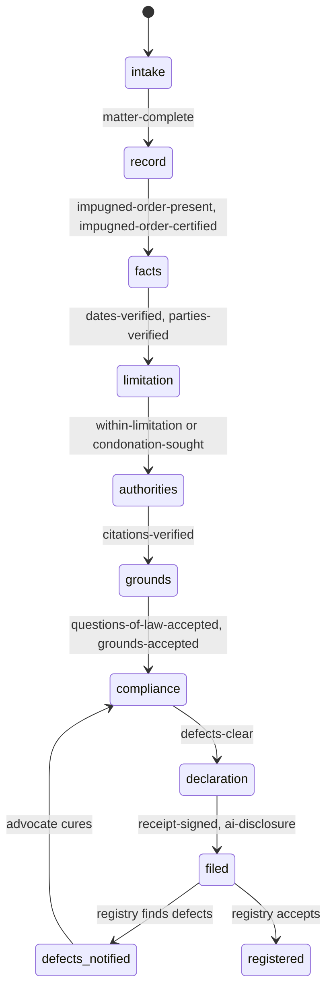

# The SLP as a procedural state machine

A Special Leave Petition is not a document to generate. It is a procedure. Each state has guards: conditions over the verified record, the citation verdicts and the Case Conference decisions. A transition happens only when every guard passes, and the transition is a ledger event that records each guard's result.

The document (synopsis and list of dates, petition, grounds, annexure index, affidavit, declaration) is a view of the machine's data at the end, not something written by a model.

## States

| State | The advocate is | Leaves when |
|---|---|---|
| `intake` | Describing the matter: impugned order, court, date, custody | Matter has every required field |
| `record` | Adding the impugned order and annexures | The impugned order is a source, and it is a certified copy |
| `facts` | Confirming the Notebook's dates and parties | Every date and party extract is `confirmed`, none failed or unresolved |
| `limitation` | Seeing the computed limitation | Within 90 days of the order date as the record shows it (a confirmed date from the impugned order itself, not the date typed at intake), or a condonation application is recorded in the ledger |
| `authorities` | Clearing the citation verifier | Every citation not discarded has a verdict on its current version, with identity and standing verified, pinpoint verified or not checked, and support not failed |
| `grounds` | Running Case Conferences | At least one question of law and one ground accepted, each with every grounding verified |
| `compliance` | Clearing the defect checker | No defect from the Supreme Court rules pack |
| `declaration` | Signing | The AI-use declaration is a ledger event, and the receipt is signed in this state. The filed bytes are fixed at signing |
| `filed` | Waiting on the registry | Registry returns defects or a diary number |

## Defect rules

Rules live as data in `packages/pleading/rules/sc-slp.json`. Each has a code, the rule it enforces, and the check that tests it. The same file is used by the workspace before filing and by the simulated registry after filing.

Each rule's `rule` reference must be checked against the text of the Supreme Court Rules, 2013 and the Court's current practice directions before release. Rules not yet checked carry `"confirmed": false`.

## Why a state machine

- **No skipped steps.** The pleading cannot reach `grounds` with an unverified citation, because the transition's guard reads the verifier's verdicts.
- **Change is safe.** If a confirmed date is later rejected, the guard for `facts` fails on the next evaluation and the advocate sees exactly which step reopened.
- **The audit trail is the procedure.** Each transition records which guards passed, so the receipt can show what was checked before filing.
